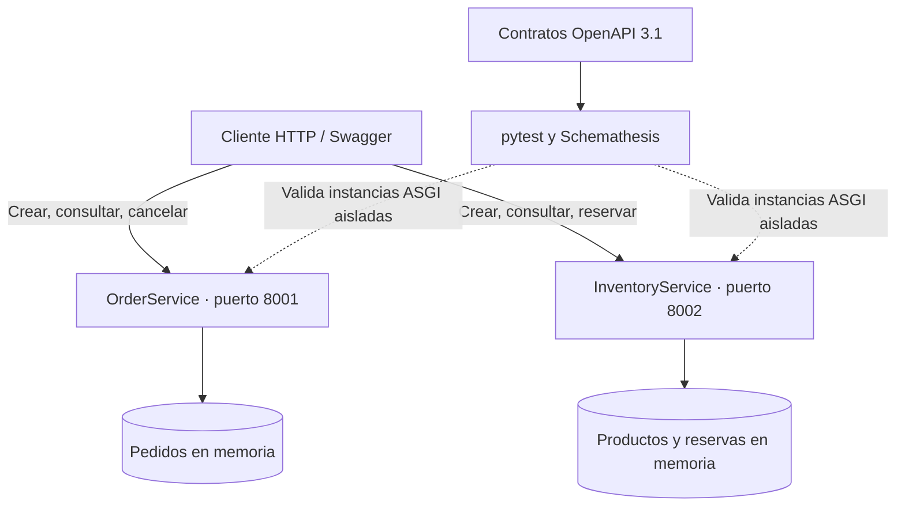

# Laboratorio 1 — Prototipo de microservicios con FastAPI y pruebas contractuales

Curso: **Microservicios Avanzado** · Capítulo 1 · Complejidad media · Bloom: Crear.

Construirás dos servicios independientes, Pedidos e Inventario, siguiendo un enfoque API-first. Este workspace será la base para las prácticas posteriores. El resultado es un prototipo educativo ejecutable, con contratos comprobados y contenedores preparados.

## Resultado esperado



Los nodos representan el código de cada servicio. Docker Compose ejecuta ambos como procesos independientes; las pruebas crean sus propias instancias ASGI sin llamar a los contenedores. **No existe comunicación automática entre Pedidos e Inventario en este laboratorio.** El cliente realiza la secuencia de llamadas. No se implementan todavía eventos ni base de datos.

## Objetivos de aprendizaje

- [ ] Definir los bounded contexts de Pedidos e Inventario, sus entidades y fronteras.
- [ ] Implementar modelos Pydantic v2 y endpoints REST conformes a OpenAPI.
- [ ] Separar las responsabilidades de `routers`, `services`, `schemas` y `models`.
- [ ] Ejecutar pruebas contractuales automatizadas con Schemathesis.
- [ ] Dockerizar ambos servicios mediante `docker-compose.yml`.

## Duración y forma de trabajo

La planificación original asigna **42 minutos**. Ese tiempo requiere Python, Docker, dependencias e imágenes preparados antes de clase y el material de apoyo descargado. Para construir todos los archivos desde cero, el instructor deberá ampliar o dividir la sesión; la duración completa aún debe validarse en aula.

Propuesta para los 42 minutos con preparación previa: fronteras y contratos (8), recorrido e implementación guiada de modelos y reglas (14), pruebas y discrepancia contractual (10), Docker y evidencia final (10). Descargar o compilar paquetes no forma parte de ese bloque.

Esta guía contiene todos los archivos necesarios. Puedes construirlos en el orden indicado o utilizar la solución completa del ZIP para contrastar tu trabajo. Si usas el ZIP, revisa los contratos antes de ejecutar la implementación, explica las decisiones y realiza la actividad de detección de discrepancias; ejecutar la solución sin análisis no demuestra los objetivos.

## Preparación y dependencias

Necesitas fundamentos de REST, FastAPI, Pydantic y Docker; la lección previa de bounded contexts; un editor; y acceso a los paquetes e imágenes. En Windows usa PowerShell y Docker Desktop configurado para contenedores Linux. En Linux/macOS usa Bash y Docker con Compose v2. Puertos 8001 y 8002 libres.

**Usa Python 3.12, no el Python 3.13.2 de tu entorno anterior.** La combinación fijada de Pydantic 2.7.1 y su dependencia nativa pydantic-core 2.18.2 es la causa del problema de instalación observado con Python 3.13. Actualizar pip por sí solo no corrige esa combinación. No cambies pydantic-core de manera independiente: Pydantic fija su versión.

Se han probado estas versiones con Python 3.12.14 en Linux. Puedes tener Python 3.12 instalado junto a 3.13; el nuevo entorno `.venv312` evita reutilizar el anterior. Los comandos de PowerShell se han revisado, pero no se han ejecutado en Windows durante esta revisión.

| Paquete | Versión | Uso |
|---|---|---|
| fastapi | 0.111.0 | API |
| uvicorn | 0.29.0 | Servidor ASGI |
| pydantic | 2.7.1 | Modelos y validación |
| httpx | 0.27.0 | Cliente de pruebas |
| pytest | 8.2.1 | Pruebas |
| pytest-asyncio | 0.23.7 | Pruebas async |
| schemathesis | 3.34.0 | Contratos |
| openapi-spec-validator | 0.7.2 | Validación del documento OpenAPI |
| PyYAML | 6.0.2 | Lectura de contratos YAML |

Los pins conservan la familia de dependencias del original; no representan una recomendación de versiones actuales para producción. Las dependencias transitivas no están bloqueadas para todas las plataformas. `docs/dependencias-entorno-validado.txt` registra el entorno de revisión.

Comprueba las herramientas antes de clase:

**PowerShell**

```powershell
py -0p
py -3.12 --version
docker --version
docker compose version
docker info
```

**Bash**

```bash
python3.12 --version
docker --version
docker compose version
docker info
```

Si `py -3.12` o `python3.12` no existe, instala Python 3.12 y vuelve a comprobarlo antes de continuar. Si Docker no responde, inicia su motor. El laboratorio usa `docker compose up --wait`, disponible en Compose v2 reciente; la referencia original 2.27.1 admite esta opción.

## Paso 1. Crear la estructura y delimitar los contextos

Si descomprimiste el ZIP, abre una terminal en `microservices-lab/` y omite la creación de carpetas. Si partes desde cero:

**PowerShell**

```powershell
New-Item -ItemType Directory -Force microservices-lab | Out-Null
Set-Location microservices-lab
foreach ($service in @('order-service', 'inventory-service')) {
    foreach ($folder in @('app', 'app/models', 'app/schemas', 'app/services', 'app/routers', 'tests')) {
        New-Item -ItemType Directory -Force "$service/$folder" | Out-Null
    }
    foreach ($folder in @('app', 'app/models', 'app/schemas', 'app/services', 'app/routers')) {
        New-Item -ItemType File -Force "$service/$folder/__init__.py" | Out-Null
    }
}
foreach ($folder in @('contracts', 'scripts', 'docs/api')) {
    New-Item -ItemType Directory -Force $folder | Out-Null
}
```

**Bash**

```bash
mkdir -p microservices-lab
cd microservices-lab
for service in order-service inventory-service; do
  mkdir -p "$service"/app/{models,schemas,services,routers} "$service/tests"
  touch "$service/app/__init__.py"
  for layer in models schemas services routers; do
    touch "$service/app/$layer/__init__.py"
  done
done
mkdir -p contracts scripts docs/api
```

Todos los bloques de archivos posteriores se guardan con el editor, en UTF-8 y sin copiar las marcas de apertura/cierre del bloque Markdown. Los `__init__.py` quedan vacíos. No vuelvas a ejecutar la creación de archivos sobre código que hayas añadido a esos archivos.

Antes de programar, discute quién puede modificar el stock y por qué un `product_id` no obliga a compartir el modelo `Product`. Guarda la frontera acordada:

### Archivo `docs/bounded-contexts.md`

Guarda el siguiente contenido en esa ruta, relativa a `microservices-lab/`.

```text
# Fronteras del dominio

| Contexto | Entidades propias | Responsabilidad | Referencias externas |
|---|---|---|---|
| Pedidos | Order, OrderItem | Crear, consultar, listar y cancelar pedidos pendientes; calcular importes | customer_id, product_id |
| Inventario | Product, StockReservation | Administrar existencias y reservar sin stock negativo | order_id |

Los contextos comparten identificadores, no objetos de dominio ni almacenamiento.
Crear un pedido no comprueba la existencia del producto ni reserva stock.
Inventario no verifica la existencia del pedido: order_id es una referencia opaca.
La coordinación manual del ensayo no constituye una integración entre servicios.

Estados implementados: pedido pending → cancelled; reserva nace pending y descuenta stock disponible.
Los demás valores de los enums se conservan para evolución del dominio, pero no tienen endpoints de transición.
Cancelar un pedido no libera reservas. No hay confirmación, liberación, eventos, persistencia ni reintentos idempotentes.
SKU cumple un formato, pero no tiene restricción de unicidad en este prototipo.
Los precios son valores de entrada del ejercicio; no hay catálogo autoritativo de precios.
```

## Paso 2. Diseñar los contratos antes de implementar

Revisa métodos, rutas, cuerpos, restricciones y respuestas. Los YAML siguientes son la referencia independiente de las pruebas. No los sustituyas por la exportación automática de FastAPI.

| Servicio | Método y ruta | Respuestas principales |
|---|---|---|
| Pedidos | POST `/api/v1/orders` | 201 / 422 |
| Pedidos | GET `/api/v1/orders` | 200 |
| Pedidos | GET `/api/v1/orders/{order_id}` | 200 / 404 / 422 |
| Pedidos | PATCH `/api/v1/orders/{order_id}/cancel` | 200 / 404 / 409 / 422 |
| Inventario | POST `/api/v1/products` | 201 / 422 |
| Inventario | GET `/api/v1/products` | 200 |
| Inventario | GET `/api/v1/products/{product_id}` | 200 / 404 / 422 |
| Inventario | POST `/api/v1/reservations` | 201 / 404 / 409 / 422 |
| Ambos | GET `/health` | 200 |

Los importes se envían como texto con dos decimales, por ejemplo `"19.99"`, y se calculan internamente con `Decimal`. Es una corrección deliberada respecto al uso de `float` del original. Un importe numérico `19.99`, `"0.00"` o `"19.999"` se rechaza. No hay conversión de monedas ni impuestos en este ejercicio.

### Archivo `contracts/order-service.openapi.yaml`

Guarda el siguiente contenido en esa ruta, relativa a `microservices-lab/`.

```yaml
openapi: 3.1.0
info:
  title: order-service
  version: 1.0.0
  description: Contrato esperado independiente para Lab 01. No sobrescribir desde
    /openapi.json.
servers:
- url: http://localhost:8001
paths:
  /api/v1/orders:
    post:
      operationId: createOrder
      responses:
        '201':
          description: Resultado esperado
          content:
            application/json:
              schema:
                $ref: '#/components/schemas/OrderResponse'
        '422':
          description: Entrada inválida
          content:
            application/json:
              schema:
                $ref: '#/components/schemas/ValidationError'
      requestBody:
        required: true
        content:
          application/json:
            schema:
              $ref: '#/components/schemas/OrderCreate'
    get:
      operationId: listOrders
      responses:
        '200':
          description: Resultado esperado
          content:
            application/json:
              schema:
                type: array
                items:
                  $ref: '#/components/schemas/OrderResponse'
  /api/v1/orders/{order_id}:
    get:
      operationId: getOrder
      responses:
        '200':
          description: Resultado esperado
          content:
            application/json:
              schema:
                $ref: '#/components/schemas/OrderResponse'
        '404':
          description: Recurso inexistente
          content:
            application/json:
              schema:
                $ref: '#/components/schemas/BusinessError'
        '422':
          description: Entrada inválida
          content:
            application/json:
              schema:
                $ref: '#/components/schemas/ValidationError'
      parameters:
      - name: order_id
        in: path
        required: true
        schema: &id001
          type: string
          format: uuid
  /api/v1/orders/{order_id}/cancel:
    patch:
      operationId: cancelOrder
      responses:
        '200':
          description: Resultado esperado
          content:
            application/json:
              schema:
                $ref: '#/components/schemas/OrderResponse'
        '404':
          description: Recurso inexistente
          content:
            application/json:
              schema:
                $ref: '#/components/schemas/BusinessError'
        '409':
          description: Conflicto de negocio
          content:
            application/json:
              schema:
                $ref: '#/components/schemas/BusinessError'
        '422':
          description: Entrada inválida
          content:
            application/json:
              schema:
                $ref: '#/components/schemas/ValidationError'
      parameters:
      - name: order_id
        in: path
        required: true
        schema: *id001
  /health:
    get:
      operationId: health
      responses:
        '200':
          description: Resultado esperado
          content:
            application/json:
              schema:
                type: object
                properties:
                  status:
                    type: string
                    const: healthy
                  service:
                    type: string
                    const: order-service
                required:
                - status
                - service
                additionalProperties: false
components:
  schemas:
    OrderItemCreate:
      type: object
      properties:
        product_id: *id001
        quantity: &id002
          type: integer
          minimum: 1
          maximum: 1000
        unit_price: &id003
          type: string
          pattern: ^([1-9][0-9]{0,5}\.[0-9]{2}|0\.(0[1-9]|[1-9][0-9]))$
      required:
      - product_id
      - quantity
      - unit_price
      additionalProperties: false
    OrderItemResponse:
      type: object
      properties:
        product_id: *id001
        quantity: *id002
        unit_price: *id003
        subtotal: &id004
          type: string
          pattern: ^[0-9]+\.[0-9]{2}$
      required:
      - product_id
      - quantity
      - unit_price
      - subtotal
      additionalProperties: false
    OrderCreate:
      type: object
      properties:
        customer_id: *id001
        items:
          type: array
          items:
            $ref: '#/components/schemas/OrderItemCreate'
          minItems: 1
          maxItems: 100
      required:
      - customer_id
      - items
      additionalProperties: false
    OrderResponse:
      type: object
      properties:
        id: *id001
        customer_id: *id001
        status:
          type: string
          enum:
          - pending
          - confirmed
          - shipped
          - delivered
          - cancelled
        items:
          type: array
          items:
            $ref: '#/components/schemas/OrderItemResponse'
        total: *id004
        created_at:
          type: string
          format: date-time
      required:
      - id
      - customer_id
      - status
      - items
      - total
      - created_at
      additionalProperties: false
    BusinessError:
      type: object
      properties:
        code:
          type: string
        message:
          type: string
      required:
      - code
      - message
      additionalProperties: false
    ValidationError:
      type: object
      required:
      - detail
      properties:
        detail:
          type: array
          items:
            type: object
            required:
            - loc
            - msg
            - type
            properties:
              loc:
                type: array
                items:
                  anyOf:
                  - type: string
                  - type: integer
              msg:
                type: string
              type:
                type: string
            additionalProperties: true
      additionalProperties: false
```

### Archivo `contracts/inventory-service.openapi.yaml`

Guarda el siguiente contenido en esa ruta, relativa a `microservices-lab/`.

```yaml
openapi: 3.1.0
info:
  title: inventory-service
  version: 1.0.0
  description: Contrato esperado independiente para Lab 01. No sobrescribir desde
    /openapi.json.
servers:
- url: http://localhost:8002
paths:
  /api/v1/products:
    post:
      operationId: createProduct
      responses:
        '201':
          description: Resultado esperado
          content:
            application/json:
              schema:
                $ref: '#/components/schemas/Product'
        '422':
          description: Entrada inválida
          content:
            application/json:
              schema:
                $ref: '#/components/schemas/ValidationError'
      requestBody:
        required: true
        content:
          application/json:
            schema:
              $ref: '#/components/schemas/ProductCreate'
    get:
      operationId: listProducts
      responses:
        '200':
          description: Resultado esperado
          content:
            application/json:
              schema:
                type: array
                items:
                  $ref: '#/components/schemas/Product'
  /api/v1/products/{product_id}:
    get:
      operationId: getProduct
      responses:
        '200':
          description: Resultado esperado
          content:
            application/json:
              schema:
                $ref: '#/components/schemas/Product'
        '404':
          description: Recurso inexistente
          content:
            application/json:
              schema:
                $ref: '#/components/schemas/BusinessError'
        '422':
          description: Entrada inválida
          content:
            application/json:
              schema:
                $ref: '#/components/schemas/ValidationError'
      parameters:
      - name: product_id
        in: path
        required: true
        schema: &id005
          type: string
          format: uuid
  /api/v1/reservations:
    post:
      operationId: createReservation
      responses:
        '201':
          description: Resultado esperado
          content:
            application/json:
              schema:
                $ref: '#/components/schemas/StockReservationResponse'
        '404':
          description: Recurso inexistente
          content:
            application/json:
              schema:
                $ref: '#/components/schemas/BusinessError'
        '409':
          description: Conflicto de negocio
          content:
            application/json:
              schema:
                $ref: '#/components/schemas/BusinessError'
        '422':
          description: Entrada inválida
          content:
            application/json:
              schema:
                $ref: '#/components/schemas/ValidationError'
      requestBody:
        required: true
        content:
          application/json:
            schema:
              $ref: '#/components/schemas/StockReservationCreate'
  /health:
    get:
      operationId: health
      responses:
        '200':
          description: Resultado esperado
          content:
            application/json:
              schema:
                type: object
                properties:
                  status:
                    type: string
                    const: healthy
                  service:
                    type: string
                    const: inventory-service
                required:
                - status
                - service
                additionalProperties: false
components:
  schemas:
    ProductCreate:
      type: object
      properties:
        name: &id001
          type: string
          minLength: 1
          maxLength: 200
        sku: &id002
          type: string
          minLength: 1
          maxLength: 50
          pattern: ^[A-Z0-9-]+$
        stock_quantity: &id003
          type: integer
          minimum: 0
          maximum: 1000000
          default: 0
        reorder_threshold: &id004
          type: integer
          minimum: 0
          maximum: 1000000
          default: 10
      required:
      - name
      - sku
      additionalProperties: false
    Product:
      type: object
      properties:
        name: *id001
        sku: *id002
        stock_quantity: *id003
        reorder_threshold: *id004
        id: *id005
      required:
      - name
      - sku
      - stock_quantity
      - reorder_threshold
      - id
      additionalProperties: false
    StockReservationCreate:
      type: object
      properties:
        product_id: *id005
        order_id: *id005
        quantity: &id006
          type: integer
          minimum: 1
          maximum: 1000000
      required:
      - product_id
      - order_id
      - quantity
      additionalProperties: false
    StockReservationResponse:
      type: object
      properties:
        product_id: *id005
        order_id: *id005
        quantity: *id006
        id: *id005
        status:
          type: string
          enum:
          - pending
          - confirmed
          - released
      required:
      - product_id
      - order_id
      - quantity
      - id
      - status
      additionalProperties: false
    BusinessError:
      type: object
      properties:
        code:
          type: string
        message:
          type: string
      required:
      - code
      - message
      additionalProperties: false
    ValidationError:
      type: object
      required:
      - detail
      properties:
        detail:
          type: array
          items:
            type: object
            required:
            - loc
            - msg
            - type
            properties:
              loc:
                type: array
                items:
                  anyOf:
                  - type: string
                  - type: integer
              msg:
                type: string
              type:
                type: string
            additionalProperties: true
      additionalProperties: false
```

## Paso 3. Instalar un entorno compatible por servicio

Guarda los siguientes archivos en ambos servicios. Las dependencias de pruebas se separan de las que necesita el contenedor.

### Archivo `order-service/requirements.txt`

Guarda el siguiente contenido en esa ruta, relativa a `microservices-lab/`.

```text
fastapi==0.111.0
uvicorn==0.29.0
pydantic==2.7.1
```

### Archivo `order-service/requirements-dev.txt`

Guarda el siguiente contenido en esa ruta, relativa a `microservices-lab/`.

```text
-r requirements.txt
httpx==0.27.0
pytest==8.2.1
pytest-asyncio==0.23.7
schemathesis==3.34.0
openapi-spec-validator==0.7.2
PyYAML==6.0.2
```

### Archivo `order-service/pytest.ini`

Guarda el siguiente contenido en esa ruta, relativa a `microservices-lab/`.

```text
[pytest]
pythonpath = .
testpaths = tests
asyncio_mode = strict
addopts = -ra
```

### Archivo `inventory-service/requirements.txt`

Guarda el siguiente contenido en esa ruta, relativa a `microservices-lab/`.

```text
fastapi==0.111.0
uvicorn==0.29.0
pydantic==2.7.1
```

### Archivo `inventory-service/requirements-dev.txt`

Guarda el siguiente contenido en esa ruta, relativa a `microservices-lab/`.

```text
-r requirements.txt
httpx==0.27.0
pytest==8.2.1
pytest-asyncio==0.23.7
schemathesis==3.34.0
openapi-spec-validator==0.7.2
PyYAML==6.0.2
```

### Archivo `inventory-service/pytest.ini`

Guarda el siguiente contenido en esa ruta, relativa a `microservices-lab/`.

```text
[pytest]
pythonpath = .
testpaths = tests
asyncio_mode = strict
addopts = -ra
```

Ejecuta desde `microservices-lab/`. No necesitas activar el entorno: cada comando utiliza su ejecutable explícito. Si tu terminal muestra `(.venv)` del entorno anterior, ejecuta `deactivate` o abre una terminal nueva.

**PowerShell**

```powershell
foreach ($service in @('order-service', 'inventory-service')) {
    python -m venv "$service/.venv312"
    if ($LASTEXITCODE -ne 0) {
        throw "No se pudo crear el entorno de $service"
    }

    & "$service/.venv312/Scripts/python.exe" -m pip install -r "$service/requirements-dev.txt"
    if ($LASTEXITCODE -ne 0) {
        throw "Falló la instalación de $service"
    }

    & "$service/.venv312/Scripts/python.exe" -m pip check
    if ($LASTEXITCODE -ne 0) {
        throw "Dependencias inconsistentes en $service"
    }
}
```

**Bash**

```bash
for service in order-service inventory-service; do
  python3.12 -m venv "$service/.venv312" || exit 1
  "$service/.venv312/bin/python" -m pip install -r "$service/requirements-dev.txt" || exit 1
  "$service/.venv312/bin/python" -m pip check || exit 1
done
```

Si reaparece el error de `pydantic-core`, comprueba la versión con el ejecutable dentro de `.venv312`. No reutilices un entorno creado con Python 3.13 ni elimines tu entorno anterior para intentar repararlo. Si Python es 3.12 y falta el paquete, revisa la arquitectura y el índice de paquetes configurado por tu organización.

## Paso 4. Implementar modelos y esquemas

`models` representa las entidades y estados del dominio; `schemas` representa entradas y salidas HTTP. Pydantic v2 valida ambos. Los objetos de dominio se mantienen separados de los DTOs y las respuestas se convierten explícitamente.

La creación de productos permite omitir `stock_quantity`: su valor inicial será 0. Las cantidades recibidas deben ser enteros estrictos. Se conserva el umbral de reposición como dato; no dispara acciones automáticas.

### Archivo `order-service/app/models/order.py`

Guarda el siguiente contenido en esa ruta, relativa a `microservices-lab/`.

```python
from datetime import datetime, UTC
from decimal import Decimal
from enum import Enum
from uuid import UUID, uuid4
from pydantic import BaseModel, ConfigDict, Field

class OrderStatus(str, Enum):
    PENDING = "pending"
    CONFIRMED = "confirmed"  # Evolución futura, no operación disponible en Lab 01.
    SHIPPED = "shipped"
    DELIVERED = "delivered"
    CANCELLED = "cancelled"

class OrderItem(BaseModel):
    model_config = ConfigDict(frozen=True)
    product_id: UUID
    quantity: int = Field(gt=0)
    unit_price: Decimal = Field(gt=0)

    @property
    def subtotal(self) -> Decimal:
        return self.unit_price * self.quantity

class Order(BaseModel):
    model_config = ConfigDict(frozen=True)
    id: UUID = Field(default_factory=uuid4)
    customer_id: UUID
    items: tuple[OrderItem, ...] = Field(min_length=1)
    status: OrderStatus = OrderStatus.PENDING
    created_at: datetime = Field(default_factory=lambda: datetime.now(UTC))

    @property
    def total(self) -> Decimal:
        return sum((item.subtotal for item in self.items), Decimal("0.00"))
```

### Archivo `order-service/app/schemas/order.py`

Guarda el siguiente contenido en esa ruta, relativa a `microservices-lab/`.

```python
from datetime import datetime
from typing import Annotated, Literal
from uuid import UUID
from pydantic import BaseModel, ConfigDict, Field
from app.models.order import OrderStatus

# Importes JSON como texto decimal exacto, máximo 999999.99.
Money = Annotated[str, Field(pattern=r"^([1-9][0-9]{0,5}\.[0-9]{2}|0\.(0[1-9]|[1-9][0-9]))$")]

class OrderItemCreate(BaseModel):
    model_config = ConfigDict(extra="forbid")
    product_id: UUID
    quantity: int = Field(strict=True, ge=1, le=1000)
    unit_price: Money

class OrderCreate(BaseModel):
    model_config = ConfigDict(extra="forbid")
    customer_id: UUID
    items: list[OrderItemCreate] = Field(min_length=1, max_length=100)

class OrderItemResponse(OrderItemCreate):
    subtotal: str = Field(pattern=r"^[0-9]+\.[0-9]{2}$")

class OrderResponse(BaseModel):
    id: UUID
    customer_id: UUID
    status: OrderStatus
    items: list[OrderItemResponse]
    total: str = Field(pattern=r"^[0-9]+\.[0-9]{2}$")
    created_at: datetime

class BusinessError(BaseModel):
    code: str
    message: str
```

### Archivo `inventory-service/app/models/product.py`

Guarda el siguiente contenido en esa ruta, relativa a `microservices-lab/`.

```python
from enum import Enum
from uuid import UUID, uuid4
from pydantic import BaseModel, ConfigDict, Field

class ReservationStatus(str, Enum):
    PENDING = "pending"
    CONFIRMED = "confirmed"  # Reservado para futuros capítulos; sin transición implementada.
    RELEASED = "released"

class Product(BaseModel):
    model_config = ConfigDict(frozen=True)
    id: UUID = Field(default_factory=uuid4)
    name: str
    sku: str
    stock_quantity: int = Field(ge=0)
    reorder_threshold: int = Field(ge=0, default=10)

class StockReservation(BaseModel):
    model_config = ConfigDict(frozen=True)
    id: UUID = Field(default_factory=uuid4)
    product_id: UUID
    order_id: UUID
    quantity: int = Field(gt=0)
    status: ReservationStatus = ReservationStatus.PENDING
```

### Archivo `inventory-service/app/schemas/product.py`

Guarda el siguiente contenido en esa ruta, relativa a `microservices-lab/`.

```python
from typing import Annotated, Literal
from uuid import UUID, uuid4
from pydantic import BaseModel, ConfigDict, Field
from app.models.product import ReservationStatus

Quantity = Annotated[int, Field(strict=True, ge=1, le=1000000)]

class ProductCreate(BaseModel):
    model_config = ConfigDict(extra="forbid")
    name: str = Field(min_length=1, max_length=200)
    sku: str = Field(min_length=1, max_length=50, pattern=r"^[A-Z0-9-]+$")
    stock_quantity: int = Field(strict=True, ge=0, le=1000000, default=0)
    reorder_threshold: int = Field(strict=True, ge=0, le=1000000, default=10)

class ProductResponse(ProductCreate):
    id: UUID = Field(default_factory=uuid4)

class StockReservationCreate(BaseModel):
    model_config = ConfigDict(extra="forbid")
    product_id: UUID
    order_id: UUID
    quantity: Quantity

class StockReservationResponse(StockReservationCreate):
    id: UUID = Field(default_factory=uuid4)
    status: ReservationStatus

class BusinessError(BaseModel):
    code: str
    message: str
```

## Paso 5. Implementar reglas de negocio

`services` mantiene el estado local y ejecuta las reglas. Las excepciones de negocio no dependen de códigos HTTP. El router las traduce después.

En esta práctica el servicio acepta el DTO de entrada para reducir código de adaptación; esto no pretende representar aislamiento hexagonal completo. Cada instancia de aplicación tiene su propio estado. El `Lock` protege una sección crítica dentro de un único proceso; no ofrece transacciones distribuidas ni coordinación entre réplicas.

Antes de ejecutar: predice qué ocurre al reservar exactamente el stock y al excederlo. Un rechazo debe conservar tanto el stock como el número de reservas.

### Archivo `order-service/app/services/order_service.py`

Guarda el siguiente contenido en esa ruta, relativa a `microservices-lab/`.

```python
from decimal import Decimal
from threading import Lock
from uuid import UUID
from app.models.order import Order, OrderItem, OrderStatus
from app.schemas.order import OrderCreate

class OrderNotFound(Exception):
    pass

class InvalidOrderState(Exception):
    pass

class OrderService:
    def __init__(self):
        self._orders: dict[UUID, Order] = {}
        self._lock = Lock()

    def create_order(self, payload: OrderCreate) -> Order:
        items = tuple(OrderItem(product_id=i.product_id, quantity=i.quantity,
                                unit_price=Decimal(i.unit_price)) for i in payload.items)
        order = Order(customer_id=payload.customer_id, items=items)
        with self._lock:
            self._orders[order.id] = order
        return order.model_copy(deep=True)

    def get_order(self, order_id: UUID) -> Order | None:
        with self._lock:
            order = self._orders.get(order_id)
            return order.model_copy(deep=True) if order else None

    def list_orders(self) -> list[Order]:
        with self._lock:
            return [o.model_copy(deep=True) for o in self._orders.values()]

    def cancel_order(self, order_id: UUID) -> Order:
        with self._lock:
            order = self._orders.get(order_id)
            if order is None:
                raise OrderNotFound()
            if order.status != OrderStatus.PENDING:
                raise InvalidOrderState()
            cancelled = Order(**{**order.model_dump(), "status": OrderStatus.CANCELLED})
            self._orders[order_id] = cancelled
            return cancelled.model_copy(deep=True)
```

### Archivo `inventory-service/app/services/inventory_service.py`

Guarda el siguiente contenido en esa ruta, relativa a `microservices-lab/`.

```python
from uuid import UUID
from threading import Lock
from app.models.product import Product, StockReservation
from app.schemas.product import ProductCreate, StockReservationCreate

class ProductNotFound(Exception):
    pass

class InsufficientStock(Exception):
    pass

class InventoryService:
    """Estado volátil local. El lock protege un solo proceso, no réplicas."""
    def __init__(self):
        self._products: dict[UUID, Product] = {}
        self._reservations: dict[UUID, StockReservation] = {}
        self._lock = Lock()

    def add_product(self, payload: ProductCreate) -> Product:
        product = Product(**payload.model_dump())
        with self._lock:
            self._products[product.id] = product
        return product.model_copy(deep=True)

    def get_product(self, product_id: UUID) -> Product | None:
        with self._lock:
            product = self._products.get(product_id)
            return product.model_copy(deep=True) if product else None

    def list_products(self) -> list[Product]:
        with self._lock:
            return [p.model_copy(deep=True) for p in self._products.values()]

    def reservation_count(self) -> int:
        with self._lock:
            return len(self._reservations)

    def create_reservation(self, payload: StockReservationCreate) -> StockReservation:
        with self._lock:
            product = self._products.get(payload.product_id)
            if product is None:
                raise ProductNotFound()
            if product.stock_quantity < payload.quantity:
                raise InsufficientStock()
            reservation = StockReservation(**payload.model_dump())
            # Construir objetos válidos antes de modificar el estado.
            updated = Product(**{**product.model_dump(),
                                 "stock_quantity": product.stock_quantity - payload.quantity})
            self._products[product.id] = updated
            self._reservations[reservation.id] = reservation
            return reservation.model_copy(deep=True)
```

## Paso 6. Exponer las APIs

`routers` valida el transporte, llama al servicio, convierte las respuestas y traduce errores. `main.py` crea una aplicación y su instancia de servicio. Las pruebas usan `create_app()` para no compartir datos entre casos.

Los errores de negocio usan `{ "code": "...", "message": "..." }`; los errores de entrada 422 mantienen el formato `detail` de FastAPI. Los errores 404/409 están declarados también en el OpenAPI generado.

### Archivo `order-service/app/routers/orders.py`

Guarda el siguiente contenido en esa ruta, relativa a `microservices-lab/`.

```python
from uuid import UUID
from fastapi import APIRouter, Request
from fastapi.responses import JSONResponse
from app.schemas.order import OrderCreate, OrderResponse, OrderItemResponse, BusinessError
from app.services.order_service import OrderNotFound, InvalidOrderState

router = APIRouter(prefix="/api/v1/orders", tags=["orders"])

def to_response(order):
    return OrderResponse(id=order.id, customer_id=order.customer_id,
        status=order.status, created_at=order.created_at,
        total=f"{order.total:.2f}", items=[OrderItemResponse(
            product_id=i.product_id, quantity=i.quantity,
            unit_price=f"{i.unit_price:.2f}", subtotal=f"{i.subtotal:.2f}") for i in order.items])

def error(code, message, status):
    return JSONResponse(status_code=status, content={"code": code, "message": message})

@router.post("", response_model=OrderResponse, status_code=201)
def create_order(payload: OrderCreate, request: Request):
    return to_response(request.app.state.service.create_order(payload))

@router.get("", response_model=list[OrderResponse])
def list_orders(request: Request):
    return [to_response(o) for o in request.app.state.service.list_orders()]

@router.get("/{order_id}", response_model=OrderResponse, responses={404: {"model": BusinessError}})
def get_order(order_id: UUID, request: Request):
    order = request.app.state.service.get_order(order_id)
    if order is None:
        return error("ORDER_NOT_FOUND", "Order not found", 404)
    return to_response(order)

@router.patch("/{order_id}/cancel", response_model=OrderResponse,
              responses={404: {"model": BusinessError}, 409: {"model": BusinessError}})
def cancel_order(order_id: UUID, request: Request):
    try:
        return to_response(request.app.state.service.cancel_order(order_id))
    except OrderNotFound:
        return error("ORDER_NOT_FOUND", "Order not found", 404)
    except InvalidOrderState:
        return error("INVALID_ORDER_STATE", "Order cannot be cancelled", 409)
```

### Archivo `order-service/app/main.py`

Guarda el siguiente contenido en esa ruta, relativa a `microservices-lab/`.

```python
from fastapi import FastAPI
from app.routers.orders import router
from app.services.order_service import OrderService

def create_app() -> FastAPI:
    application = FastAPI(title="OrderService", version="1.0.0")
    application.state.service = OrderService()
    application.include_router(router)
    @application.get("/health")
    def health():
        return {"status": "healthy", "service": "order-service"}
    return application

app = create_app()
```

### Archivo `inventory-service/app/routers/products.py`

Guarda el siguiente contenido en esa ruta, relativa a `microservices-lab/`.

```python
from uuid import UUID
from fastapi import APIRouter, Request
from fastapi.responses import JSONResponse
from app.schemas.product import ProductResponse, ProductCreate, StockReservationCreate, StockReservationResponse, BusinessError
from app.services.inventory_service import ProductNotFound, InsufficientStock

router = APIRouter(prefix="/api/v1", tags=["inventory"])

def error(code: str, message: str, status: int):
    return JSONResponse(status_code=status, content={"code": code, "message": message})

@router.post("/products", response_model=ProductResponse, status_code=201)
def create_product(payload: ProductCreate, request: Request):
    return ProductResponse.model_validate(request.app.state.service.add_product(payload).model_dump())

@router.get("/products", response_model=list[ProductResponse])
def list_products(request: Request):
    return [ProductResponse.model_validate(p.model_dump()) for p in request.app.state.service.list_products()]

@router.get("/products/{product_id}", response_model=ProductResponse,
            responses={404: {"model": BusinessError}})
def get_product(product_id: UUID, request: Request):
    product = request.app.state.service.get_product(product_id)
    if product is None:
        return error("PRODUCT_NOT_FOUND", "Product not found", 404)
    return ProductResponse.model_validate(product.model_dump())

@router.post("/reservations", response_model=StockReservationResponse,
             status_code=201,
             responses={404: {"model": BusinessError}, 409: {"model": BusinessError}})
def create_reservation(payload: StockReservationCreate, request: Request):
    try:
        return StockReservationResponse.model_validate(request.app.state.service.create_reservation(payload).model_dump())
    except ProductNotFound:
        return error("PRODUCT_NOT_FOUND", "Product not found", 404)
    except InsufficientStock:
        return error("INSUFFICIENT_STOCK", "Insufficient stock", 409)
```

### Archivo `inventory-service/app/main.py`

Guarda el siguiente contenido en esa ruta, relativa a `microservices-lab/`.

```python
from fastapi import FastAPI
from app.routers.products import router
from app.services.inventory_service import InventoryService

def create_app() -> FastAPI:
    application = FastAPI(title="InventoryService", version="1.0.0")
    application.state.service = InventoryService()
    application.include_router(router)
    @application.get("/health")
    def health():
        return {"status": "healthy", "service": "inventory-service"}
    return application

app = create_app()
```

Para explorar sin Docker, abre dos terminales desde la raíz. No dejes estos procesos ocupando los puertos cuando pases al paso 8.

**PowerShell — terminal 1**

```powershell
./order-service/.venv312/Scripts/python.exe -m uvicorn app.main:app --app-dir order-service --port 8001
```

**PowerShell — terminal 2**

```powershell
./inventory-service/.venv312/Scripts/python.exe -m uvicorn app.main:app --app-dir inventory-service --port 8002
```

**Bash — una línea por terminal**

```bash
./order-service/.venv312/bin/python -m uvicorn app.main:app --app-dir order-service --port 8001
./inventory-service/.venv312/bin/python -m uvicorn app.main:app --app-dir inventory-service --port 8002
```

Abre [Swagger de Pedidos](http://localhost:8001/docs) y [Swagger de Inventario](http://localhost:8002/docs). Crea primero un producto y utiliza su `id` al crear el pedido. Esto lo hace el cliente: la API de pedidos no consulta Inventario. Detén ambos procesos con Ctrl+C antes de iniciar contenedores.

## Paso 7. Verificar reglas y contratos

Las pruebas funcionales verifican reglas y rechazos; las contractuales comparan respuestas con los YAML del paso 2. Una respuesta con forma correcta no demuestra por sí sola que el stock sea correcto: se necesitan ambos tipos de pruebas.

En **Schemathesis 3.34.0**, OpenAPI 3.1 se habilita explícitamente como experimental. `call_asgi` invoca la aplicación aislada y `validate_response(..., checks=ALL_CHECKS)` comprueba el contrato. Esta API emite avisos de deprecación en 3.x; se conserva para la versión fijada. No mezcles estas instrucciones con las de Schemathesis 4.

Las pruebas generadas cubren las operaciones con hasta 10 ejemplos positivos por operación, sin servidor externo. Las búsquedas de UUID inexistentes pueden responder 404 válidamente; por eso hay pruebas de ciclo de vida con IDs reales y casos negativos deterministas. No es una prueba exhaustiva, de carga, seguridad o integración distribuida.

### Archivo `order-service/tests/conftest.py`

Guarda el siguiente contenido en esa ruta, relativa a `microservices-lab/`.

```python
import pytest
from fastapi.testclient import TestClient
from app.main import create_app

@pytest.fixture
def app():
    return create_app()

@pytest.fixture
def client(app):
    with TestClient(app) as c:
        yield c
```

### Archivo `order-service/tests/test_async.py`

Guarda el siguiente contenido en esa ruta, relativa a `microservices-lab/`.

```python
import pytest
from httpx import AsyncClient, ASGITransport
from app.main import create_app

@pytest.mark.asyncio
async def test_create_order_async():
    async with AsyncClient(transport=ASGITransport(app=create_app()), base_url="http://test") as client:
        response = await client.post("/api/v1/orders", json={
            "customer_id": "11111111-1111-1111-1111-111111111111",
            "items": [{"product_id": "22222222-2222-2222-2222-222222222222",
                       "quantity": 2, "unit_price": "25.50"}]})
    assert response.status_code == 201
    assert response.json()["total"] == "51.00"
```

### Archivo `order-service/tests/test_contract.py`

Guarda el siguiente contenido en esa ruta, relativa a `microservices-lab/`.

```python
from pathlib import Path
from uuid import uuid4
import schemathesis
from schemathesis.checks import ALL_CHECKS

def call_checked(self, *, app, checks=ALL_CHECKS):
    response = self.call_asgi(app=app)
    self.validate_response(response, checks=checks)
    return response

schemathesis.experimental.OPEN_API_3_1.enable()
schema=schemathesis.from_path(str(Path(__file__).resolve().parents[2]/"contracts/order-service.openapi.yaml"))

def test_order_lifecycle_contract(app):
    response=call_checked(schema["/api/v1/orders"]["POST"].make_case(body={"customer_id":str(uuid4()),"items":[{"product_id":str(uuid4()),"quantity":3,"unit_price":"19.99"}]}), app=app)
    oid=response.json()["id"]
    assert response.json()["total"] == "59.97"
    call_checked(schema["/api/v1/orders/{order_id}"]["GET"].make_case(path_parameters={"order_id":oid}), app=app)
    operation=schema["/api/v1/orders/{order_id}/cancel"]["PATCH"]
    assert call_checked(operation.make_case(path_parameters={"order_id":oid}), app=app).status_code == 200
    assert call_checked(operation.make_case(path_parameters={"order_id":oid}), app=app).status_code == 409
```

### Archivo `order-service/tests/test_contract_generated.py`

Guarda el siguiente contenido en esa ruta, relativa a `microservices-lab/`.

```python
from pathlib import Path
import pytest
import yaml
import schemathesis
from schemathesis.checks import ALL_CHECKS

def call_checked(self, *, app, checks=ALL_CHECKS):
    response = self.call_asgi(app=app)
    self.validate_response(response, checks=checks)
    return response

schemathesis.experimental.OPEN_API_3_1.enable()
from hypothesis import given, settings, strategies as st
from app.main import create_app

contract = Path(__file__).resolve().parents[2] / "contracts/order-service.openapi.yaml"
spec = yaml.safe_load(contract.read_text())
schema = schemathesis.from_path(str(contract))
schemathesis.register_string_format("uuid", st.uuids().map(str))
operations = [(path, method.upper()) for path, methods in spec["paths"].items() for method in methods]

@pytest.mark.parametrize("path,method", operations)
@given(data=st.data())
@settings(max_examples=10, deadline=None, derandomize=True)
def test_contract_generated(path, method, data):
    # Generación positiva acotada. Negativos explícitos: test_functional.py.
    case = data.draw(schema[path][method].as_strategy())
    call_checked(case, app=create_app())
```

### Archivo `order-service/tests/test_functional.py`

Guarda el siguiente contenido en esa ruta, relativa a `microservices-lab/`.

```python
from uuid import uuid4
import pytest

def body():
    return {"customer_id":str(uuid4()),"items":[{"product_id":str(uuid4()),"quantity":3,"unit_price":"19.99"}]}

def test_create_get_cancel(client):
    r=client.post("/api/v1/orders",json=body())
    assert r.status_code == 201
    data=r.json(); oid=data["id"]
    assert data["total"] == "59.97"
    assert data["created_at"].endswith("Z")
    assert client.get(f"/api/v1/orders/{oid}").status_code == 200
    assert len(client.get("/api/v1/orders").json()) == 1
    assert client.patch(f"/api/v1/orders/{oid}/cancel").json()["status"] == "cancelled"
    assert client.patch(f"/api/v1/orders/{oid}/cancel").status_code == 409

def test_missing(client):
    oid=uuid4()
    assert client.get(f"/api/v1/orders/{oid}").status_code == 404
    assert client.patch(f"/api/v1/orders/{oid}/cancel").status_code == 404

@pytest.mark.parametrize("price", ["0.00",19.99,"19.999","-1.00","1e3","1000000.00"])
def test_invalid_money(client, price):
    value=body(); value["items"][0]["unit_price"]=price
    assert client.post("/api/v1/orders",json=value).status_code == 422

def test_empty_items(client):
    assert client.post("/api/v1/orders",json={"customer_id":str(uuid4()),"items":[]}).status_code == 422
```

### Archivo `order-service/tests/test_spec.py`

Guarda el siguiente contenido en esa ruta, relativa a `microservices-lab/`.

```python
from pathlib import Path
import yaml
from openapi_spec_validator import validate

def test_static_contract_is_valid():
    path = Path(__file__).resolve().parents[2] / "contracts/order-service.openapi.yaml"
    validate(yaml.safe_load(path.read_text()))
```

### Archivo `inventory-service/tests/conftest.py`

Guarda el siguiente contenido en esa ruta, relativa a `microservices-lab/`.

```python
import pytest
from fastapi.testclient import TestClient
from app.main import create_app

@pytest.fixture
def app():
    return create_app()

@pytest.fixture
def client(app):
    with TestClient(app) as c:
        yield c
```

### Archivo `inventory-service/tests/test_async.py`

Guarda el siguiente contenido en esa ruta, relativa a `microservices-lab/`.

```python
import pytest
from httpx import AsyncClient, ASGITransport
from app.main import create_app

@pytest.mark.asyncio
async def test_invalid_sku_is_rejected():
    async with AsyncClient(transport=ASGITransport(app=create_app()), base_url="http://test") as client:
        response = await client.post("/api/v1/products", json={
            "name": "Producto", "sku": "invalid sku!", "stock_quantity": 10})
    assert response.status_code == 422
```

### Archivo `inventory-service/tests/test_business.py`

Guarda el siguiente contenido en esa ruta, relativa a `microservices-lab/`.

```python
from uuid import uuid4
import pytest
from app.schemas.product import ProductCreate, StockReservationCreate
from app.services.inventory_service import InventoryService, ProductNotFound, InsufficientStock

def fixture_service(stock=5):
    service = InventoryService()
    product = service.add_product(ProductCreate(name="Sensor", sku="SNS-001", stock_quantity=stock))
    return service, product

def payload(product_id, quantity):
    return StockReservationCreate(product_id=product_id, order_id=uuid4(), quantity=quantity)

@pytest.mark.parametrize("quantity,remaining", [(3,2),(5,0)])
def test_reserve_success(quantity, remaining):
    service, product = fixture_service()
    reservation = service.create_reservation(payload(product.id, quantity))
    assert reservation.quantity == quantity
    assert reservation.status == "pending"
    assert service.get_product(product.id).stock_quantity == remaining
    assert service.reservation_count() == 1

def test_insufficient_stock_preserves_state():
    service, product = fixture_service()
    before = service.get_product(product.id)
    with pytest.raises(InsufficientStock):
        service.create_reservation(payload(product.id, 6))
    assert service.get_product(product.id) == before
    assert service.reservation_count() == 0

def test_missing_product_preserves_state():
    service, product = fixture_service()
    with pytest.raises(ProductNotFound):
        service.create_reservation(payload(uuid4(), 1))
    assert service.get_product(product.id).stock_quantity == 5
    assert service.reservation_count() == 0

def test_consecutive_reservations():
    service, product = fixture_service()
    service.create_reservation(payload(product.id, 3))
    with pytest.raises(InsufficientStock):
        service.create_reservation(payload(product.id, 3))
    assert service.get_product(product.id).stock_quantity == 2
    assert service.reservation_count() == 1
```

### Archivo `inventory-service/tests/test_contract.py`

Guarda el siguiente contenido en esa ruta, relativa a `microservices-lab/`.

```python
from pathlib import Path
from uuid import uuid4
import schemathesis
from schemathesis.checks import ALL_CHECKS

def call_checked(self, *, app, checks=ALL_CHECKS):
    response = self.call_asgi(app=app)
    self.validate_response(response, checks=checks)
    return response

schemathesis.experimental.OPEN_API_3_1.enable()

schema=schemathesis.from_path(str(Path(__file__).resolve().parents[2]/"contracts/inventory-service.openapi.yaml"))

def create_product(app):
    response=call_checked(schema["/api/v1/products"]["POST"].make_case(body={"name":"Sensor","sku":"SNS-001","stock_quantity":5}), app=app)
    return response.json()["id"]

def test_reservation_success_contract(app):
    pid=create_product(app)
    response=call_checked(schema["/api/v1/reservations"]["POST"].make_case(body={"product_id":pid,"order_id":str(uuid4()),"quantity":3}), app=app)
    assert response.status_code == 201
    assert response.json()["quantity"] == 3

def test_reservation_conflict_contract(app):
    pid=create_product(app)
    response=call_checked(schema["/api/v1/reservations"]["POST"].make_case(body={"product_id":pid,"order_id":str(uuid4()),"quantity":6}), app=app)
    assert response.status_code == 409

def test_product_missing_contract(app):
    response=call_checked(schema["/api/v1/reservations"]["POST"].make_case(body={"product_id":str(uuid4()),"order_id":str(uuid4()),"quantity":1}), app=app)
    assert response.status_code == 404
```

### Archivo `inventory-service/tests/test_contract_generated.py`

Guarda el siguiente contenido en esa ruta, relativa a `microservices-lab/`.

```python
from pathlib import Path
import pytest
import yaml
import schemathesis
from schemathesis.checks import ALL_CHECKS

def call_checked(self, *, app, checks=ALL_CHECKS):
    response = self.call_asgi(app=app)
    self.validate_response(response, checks=checks)
    return response

schemathesis.experimental.OPEN_API_3_1.enable()
from hypothesis import given, settings, strategies as st
from app.main import create_app

contract = Path(__file__).resolve().parents[2] / "contracts/inventory-service.openapi.yaml"
spec = yaml.safe_load(contract.read_text())
schema = schemathesis.from_path(str(contract))
schemathesis.register_string_format("uuid", st.uuids().map(str))
operations = [(path, method.upper()) for path, methods in spec["paths"].items() for method in methods]

@pytest.mark.parametrize("path,method", operations)
@given(data=st.data())
@settings(max_examples=10, deadline=None, derandomize=True)
def test_contract_generated(path, method, data):
    # Generación positiva acotada. Negativos explícitos: test_functional.py.
    case = data.draw(schema[path][method].as_strategy())
    call_checked(case, app=create_app())
```

### Archivo `inventory-service/tests/test_functional.py`

Guarda el siguiente contenido en esa ruta, relativa a `microservices-lab/`.

```python
from uuid import uuid4
import pytest

def product(client):
    r = client.post("/api/v1/products", json={"name":"Sensor","sku":"SNS-001","stock_quantity":5})
    assert r.status_code == 201
    return r.json()["id"]

def test_create_and_get_product(client):
    pid = product(client)
    assert client.get(f"/api/v1/products/{pid}").json()["stock_quantity"] == 5
    assert len(client.get("/api/v1/products").json()) == 1

@pytest.mark.parametrize("quantity", [0,-1,"3",True,1.5,1000001])
def test_invalid_quantity(client, quantity):
    pid = product(client)
    r = client.post("/api/v1/reservations", json={"product_id":pid,"order_id":str(uuid4()),"quantity":quantity})
    assert r.status_code == 422
    assert client.get(f"/api/v1/products/{pid}").json()["stock_quantity"] == 5

@pytest.mark.parametrize("changes", [{"product_id":"bad"},{"order_id":"bad"},{"extra":1}])
def test_invalid_fields(client, changes):
    body={"product_id":product(client),"order_id":str(uuid4()),"quantity":1}
    body.update(changes)
    assert client.post("/api/v1/reservations",json=body).status_code == 422

def test_missing_quantity(client):
    assert client.post("/api/v1/reservations",json={"product_id":product(client),"order_id":str(uuid4())}).status_code == 422

def test_http_insufficient_stock(client):
    pid=product(client)
    r=client.post("/api/v1/reservations",json={"product_id":pid,"order_id":str(uuid4()),"quantity":6})
    assert r.status_code == 409
    assert r.json()["code"] == "INSUFFICIENT_STOCK"
    assert client.get(f"/api/v1/products/{pid}").json()["stock_quantity"] == 5

def test_http_missing_product(client):
    r=client.post("/api/v1/reservations",json={"product_id":str(uuid4()),"order_id":str(uuid4()),"quantity":1})
    assert r.status_code == 404
    assert r.json()["code"] == "PRODUCT_NOT_FOUND"
```

### Archivo `inventory-service/tests/test_preservation.py`

Guarda el siguiente contenido en esa ruta, relativa a `microservices-lab/`.

```python
from uuid import uuid4

def test_rejection_preserves_stock(client):
    product=client.post("/api/v1/products",json={"name":"Sensor","sku":"SNS-001","stock_quantity":5}).json()
    pid=product["id"]
    before=client.get(f"/api/v1/products/{pid}").json()["stock_quantity"]
    response=client.post("/api/v1/reservations",json={"product_id":pid,"order_id":str(uuid4()),"quantity":6})
    assert response.status_code == 409
    after=client.get(f"/api/v1/products/{pid}").json()["stock_quantity"]
    assert after == before == 5
```

### Archivo `inventory-service/tests/test_spec.py`

Guarda el siguiente contenido en esa ruta, relativa a `microservices-lab/`.

```python
from pathlib import Path
import yaml
from openapi_spec_validator import validate

def test_static_contract_is_valid():
    path = Path(__file__).resolve().parents[2] / "contracts/inventory-service.openapi.yaml"
    validate(yaml.safe_load(path.read_text()))
```

### Archivo `scripts/preflight.py`

Guarda el siguiente contenido en esa ruta, relativa a `microservices-lab/`.

```python
from pathlib import Path
import importlib.metadata as m
import sys
root=Path(__file__).resolve().parents[1]
if sys.version_info[:2] != (3,12):
    raise SystemExit("Usa Python 3.12 para reproducir el entorno probado.")
for name,version in {"fastapi":"0.111.0","pydantic":"2.7.1","schemathesis":"3.34.0","pytest":"8.2.1","httpx":"0.27.0"}.items():
    actual=m.version(name)
    if actual != version: raise SystemExit(f"{name}: esperado {version}, encontrado {actual}")
    print(name,actual)
import yaml
from openapi_spec_validator import validate
for path in (root/"contracts").glob("*.yaml"):
    validate(yaml.safe_load(path.read_text()))
    print("Contrato válido:",path.name)
print("Preflight de Python y contratos aprobado; verificar Docker Compose antes de clase.")
```

### Archivo `scripts/validate.py`

Guarda el siguiente contenido en esa ruta, relativa a `microservices-lab/`.

```python
"""Desde la raíz: python scripts/validate.py; cada servicio usa su venv."""
from pathlib import Path
import argparse
import subprocess
import sys

root = Path(__file__).resolve().parents[1]
parser = argparse.ArgumentParser()
parser.add_argument('--python', help='Intérprete común explícito, solo si tiene todas las dependencias')
args = parser.parse_args()
for service in ('order-service', 'inventory-service'):
    venv = root / service / '.venv312'
    executable = Path(args.python).absolute() if args.python else (
        venv / 'Scripts/python.exe' if sys.platform == 'win32' else venv / 'bin/python')
    if not executable.is_file():
        raise SystemExit(f'Falta el intérprete de {service}: {executable}. Completa el paso 3.')
    print(f'Validando {service}', flush=True)
    result = subprocess.run([str(executable), '-m', 'pytest', 'tests/', '-q'], cwd=root/service)
    if result.returncode:
        raise SystemExit(result.returncode)
print('CÓDIGO Y CONTRATOS APROBADOS. Compose/HTTP se verifica por separado.')
```

Ejecuta desde la raíz:

**PowerShell**

```powershell
./order-service/.venv312/Scripts/python.exe scripts/preflight.py
./inventory-service/.venv312/Scripts/python.exe scripts/preflight.py
./order-service/.venv312/Scripts/python.exe scripts/validate.py
if ($LASTEXITCODE -ne 0) { throw 'La validación falló; revisa la salida de pytest' }
```

**Bash**

```bash
./order-service/.venv312/bin/python scripts/preflight.py
./inventory-service/.venv312/bin/python scripts/preflight.py
./order-service/.venv312/bin/python scripts/validate.py
```

Resultado de referencia: **17 pruebas de Pedidos y 29 de Inventario: 46 aprobadas**. Los avisos de deprecación no equivalen a fallos, pero deben revisarse en una futura actualización de dependencias.

### Actividad: detectar una ruptura contractual

1. En `inventory-service/app/routers/products.py`, cambia temporalmente el `status_code=201` de creación de producto por `200`.
2. Desde la raíz, ejecuta solo el contrato: en PowerShell, `Push-Location inventory-service`, luego `./.venv312/Scripts/python.exe -m pytest tests/test_contract.py -q`, y finalmente `Pop-Location`. En Bash, usa `(cd inventory-service && ./.venv312/bin/python -m pytest tests/test_contract.py -q)`.
3. Identifica el fallo: el contrato admite 201 para esa creación, no 200. Registra el mensaje y explica la discrepancia.
4. Restaura 201 y vuelve a ejecutar la validación completa. El entregable debe quedar aprobado; no cambies el contrato para ocultar el defecto.

## Paso 8. Dockerizar ambos servicios

Guarda los Dockerfiles y archivos de exclusión. Cada contenedor incluye solo la aplicación y sus dependencias de ejecución. Se utiliza un usuario sin privilegios y un proceso por servicio. No añadas múltiples workers: cada proceso tendría memoria independiente.

### Archivo `order-service/Dockerfile`

Guarda el siguiente contenido en esa ruta, relativa a `microservices-lab/`.

```dockerfile
FROM python:3.12.14-slim
ENV PYTHONDONTWRITEBYTECODE=1 PYTHONUNBUFFERED=1
WORKDIR /app
COPY requirements.txt ./
RUN pip install --no-cache-dir -r requirements.txt
COPY app/ ./app/
RUN useradd --uid 10001 --no-create-home appuser
USER appuser
EXPOSE 8001
CMD ["uvicorn", "app.main:app", "--host", "0.0.0.0", "--port", "8001"]
```

### Archivo `order-service/.dockerignore`

Guarda el siguiente contenido en esa ruta, relativa a `microservices-lab/`.

```text
.venv/
__pycache__/
.pytest_cache/
tests/
*.pyc
.git/
.venv312/
```

### Archivo `inventory-service/Dockerfile`

Guarda el siguiente contenido en esa ruta, relativa a `microservices-lab/`.

```dockerfile
FROM python:3.12.14-slim
ENV PYTHONDONTWRITEBYTECODE=1 PYTHONUNBUFFERED=1
WORKDIR /app
COPY requirements.txt ./
RUN pip install --no-cache-dir -r requirements.txt
COPY app/ ./app/
RUN useradd --uid 10001 --no-create-home appuser
USER appuser
EXPOSE 8002
CMD ["uvicorn", "app.main:app", "--host", "0.0.0.0", "--port", "8002"]
```

### Archivo `inventory-service/.dockerignore`

Guarda el siguiente contenido en esa ruta, relativa a `microservices-lab/`.

```text
.venv/
__pycache__/
.pytest_cache/
tests/
*.pyc
.git/
.venv312/
```

### Archivo `docker-compose.yml`

Guarda el siguiente contenido en esa ruta, relativa a `microservices-lab/`.

```yaml
name: micr-lab01
services:
  order-service:
    build: ./order-service
    ports: ["8001:8001"]
    healthcheck:
      test: ["CMD", "python", "-c", "import urllib.request; urllib.request.urlopen('http://localhost:8001/health', timeout=2)"]
      interval: 5s
      timeout: 3s
      retries: 12
      start_period: 5s
  inventory-service:
    build: ./inventory-service
    ports: ["8002:8002"]
    healthcheck:
      test: ["CMD", "python", "-c", "import urllib.request; urllib.request.urlopen('http://localhost:8002/health', timeout=2)"]
      interval: 5s
      timeout: 3s
      retries: 12
      start_period: 5s
```

Desde la raíz, con los servidores locales detenidos y Docker iniciado, estos comandos sirven tanto en PowerShell como en Bash:

```text
docker compose config
docker compose build
docker compose up -d --wait --wait-timeout 120
docker compose ps
```

Resultado esperado: ambos servicios en ejecución y saludables, con puertos 8001 y 8002 publicados. Si falla, detente y revisa `docker compose logs --tail=100`. No continúes suponiendo que el arranque se completó. El tiempo de descarga depende de la conexión.

Docker no estaba disponible en el entorno de revisión: la construcción y ejecución de contenedores debe verificarse aquí, en el equipo del participante. El código se comprobó con procesos Uvicorn reales fuera de Docker.

## Paso 9. Comprobar el flujo HTTP y exportar OpenAPI

El siguiente script espera respuestas de salud, crea un producto con stock 5 y un pedido de 3 unidades a `"19.99"`, reserva 3 y verifica stock 2. Después intenta reservar otras 3: debe recibir 409 y conservar stock 2. Los IDs se obtienen de las respuestas, no de valores copiados de otra ejecución.

El script no es idempotente: cada ejecución crea datos nuevos. Es el cliente quien coordina las llamadas. No implementa una saga ni comunicación entre los servicios.

### Archivo `scripts/smoke_http.py`

Guarda el siguiente contenido en esa ruta, relativa a `microservices-lab/`.

```python
"""Ensayo HTTP repetible: crea un producto nuevo por ejecución; no es idempotente."""
import json
import time
from uuid import uuid4
from urllib.request import Request, urlopen
from urllib.error import HTTPError, URLError

def call(base,path,method="GET",body=None):
    data=json.dumps(body).encode() if body is not None else None
    req=Request(base+path,data=data,method=method,headers={"Content-Type":"application/json"})
    try:
        with urlopen(req,timeout=5) as r:return r.status,json.load(r)
    except HTTPError as e:return e.code,json.load(e)

def main():
    order="http://localhost:8001"; inventory="http://localhost:8002"
    deadline=time.monotonic()+60
    for base in (order,inventory):
        while True:
            try:
                code,data=call(base,"/health")
                if code==200 and data.get("status")=="healthy":break
            except (URLError,TimeoutError,ConnectionError):pass
            if time.monotonic()>deadline:raise SystemExit("Timeout de health: revisa docker compose ps y logs")
            time.sleep(1)
    code,p=call(inventory,"/api/v1/products","POST",{"name":"Sensor de prueba","sku":"SNS-"+uuid4().hex[:8].upper(),"stock_quantity":5})
    assert code==201,(code,p)
    pid=p["id"]
    code,o=call(order,"/api/v1/orders","POST",{"customer_id":str(uuid4()),"items":[{"product_id":pid,"quantity":3,"unit_price":"19.99"}]})
    assert code==201 and o["total"]=="59.97",(code,o)
    request={"product_id":pid,"order_id":o["id"],"quantity":3}
    code,r=call(inventory,"/api/v1/reservations","POST",request)
    assert code==201 and r["status"]=="pending",(code,r)
    assert call(inventory,f"/api/v1/products/{pid}")[1]["stock_quantity"]==2
    code,r=call(inventory,"/api/v1/reservations","POST",request)
    assert code==409 and r["code"]=="INSUFFICIENT_STOCK",(code,r)
    assert call(inventory,f"/api/v1/products/{pid}")[1]["stock_quantity"]==2
    print("HTTP APROBADO: 5 → reserva 3 → stock 2 → rechazo sin pérdida de stock.")
    print("product_id:",pid,"order_id:",o["id"])
    print("El script coordinó las llamadas; los servicios no se comunican automáticamente.")
if __name__=="__main__":main()
```

### Archivo `scripts/export_openapi.py`

Guarda el siguiente contenido en esa ruta, relativa a `microservices-lab/`.

```python
from pathlib import Path
import json
from openapi_spec_validator import validate
from urllib.request import urlopen
root=Path(__file__).resolve().parents[1]
out=root/"docs/api";out.mkdir(parents=True,exist_ok=True)
for service,port in [("order-service",8001),("inventory-service",8002)]:
    with urlopen(f"http://localhost:{port}/openapi.json",timeout=5) as response:
        schema=json.load(response)
    validate(schema)
    path=out/f"{service}-generated.json"
    path.write_text(json.dumps(schema,indent=2),encoding="utf-8")
    print(path)
print("Exportación derivada guardada. contracts/ permanece independiente.")
```

**PowerShell**

```powershell
./order-service/.venv312/Scripts/python.exe scripts/smoke_http.py
if ($LASTEXITCODE -ne 0) { throw 'Falló el ensayo HTTP' }
./order-service/.venv312/Scripts/python.exe scripts/export_openapi.py
```

**Bash**

```bash
./order-service/.venv312/bin/python scripts/smoke_http.py
./order-service/.venv312/bin/python scripts/export_openapi.py
```

La exportación descarga y valida estructuralmente el OpenAPI de ambas APIs en `docs/api/*-generated.json`. Esa validación no demuestra equivalencia completa con los YAML independientes; las pruebas contractuales verifican respuestas observadas. Inspecciona además los códigos 404/409 de las operaciones y compara sus restricciones con el contrato acordado.

Si ejecutas contra procesos Uvicorn locales, el ensayo verifica HTTP, pero no demuestra el objetivo de Dockerización. Para completar ese objetivo debes ejecutarlo con los contenedores del paso 8.

## Paso 10. Evidencias y cierre

### Archivo `docs/decisiones.md`

Guarda el siguiente contenido en esa ruta, relativa a `microservices-lab/`.

```text
# Evidencias y decisiones del equipo

Participantes:

1. ¿Por qué Inventario es dueño del stock y Pedidos no lo modifica?
2. ¿Por qué se comparten IDs, pero no modelos de dominio?
3. ¿Crear un pedido garantiza una reserva? Justifica con las llamadas observadas.
4. Predice y verifica reservar 5 de 5 y reservar 6 de 5.
5. Registra el nombre del test y el mensaje al cambiar temporalmente un 201 por 200. Revierte el cambio.
6. Adjunta la evidencia de que un rechazo 409 conserva el stock y no crea una reserva.
7. Explica por qué un Lock no resuelve la consistencia entre réplicas.
8. Adjunta la salida de pytest, docker compose ps y smoke_http.py.
9. Indica qué integración falta para que la cancelación libere inventario.
```

Completa estas evidencias:

- [ ] Documento de contextos y explicación de propiedad del stock.
- [ ] Dos contratos OpenAPI 3.1 independientes y dos APIs con las cuatro capas.
- [ ] 46 pruebas aprobadas y evidencia del fallo contractual introducido y revertido.
- [ ] Contenedores saludables en `docker compose ps`.
- [ ] Ensayo HTTP aprobado contra los contenedores, con stock conservado tras 409.
- [ ] Exportaciones OpenAPI y respuestas a `docs/decisiones.md`.

Para terminar:

```text
docker compose down
```

El estado reside en memoria: reiniciar un proceso o contenedor lo elimina. Conserva el código, los contratos y las evidencias para el siguiente laboratorio. No se guarda inventario por el hecho de mantener un contenedor detenido.

## Problemas frecuentes

| Síntoma | Qué comprobar |
|---|---|
| Falla la instalación de pydantic-core | Python real dentro de `.venv312` debe ser 3.12; no alterar su pin por separado |
| PowerShell bloquea Activate.ps1 | Usa los ejecutables explícitos de esta guía; no hace falta activar scripts |
| No se encuentra `app` | Ejecuta pytest dentro del servicio mediante el validador, o Uvicorn con `--app-dir` |
| Puerto ocupado | Detén los Uvicorn locales antes de Docker, o identifica el proceso que usa el puerto |
| Schemathesis no admite OpenAPI 3.1 | Comprueba versión 3.34.0 y habilitación experimental en los tests |
| Respuesta 422 al enviar precio | Debe ser cadena positiva de dos decimales, p. ej. `"19.99"` |
| Reserva devuelve 404 | Usa un ID de producto creado en la instancia actual de Inventario |
| Crear pedido no reduce stock | Es el comportamiento previsto; hay que llamar al endpoint de reservas |
| Cancelar no libera la reserva | Esa coordinación queda fuera del alcance del capítulo 1 |
| Tests pasan, pero Docker falla | Son comprobaciones distintas; revisa build, logs, puertos y disponibilidad del motor |

## Alcance de la revisión

Se verificaron instalación, 46 pruebas, HTTP real con dos procesos y validez de ambos OpenAPI generados en Linux/Python 3.12.14. Docker, ejecución de PowerShell y duración de aula quedan pendientes de validación en el entorno docente. El ZIP incluye `docs/informe-revision.md` con el detalle de correcciones y `docs/dependencias-entorno-validado.txt` con el entorno observado.
