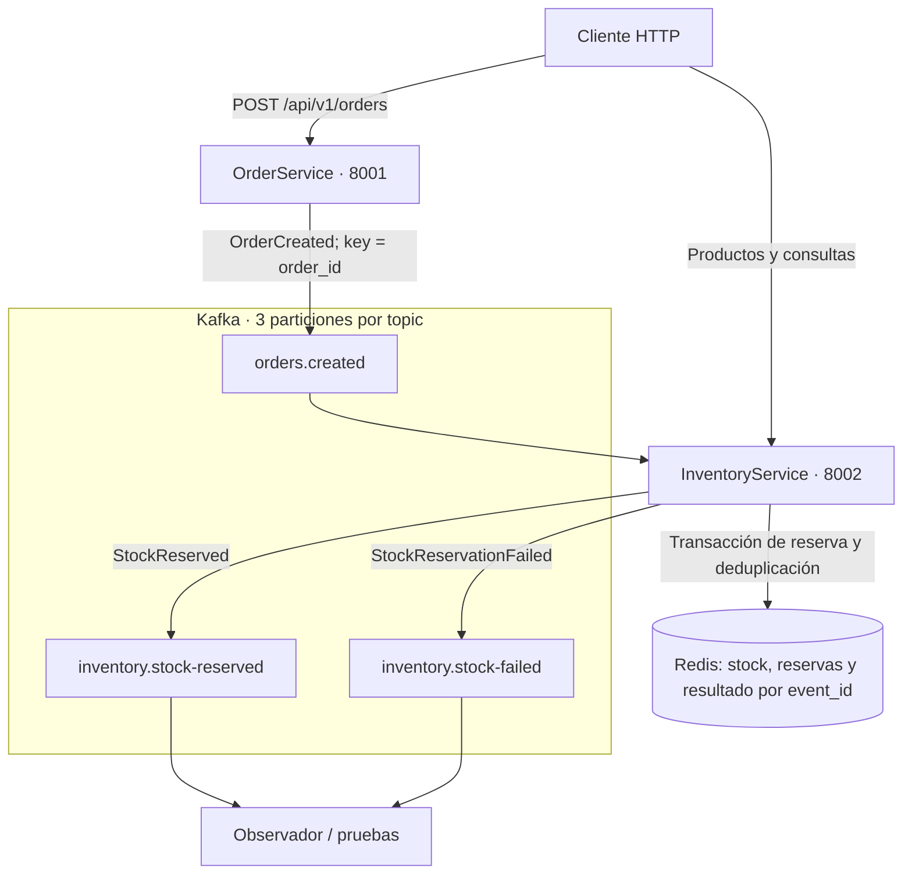

# Laboratorio 2 — Integrar microservicios Python con Kafka y deduplicar eventos

Curso: **Microservicios Avanzado** · Continuación del laboratorio 1 corregido.

| Campo | Valor |
|---|---|
| Duración planificada original | 57 minutos |
| Complejidad | Alta |
| Nivel Bloom | Aplicar |
| Entorno Python | 3.12; validado con 3.12.14 |

## Descripción y resultado esperado

Extenderás los dos servicios del laboratorio 1 para que crear un pedido publique `OrderCreated` en Kafka. Inventario lo consumirá, reservará todos los artículos o rechazará el pedido completo, y publicará `StockReserved` o `StockReservationFailed`. Redis conservará el inventario y un resultado idempotente por `event_id`, con TTL de 24 horas para ese registro.



OrderService no espera la reserva: espera la confirmación de Kafka sobre la publicación y devuelve 201. El resultado de Inventario llega después. **El pedido conserva el estado `pending`** porque este laboratorio no añade un consumidor de respuestas en Pedidos. No se implementan confirmación automática del pedido, saga ni liberación al cancelar.

## Objetivos de aprendizaje preservados

- [ ] Integrar OrderService e InventoryService mediante Kafka con productores y consumidores que trabajen sin bloquear el bucle de FastAPI.
- [ ] Diseñar eventos de dominio con UUID v4, timestamp UTC y versión semántica usando Pydantic v2.
- [ ] Implementar deduplicación en el consumidor con Redis y TTL de 24 horas.
- [ ] Configurar tres topics con tres particiones y usar `order_id` como key para mantener el orden dentro de cada partición.
- [ ] Validar la reentrega del mismo evento sin repetir el descuento de stock.

## Continuidad con el laboratorio 1

| Elemento | Comportamiento en este laboratorio |
|---|---|
| Puertos | Pedidos 8001; Inventario 8002 |
| Rutas | Se conservan `/api/v1/orders`, `/api/v1/products`, `/api/v1/reservations` y `/health` |
| Identificadores | UUID; se eliminan los IDs ficticios `prod-abc` y `cust-001` |
| Pedido | Mantiene `customer_id`, lista `items`, cantidades y precios como cadenas decimales |
| Capas | Se conservan `models`, `schemas`, `services` y `routers`; se añade mensajería |
| Creación del pedido | Con mensajería activa publica todos sus artículos; no reserva de forma síncrona |
| Inventario | La API y el consumidor usan el mismo servicio y Redis como almacenamiento |
| Reserva REST manual | Sigue disponible; no la llames después de un pedido que ya desencadenó la reserva automática |
| Datos del Lab 1 | Los datos en memoria no se migran: crea productos nuevos después del cambio |
| Pruebas del Lab 1 | Se conservan las 46 y se añaden pruebas para el Lab 2 |

El uso de Redis para stock y reservas es una decisión explícita: permite guardar el efecto y el resultado de deduplicación en la misma transacción. Guardar solo el marcador en Redis y descontar una variable en memoria deja una ventana de duplicación y separa el stock observado por la API del utilizado por el consumidor.

## Preparación y duración

Necesitas el Lab 1 corregido, Docker con Compose v2 reciente, Python 3.12, puertos 8001/8002/6379/29092 libres y acceso para descargar las imágenes. Confluent Platform 7.6.1 corresponde a las etiquetas de imágenes; **no es el número de versión de Apache Kafka ni de ZooKeeper**.

| Componente | Imagen o paquete |
|---|---|
| Broker Kafka | `confluentinc/cp-kafka:7.6.1` |
| ZooKeeper | `confluentinc/cp-zookeeper:7.6.1` |
| Redis | `redis:7.2.5-alpine` |
| Cliente Kafka | `confluent-kafka==2.4.0` |
| Cliente Redis | `redis==5.0.4` |

Se conservan los pins del Lab 1: FastAPI 0.111.0, Uvicorn 0.29.0, Pydantic 2.7.1, HTTPX 0.27.0, pytest 8.2.1, pytest-asyncio 0.23.7 y Schemathesis 3.34.0. No utilices Python 3.13 para esta combinación.

`confluent-kafka` 2.4.0 no tiene una API nativa `async/await`: el endpoint delega la publicación a `asyncio.to_thread` y el consumidor trabaja en un hilo dedicado. El cliente Redis síncrono se utiliza en ese hilo o en endpoints síncronos que FastAPI ejecuta fuera del event loop. No se presenta la biblioteca como un cliente asyncio nativo.

Los **57 minutos** requieren dependencias, imágenes y código de apoyo preparados antes de clase. Propuesta: arquitectura y contratos (8), infraestructura (10), productor y consumidor (15), idempotencia y fallos (15), particiones y evidencias (9). La construcción de todos los archivos desde cero y las descargas requieren tiempo adicional; el cronometraje de aula está pendiente.

La guía contiene todas las modificaciones. El ZIP incluye una solución completa basada en el Lab 1 corregido, además de pruebas e informe. Si trabajas en tu proyecto existente, aplica los archivos indicados sin sustituir tus modelos y esquemas por los simplificados del laboratorio original.

## Paso 1. Preparar el workspace y los entornos

1. Detén los servicios del Lab 1 con `docker compose down`, desde su carpeta. Si usabas Uvicorn, detén cada terminal con Ctrl+C.
2. Conserva una copia del código del Lab 1 antes de editar. Puedes usar un commit o una copia en una carpeta hermana.
3. Abre `microservices-lab/` en tu editor. Todos los archivos y comandos siguientes se refieren a esa raíz.
4. Crea `shared/` y un `shared/__init__.py` vacío. No copies los modelos de dominio de un servicio al otro: compartiremos únicamente contratos de integración y el adaptador Kafka.

**PowerShell**

```powershell
New-Item -ItemType Directory -Force shared | Out-Null
New-Item -ItemType File -Force shared/__init__.py | Out-Null
docker --version
docker compose version
docker info
```

**Bash**

```bash
mkdir -p shared
touch shared/__init__.py
docker --version
docker compose version
docker info
```

Los archivos se guardan con el editor en UTF-8; no copies las marcas de los bloques Markdown.

### Archivo `docs/bounded-contexts.md`

Crea o reemplaza este archivo relativo a `microservices-lab/`.

```text
# Bounded contexts — continuidad de Lab 01 a Lab 02

| Contexto | Entidades | Responsabilidad y almacenamiento |
|---|---|---|
| Pedidos | Order, OrderItem | API y cálculo de importes; almacenamiento de pedidos todavía en memoria |
| Inventario | Product, StockReservation | API y reservas por evento; Redis para productos, reservas y resultados idempotentes |

Se comparten contratos de eventos e identificadores, no modelos de dominio.
OrderCreated transporta todas las líneas del pedido, sin precios: Inventario solo necesita IDs y cantidades.
Redis pertenece a Inventario; Pedidos no modifica sus claves.
El consumidor consolida líneas repetidas y reserva el pedido completo o no descuenta ningún producto.
Las respuestas StockReserved/StockReservationFailed se publican para observación; Pedidos todavía no las consume.
El pedido conserva pending. Cancelar no publica un evento ni libera reservas.
Los productos del Lab 01 en memoria deben recrearse al pasar al almacenamiento Redis.
```

Guarda las dependencias de ejecución siguientes. Los `requirements-dev.txt` del Lab 1 siguen incluyendo estas dependencias mediante `-r requirements.txt` y conservan los paquetes de pruebas.

### Archivo `order-service/requirements.txt`

Crea o reemplaza este archivo relativo a `microservices-lab/`.

```text
fastapi==0.111.0
uvicorn==0.29.0
pydantic==2.7.1
confluent-kafka==2.4.0
redis==5.0.4
```

### Archivo `order-service/pytest.ini`

Crea o reemplaza este archivo relativo a `microservices-lab/`.

```text
[pytest]
pythonpath = . ..
testpaths = tests
asyncio_mode = strict
addopts = -ra
```

### Archivo `inventory-service/requirements.txt`

Crea o reemplaza este archivo relativo a `microservices-lab/`.

```text
fastapi==0.111.0
uvicorn==0.29.0
pydantic==2.7.1
confluent-kafka==2.4.0
redis==5.0.4
```

### Archivo `inventory-service/pytest.ini`

Crea o reemplaza este archivo relativo a `microservices-lab/`.

```text
[pytest]
pythonpath = . ..
testpaths = tests
asyncio_mode = strict
addopts = -ra
```

Instala en los entornos `.venv312` del Lab 1. Si utilizas el ZIP en una carpeta nueva, crea esos entornos primero con un intérprete Python 3.12 verificado. No es necesario activar los entornos ni disponer del comando `py` de Windows.

**PowerShell — reutilizar los entornos**

```powershell
foreach ($service in @('order-service', 'inventory-service')) {
    $pythonLab = "$service/.venv312/Scripts/python.exe"
    if (-not (Test-Path $pythonLab)) {
        throw "Falta $pythonLab. Crea el entorno con Python 3.12 antes de continuar."
    }
    & $pythonLab -m pip install -r "$service/requirements-dev.txt"
    if ($LASTEXITCODE -ne 0) { throw "Falló la instalación en $service" }
    & $pythonLab -m pip check
    if ($LASTEXITCODE -ne 0) { throw "Dependencias inconsistentes en $service" }
}
```

**PowerShell — crear entornos si faltan**

```powershell
$python312 = 'python.exe'
# Si python.exe es otra versión, sustituye el valor por la ruta de Python 3.12.
& $python312 -c "import sys; sys.exit(0 if sys.version_info[:2] == (3, 12) else 1)"
if ($LASTEXITCODE -ne 0) { throw 'Selecciona el ejecutable de Python 3.12 en $python312' }
foreach ($service in @('order-service', 'inventory-service')) {
    if (-not (Test-Path "$service/.venv312/Scripts/python.exe")) {
        & $python312 -m venv "$service/.venv312"
        if ($LASTEXITCODE -ne 0) { throw "No se pudo crear el entorno de $service" }
    }
}
```

Después ejecuta el bloque de instalación anterior.

**Bash — crear si faltan e instalar**

```bash
for service in order-service inventory-service; do
  if [ ! -x "$service/.venv312/bin/python" ]; then
    python3.12 -m venv "$service/.venv312" || exit 1
  fi
  "$service/.venv312/bin/python" -m pip install -r "$service/requirements-dev.txt" || exit 1
  "$service/.venv312/bin/python" -m pip check || exit 1
done
```

## Paso 2. Diseñar los contratos de eventos

Antes de programar la reserva, acuerda el contenido de cada evento:

| Campo | Función |
|---|---|
| `event_id` | UUID v4 del evento; se conserva al reentregarlo |
| `order_id` | Identificador del pedido y key Kafka |
| `correlation_id` | UUID v4 común a la cadena de eventos |
| `causation_id` | En la respuesta, identifica el `OrderCreated` que la causó |
| `timestamp` | Fecha con zona horaria, normalizada a UTC |
| `event_version` | `1.0.0`; otras versiones se rechazan hasta añadir un adaptador |
| `event_type` / `source_service` | Literales validados, no solo campos congelados |

Un `OrderCreated` incluye la lista de productos y cantidades de todo el pedido. Inventario consolida líneas del mismo producto y reserva todo o nada. Los precios no son necesarios para su responsabilidad. Una respuesta conserva `correlation_id`, añade `causation_id` y recibe su propio `event_id`.

Cuando se repite el mismo `event_id`, también debe repetirse su contenido. Reutilizarlo con otra cantidad se trata como una colisión inválida. Un evento nuevo, aunque tenga el mismo `order_id`, se considera distinto: la deduplicación de este ejercicio es por evento, no idempotencia de la petición HTTP.

### Archivo `shared/events.py`

Crea o reemplaza este archivo relativo a `microservices-lab/`.

```python
from datetime import datetime, timezone
from typing import Literal
from uuid import UUID, uuid4
from pydantic import BaseModel, ConfigDict, Field, UUID4, field_validator

class DomainEvent(BaseModel):
    model_config = ConfigDict(extra="forbid", frozen=True)
    event_id: UUID4 = Field(default_factory=uuid4)
    event_version: Literal["1.0.0"] = "1.0.0"
    timestamp: datetime = Field(default_factory=lambda: datetime.now(timezone.utc))
    correlation_id: UUID4 = Field(default_factory=uuid4)

    @field_validator("timestamp")
    @classmethod
    def aware_utc(cls, value):
        if value.tzinfo is None or value.utcoffset() is None:
            raise ValueError("timestamp debe incluir zona horaria")
        return value.astimezone(timezone.utc)

    def to_kafka_value(self):
        return self.model_dump_json().encode("utf-8")

class RequestedItem(BaseModel):
    model_config = ConfigDict(extra="forbid", frozen=True)
    product_id: UUID
    quantity: int = Field(strict=True, ge=1, le=1000)

class ReservedItem(BaseModel):
    model_config = ConfigDict(extra="forbid", frozen=True)
    product_id: UUID
    quantity_reserved: int = Field(strict=True, ge=1, le=100000)
    remaining_stock: int = Field(strict=True, ge=0)
    reservation_id: UUID4

class OrderCreated(DomainEvent):
    event_type: Literal["OrderCreated"] = "OrderCreated"
    source_service: Literal["order-service"] = "order-service"
    order_id: UUID
    customer_id: UUID
    items: list[RequestedItem] = Field(min_length=1, max_length=100)

class StockReserved(DomainEvent):
    event_type: Literal["StockReserved"] = "StockReserved"
    source_service: Literal["inventory-service"] = "inventory-service"
    causation_id: UUID4
    order_id: UUID
    items: list[ReservedItem] = Field(min_length=1, max_length=100)

class StockReservationFailed(DomainEvent):
    event_type: Literal["StockReservationFailed"] = "StockReservationFailed"
    source_service: Literal["inventory-service"] = "inventory-service"
    causation_id: UUID4
    order_id: UUID
    product_id: UUID
    quantity_requested: int = Field(strict=True, ge=1, le=100000)
    available_stock: int = Field(strict=True, ge=0)
    reason: Literal["PRODUCT_NOT_FOUND", "INSUFFICIENT_STOCK"]
```

Los esquemas JSON Schema exportados a `contracts/events/` se generan desde estos modelos para inspección e intercambio; no sustituyen un Schema Registry ni una política de compatibilidad entre versiones.

## Paso 3. Publicar desde Pedidos sin cambiar su contrato REST

`EventPublisher` usa `order_id` como key y configura explícitamente `murmur2_random`. El particionador predeterminado de librdkafka no debe describirse como Murmur2: aquí lo seleccionamos de forma explícita.

La publicación comprueba tanto el callback como los mensajes pendientes de `flush`. Si no se confirma, el endpoint devuelve **503 `EVENT_PUBLICATION_FAILED`** y no guarda el pedido en memoria. No devuelve un 201 indicando que todo funcionó tras un fallo conocido.

`enable.idempotence` evita ciertos duplicados producidos por reintentos internos del productor; no deduplica tres llamadas explícitas a `produce` ni garantiza exactamente una ejecución del flujo Kafka/Redis/HTTP. Un timeout puede dejar un resultado de entrega incierto. La atomicidad entre Kafka y el almacenamiento de Pedidos requiere un outbox durable, fuera de este laboratorio; no reintentes ciegamente el POST como si fuera idempotente.

### Archivo `shared/kafka.py`

Crea o reemplaza este archivo relativo a `microservices-lab/`.

```python
"""confluent-kafka 2.4 es síncrono; usar desde hilo o asyncio.to_thread."""
from threading import Lock
from confluent_kafka import Producer

class PublicationError(RuntimeError):
    pass

class EventPublisher:
    def __init__(self, bootstrap, client_id, producer=None):
        self.producer = producer if producer is not None else Producer({
            "bootstrap.servers": bootstrap, "client.id": client_id,
            "enable.idempotence": True, "acks": "all",
            "partitioner": "murmur2_random", "message.timeout.ms": 10000,
        })
        self.lock = Lock()

    def publish(self, topic, event):
        with self.lock:
            delivery = []
            def delivered(error, message):
                delivery.append((error, message))
            self.producer.produce(topic, key=str(event.order_id).encode(),
                                  value=event.to_kafka_value(), on_delivery=delivered)
            remaining = self.producer.flush(12)
            if remaining or not delivery or delivery[0][0] is not None:
                raise PublicationError(f"Entrega no confirmada: {delivery}, pendientes={remaining}")
            message = delivery[0][1]
            return message.partition(), message.offset()

    def ready(self):
        metadata = self.producer.list_topics(timeout=2)
        return bool(metadata.brokers)

    def close(self):
        if self.producer.flush(12):
            raise PublicationError("Mensajes pendientes al cerrar")
```

### Archivo `shared/health.py`

Crea o reemplaza este archivo relativo a `microservices-lab/`.

```python
from typing import Literal
from pydantic import BaseModel

class HealthResponse(BaseModel):
    status: Literal["healthy", "unhealthy"]
    service: Literal["order-service", "inventory-service"]

HEALTH_RESPONSES = {503: {"model": HealthResponse, "description": "Dependencias no disponibles"}}
```

### Archivo `order-service/app/services/order_service.py`

Crea o reemplaza este archivo relativo a `microservices-lab/`.

```python
from decimal import Decimal
from threading import Lock
from uuid import UUID
from app.models.order import Order, OrderItem, OrderStatus
from app.schemas.order import OrderCreate

class OrderNotFound(Exception):
    pass

class InvalidOrderState(Exception):
    pass

class OrderService:
    def __init__(self):
        self._orders: dict[UUID, Order] = {}
        self._lock = Lock()

    def prepare_order(self, payload: OrderCreate) -> Order:
        items = tuple(OrderItem(product_id=i.product_id, quantity=i.quantity,
                                unit_price=Decimal(i.unit_price)) for i in payload.items)
        order = Order(customer_id=payload.customer_id, items=items)
        return order

    def save_order(self, order: Order) -> Order:
        with self._lock:
            self._orders[order.id] = order
        return order.model_copy(deep=True)

    def create_order(self, payload: OrderCreate) -> Order:
        return self.save_order(self.prepare_order(payload))

    def get_order(self, order_id: UUID) -> Order | None:
        with self._lock:
            order = self._orders.get(order_id)
            return order.model_copy(deep=True) if order else None

    def list_orders(self) -> list[Order]:
        with self._lock:
            return [o.model_copy(deep=True) for o in self._orders.values()]

    def cancel_order(self, order_id: UUID) -> Order:
        with self._lock:
            order = self._orders.get(order_id)
            if order is None:
                raise OrderNotFound()
            if order.status != OrderStatus.PENDING:
                raise InvalidOrderState()
            cancelled = Order(**{**order.model_dump(), "status": OrderStatus.CANCELLED})
            self._orders[order_id] = cancelled
            return cancelled.model_copy(deep=True)
```

### Archivo `order-service/app/routers/orders.py`

Crea o reemplaza este archivo relativo a `microservices-lab/`.

```python
import asyncio
import logging
from uuid import UUID
from shared.events import OrderCreated, RequestedItem
from fastapi import APIRouter, Request
from fastapi.responses import JSONResponse
from app.schemas.order import OrderCreate, OrderResponse, OrderItemResponse, BusinessError
from app.services.order_service import OrderNotFound, InvalidOrderState

router = APIRouter(prefix="/api/v1/orders", tags=["orders"])

def to_response(order):
    return OrderResponse(id=order.id, customer_id=order.customer_id,
        status=order.status, created_at=order.created_at,
        total=f"{order.total:.2f}", items=[OrderItemResponse(
            product_id=i.product_id, quantity=i.quantity,
            unit_price=f"{i.unit_price:.2f}", subtotal=f"{i.subtotal:.2f}") for i in order.items])

def error(code, message, status):
    return JSONResponse(status_code=status, content={"code": code, "message": message})

@router.post("", response_model=OrderResponse, status_code=201,
             responses={503: {"model": BusinessError}})
async def create_order(payload: OrderCreate, request: Request):
    order = request.app.state.service.prepare_order(payload)
    publisher = request.app.state.publisher
    if publisher is not None:
        event = OrderCreated(order_id=order.id, customer_id=order.customer_id,
            items=[RequestedItem(product_id=i.product_id, quantity=i.quantity) for i in order.items])
        try:
            await asyncio.to_thread(publisher.publish, "orders.created", event)
        except Exception:
            logging.getLogger(__name__).exception("Publicación no confirmada")
            return error("EVENT_PUBLICATION_FAILED", "Kafka delivery not confirmed", 503)
    return to_response(request.app.state.service.save_order(order))

@router.get("", response_model=list[OrderResponse])
def list_orders(request: Request):
    return [to_response(o) for o in request.app.state.service.list_orders()]

@router.get("/{order_id}", response_model=OrderResponse, responses={404: {"model": BusinessError}})
def get_order(order_id: UUID, request: Request):
    order = request.app.state.service.get_order(order_id)
    if order is None:
        return error("ORDER_NOT_FOUND", "Order not found", 404)
    return to_response(order)

@router.patch("/{order_id}/cancel", response_model=OrderResponse,
              responses={404: {"model": BusinessError}, 409: {"model": BusinessError}})
def cancel_order(order_id: UUID, request: Request):
    try:
        return to_response(request.app.state.service.cancel_order(order_id))
    except OrderNotFound:
        return error("ORDER_NOT_FOUND", "Order not found", 404)
    except InvalidOrderState:
        return error("INVALID_ORDER_STATE", "Order cannot be cancelled", 409)
```

### Archivo `order-service/app/main.py`

Crea o reemplaza este archivo relativo a `microservices-lab/`.

```python
import asyncio
import logging
import os
from contextlib import asynccontextmanager
from fastapi import FastAPI
from fastapi.responses import JSONResponse
from app.routers.orders import router
from app.services.order_service import OrderService
from shared.kafka import EventPublisher
from shared.health import HealthResponse, HEALTH_RESPONSES

logging.basicConfig(level=logging.INFO)

def create_app(messaging=False, publisher=None):
    @asynccontextmanager
    async def lifespan(application):
        if messaging:
            application.state.publisher = EventPublisher(
                os.getenv("KAFKA_BOOTSTRAP_SERVERS", "localhost:29092"), "order-service-producer")
        try:
            yield
        finally:
            if messaging:
                await asyncio.to_thread(application.state.publisher.close)
    application = FastAPI(title="OrderService", version="2.0.0", lifespan=lifespan)
    application.state.service = OrderService()
    application.state.publisher = publisher
    application.include_router(router)
    @application.get("/health", response_model=HealthResponse, responses=HEALTH_RESPONSES)
    def health():
        if messaging:
            try:
                if not application.state.publisher.ready():
                    raise RuntimeError("Kafka no disponible")
            except Exception:
                return JSONResponse(status_code=503, content={"status":"unhealthy", "service":"order-service"})
        return {"status": "healthy", "service": "order-service"}
    return application

app = create_app(messaging=os.getenv("MESSAGING_ENABLED", "false").lower() == "true")
```

## Paso 4. Reservar y registrar el resultado de manera atómica

El consumidor y la API usan `RedisInventoryService`. Con `WATCH` se comprueba que ninguno de los productos ni el registro de evento haya cambiado; `MULTI/EXEC` guarda los productos actualizados, las reservas y la respuesta estable del evento. Si otro consumidor modifica las claves, se recalcula desde el estado actual.

Un fallo de negocio también se registra: repetirlo no reevalúa el pedido como si fuera uno nuevo. En un pedido con varios productos, si uno falta o tiene stock insuficiente no se descuenta ninguno.

El registro `lab02:idempotency:inventory:<event_id>` contiene el hash del evento, la respuesta y `published`. Su TTL es **86400 segundos**. Los productos y reservas no reciben ese TTL. Al confirmar la publicación se usa `KEEPTTL`: los duplicados no renuevan indefinidamente la ventana.

Redis se configura sin expulsión de claves (`noeviction`) y con AOF. AOF con `appendfsync everysec` no equivale a durabilidad absoluta ante fallo de máquina: puede perder escrituras recientes. Esta solución cubre la reentrega dentro de la ventana mientras se conserva el estado Redis; no promete exactamente una ejecución ante cualquier fallo de infraestructura.

### Archivo `inventory-service/app/services/redis_inventory.py`

Crea o reemplaza este archivo relativo a `microservices-lab/`.

```python
"""Inventario y resultado idempotente en una misma transacción Redis."""
import hashlib
import json
from uuid import UUID
from redis import WatchError
from app.models.product import Product, StockReservation
from app.services.inventory_service import ProductNotFound, InsufficientStock
from shared.events import StockReserved, StockReservationFailed, ReservedItem

TTL = 86400

class EventIdCollision(ValueError):
    pass

class RedisInventoryService:
    def __init__(self, client, prefix="lab02:"):
        self.client, self.prefix = client, prefix

    def product_key(self, product_id):
        return f"{self.prefix}product:{product_id}"

    def event_key(self, event_id):
        return f"{self.prefix}idempotency:inventory:{event_id}"

    def reservation_key(self, reservation_id):
        return f"{self.prefix}reservation:{reservation_id}"

    def add_product(self, payload):
        product = Product(**payload.model_dump())
        self.client.set(self.product_key(product.id), product.model_dump_json())
        return product

    def get_product(self, product_id):
        raw = self.client.get(self.product_key(product_id))
        return Product.model_validate_json(raw) if raw else None

    def list_products(self):
        result = []
        for key in self.client.scan_iter(match=f"{self.prefix}product:*"):
            raw = self.client.get(key)
            if raw:
                result.append(Product.model_validate_json(raw))
        return result

    def reservation_count(self):
        return sum(1 for _ in self.client.scan_iter(match=f"{self.prefix}reservation:*"))

    def create_reservation(self, payload):
        key = self.product_key(payload.product_id)
        for _ in range(50):
            with self.client.pipeline() as pipe:
                try:
                    pipe.watch(key)
                    raw = pipe.get(key)
                    if raw is None:
                        raise ProductNotFound()
                    product = Product.model_validate_json(raw)
                    if product.stock_quantity < payload.quantity:
                        raise InsufficientStock()
                    reservation = StockReservation(**payload.model_dump())
                    updated = Product(**{**product.model_dump(),
                        "stock_quantity": product.stock_quantity - payload.quantity})
                    pipe.multi()
                    pipe.set(key, updated.model_dump_json())
                    pipe.set(self.reservation_key(reservation.id), reservation.model_dump_json())
                    pipe.execute()
                    return reservation
                except WatchError:
                    continue
        raise RuntimeError("Contención Redis: reintentar")

    def process_event(self, event):
        # Consolidar líneas repetidas sin perder pedidos con varios productos.
        quantities = {}
        for item in event.items:
            quantities[item.product_id] = quantities.get(item.product_id, 0) + item.quantity
        event_key = self.event_key(event.event_id)
        fingerprint = hashlib.sha256(event.to_kafka_value()).hexdigest()
        keys = [self.product_key(pid) for pid in quantities]
        for _ in range(50):
            with self.client.pipeline() as pipe:
                try:
                    pipe.watch(event_key, *keys)
                    existing = pipe.get(event_key)
                    if existing:
                        record = json.loads(existing)
                        if record["input_hash"] != fingerprint:
                            raise EventIdCollision("Mismo event_id con contenido diferente")
                        return record, False
                    products = {}
                    failure = None
                    for pid, qty in quantities.items():
                        raw = pipe.get(self.product_key(pid))
                        product = Product.model_validate_json(raw) if raw else None
                        available = product.stock_quantity if product else 0
                        if product is None or available < qty:
                            failure = StockReservationFailed(
                                order_id=event.order_id, product_id=pid,
                                quantity_requested=qty, available_stock=available,
                                reason="PRODUCT_NOT_FOUND" if product is None else "INSUFFICIENT_STOCK",
                                correlation_id=event.correlation_id, causation_id=event.event_id)
                            break
                        products[pid] = product
                    updates, reservations, items = [], [], []
                    if failure is None:
                        for pid, product in products.items():
                            qty = quantities[pid]
                            updated = Product(**{**product.model_dump(),
                                "stock_quantity": product.stock_quantity - qty})
                            reservation = StockReservation(product_id=pid, order_id=event.order_id, quantity=qty)
                            updates.append(updated)
                            reservations.append(reservation)
                            items.append(ReservedItem(product_id=pid, quantity_reserved=qty,
                                remaining_stock=updated.stock_quantity, reservation_id=reservation.id))
                        reply = StockReserved(order_id=event.order_id, items=items,
                            correlation_id=event.correlation_id, causation_id=event.event_id)
                    else:
                        reply = failure
                    record = {"input_hash": fingerprint, "published": False,
                              "reply": reply.model_dump(mode="json")}
                    pipe.multi()
                    for product in updates:
                        pipe.set(self.product_key(product.id), product.model_dump_json())
                    for reservation in reservations:
                        pipe.set(self.reservation_key(reservation.id), reservation.model_dump_json())
                    pipe.set(event_key, json.dumps(record), ex=TTL)
                    pipe.execute()
                    return record, True
                except WatchError:
                    continue
        raise RuntimeError("Contención Redis: reintentar")

    def mark_published(self, event_id):
        key = self.event_key(event_id)
        for _ in range(50):
            with self.client.pipeline() as pipe:
                try:
                    pipe.watch(key)
                    raw = pipe.get(key)
                    if raw is None:
                        raise RuntimeError("Registro idempotente expirado antes de publicar")
                    record = json.loads(raw)
                    record["published"] = True
                    pipe.multi()
                    pipe.set(key, json.dumps(record), xx=True, keepttl=True)
                    pipe.execute()
                    return
                except WatchError:
                    continue
        raise RuntimeError("Contención Redis al confirmar publicación")
```

## Paso 5. Consumir, reintentar y confirmar offsets

El flujo del consumidor es:

1. Validar esquema y comprobar que la key coincide con `order_id`.
2. Recuperar el resultado ya registrado o ejecutar la transacción Redis.
3. Si falta publicar la respuesta, enviarla y confirmar su entrega.
4. Marcar `published` conservando el TTL.
5. Confirmar el offset con `asynchronous=False`.

Ante un fallo transitorio, reintenta el **mismo mensaje** sin consumir el siguiente y marca el worker como no preparado. Si no se recupera en la ventana de 60 segundos, se detiene sin commit para evitar un bucle indefinido; corrige la dependencia y reinicia Inventario para retomar el offset pendiente. Omitir un commit no rebobina automáticamente la posición del consumidor en esa misma sesión; avanzar y confirmar un offset posterior podría saltarse el mensaje fallido.

Si falla después del descuento y antes de publicar, el siguiente intento recupera la respuesta almacenada sin descontar otra vez. Si la respuesta llegó a Kafka pero el marcador no llegó a Redis, puede publicarse de nuevo con el mismo `event_id`; un consumidor futuro de respuestas también deberá deduplicar.

Si el evento es inválido o reutiliza un ID con contenido diferente, el worker se detiene sin commit y la salud pasa a 503. La corrección requiere intervención; no se implementa una DLQ en esta práctica. No se descarta el mensaje confirmándolo como si hubiese sido procesado correctamente.

### Archivo `inventory-service/app/messaging.py`

Crea o reemplaza este archivo relativo a `microservices-lab/`.

```python
import logging
import time
from threading import Event, Thread
from confluent_kafka import Consumer, KafkaError
from pydantic import ValidationError
from shared.events import OrderCreated, StockReserved, StockReservationFailed
from app.services.redis_inventory import EventIdCollision

log = logging.getLogger(__name__)

class InventoryWorker:
    def __init__(self, service, publisher, bootstrap, consumer=None):
        self.service, self.publisher = service, publisher
        self.consumer = consumer if consumer is not None else Consumer({
            "bootstrap.servers": bootstrap, "group.id": "inventory-service-group",
            "auto.offset.reset": "earliest", "enable.auto.commit": False,
            "enable.auto.offset.store": False, "max.poll.interval.ms": 300000,
        })
        self.stop_event, self.ready = Event(), Event()
        self.thread = None

    def handle(self, message):
        event = OrderCreated.model_validate_json(message.value())
        if message.key() != str(event.order_id).encode():
            raise ValueError("La key Kafka debe ser order_id")
        record, fresh = self.service.process_event(event)
        if not record["published"]:
            data = record["reply"]
            success = data["event_type"] == "StockReserved"
            reply = (StockReserved if success else StockReservationFailed).model_validate(data)
            topic = "inventory.stock-reserved" if success else "inventory.stock-failed"
            self.publisher.publish(topic, reply)
            self.service.mark_published(event.event_id)
        # Solo después del efecto y de confirmar la publicación.
        self.consumer.commit(message=message, asynchronous=False)
        log.info("event_id=%s nuevo=%s partition=%s offset=%s", event.event_id,
                 fresh, message.partition(), message.offset())

    def run(self):
        try:
            self.consumer.subscribe(["orders.created"],
                on_assign=lambda consumer, parts: self.ready.set(),
                on_revoke=lambda consumer, parts: self.ready.clear())
            while not self.stop_event.is_set():
                message = self.consumer.poll(1)
                if message is None:
                    continue
                if message.error():
                    if message.error().code() != KafkaError._PARTITION_EOF:
                        raise RuntimeError(message.error())
                    continue
                # Reintentar EL MISMO mensaje; no avanzar y confirmar offsets posteriores.
                retry_deadline = time.monotonic() + 60
                while not self.stop_event.is_set():
                    try:
                        self.handle(message)
                        self.ready.set()
                        break
                    except (ValidationError, EventIdCollision, ValueError):
                        log.exception("Evento inválido: detener consumidor sin commit; corregir antes de reiniciar")
                        return
                    except Exception:
                        self.ready.clear()
                        log.exception("Fallo transitorio: sin commit; reintento del mismo mensaje")
                        if time.monotonic() >= retry_deadline:
                            log.error("Reintentos agotados: detener sin commit; reiniciar tras corregir dependencia")
                            return
                        self.stop_event.wait(1)
        except Exception:
            log.exception("Consumidor detenido")
        finally:
            self.ready.clear()
            self.consumer.close()

    def start(self):
        self.thread = Thread(target=self.run, name="inventory-kafka", daemon=False)
        self.thread.start()

    def stop(self):
        self.stop_event.set()
        self.thread.join(timeout=30)
        if self.thread.is_alive():
            raise RuntimeError("El consumidor no terminó; no cerrar recursos compartidos")
```

### Archivo `inventory-service/app/main.py`

Crea o reemplaza este archivo relativo a `microservices-lab/`.

```python
import asyncio
import logging
import os
from contextlib import asynccontextmanager
import redis
from fastapi import FastAPI
from fastapi.responses import JSONResponse
from app.routers.products import router
from app.services.inventory_service import InventoryService
from app.services.redis_inventory import RedisInventoryService
from app.messaging import InventoryWorker
from shared.kafka import EventPublisher
from shared.health import HealthResponse, HEALTH_RESPONSES

logging.basicConfig(level=logging.INFO)

def create_app(messaging=False, service=None):
    @asynccontextmanager
    async def lifespan(application):
        client = publisher = worker = None
        try:
            if messaging:
                client = redis.Redis.from_url(os.getenv("REDIS_URL", "redis://localhost:6379/0"),
                    decode_responses=True, socket_timeout=3, socket_connect_timeout=3)
                await asyncio.to_thread(client.ping)
                application.state.service = RedisInventoryService(client)
                bootstrap = os.getenv("KAFKA_BOOTSTRAP_SERVERS", "localhost:29092")
                publisher = EventPublisher(bootstrap, "inventory-service-producer")
                worker = InventoryWorker(application.state.service, publisher, bootstrap)
                application.state.worker = worker
                worker.start()
            yield
        finally:
            if worker:
                await asyncio.to_thread(worker.stop)
            if publisher:
                await asyncio.to_thread(publisher.close)
            if client:
                client.close()
    application = FastAPI(title="InventoryService", version="2.0.0", lifespan=lifespan)
    application.state.service = service if service is not None else InventoryService()
    application.state.worker = None
    application.include_router(router)
    @application.get("/health", response_model=HealthResponse, responses=HEALTH_RESPONSES)
    def health():
        if messaging:
            try:
                worker = application.state.worker
                if worker is None or not worker.ready.is_set() or not worker.thread.is_alive():
                    raise RuntimeError("Consumidor no preparado")
                application.state.service.client.ping()
                if not worker.publisher.ready():
                    raise RuntimeError("Kafka no disponible")
            except Exception:
                return JSONResponse(status_code=503, content={"status":"unhealthy", "service":"inventory-service"})
        return {"status": "healthy", "service": "inventory-service"}
    return application

app = create_app(messaging=os.getenv("MESSAGING_ENABLED", "false").lower() == "true")
```

El `lifespan` inicia el worker y al cerrar espera que termine antes de cerrar el productor y Redis. El consumidor se cierra desde el hilo que lo usa. En modo Kafka, `/health` comprueba Redis, Kafka y el worker; una aplicación HTTP levantada no implica que el consumidor esté preparado.

`create_app()` conserva el modo aislado para las pruebas del Lab 1. La aplicación de contenedor activa el flujo con `MESSAGING_ENABLED=true`. Ejecutar pruebas aisladas no demuestra conectividad con un broker real.

## Paso 6. Actualizar los contratos REST

Se preservan los cuerpos y rutas del Lab 1 y se añaden los errores 503 de disponibilidad/publicación. Guarda los contratos independientes siguientes; no los sustituyas por el OpenAPI generado automáticamente.

### Archivo `contracts/order-service.openapi.yaml`

Crea o reemplaza este archivo relativo a `microservices-lab/`.

```yaml
openapi: 3.1.0
info:
  title: order-service
  version: 2.0.0
  description: "Contrato REST de Lab 02: conserva la interfaz de Lab 01 y a\xF1ade\
    \ disponibilidad/publicaci\xF3n 503."
servers:
- url: http://localhost:8001
paths:
  /api/v1/orders:
    post:
      operationId: createOrder
      responses:
        '201':
          description: Resultado esperado
          content:
            application/json:
              schema:
                $ref: '#/components/schemas/OrderResponse'
        '422':
          description: "Entrada inv\xE1lida"
          content:
            application/json:
              schema:
                $ref: '#/components/schemas/ValidationError'
        '503':
          description: "Publicaci\xF3n Kafka no confirmada"
          content:
            application/json:
              schema:
                $ref: '#/components/schemas/BusinessError'
      requestBody:
        required: true
        content:
          application/json:
            schema:
              $ref: '#/components/schemas/OrderCreate'
    get:
      operationId: listOrders
      responses:
        '200':
          description: Resultado esperado
          content:
            application/json:
              schema:
                type: array
                items:
                  $ref: '#/components/schemas/OrderResponse'
  /api/v1/orders/{order_id}:
    get:
      operationId: getOrder
      responses:
        '200':
          description: Resultado esperado
          content:
            application/json:
              schema:
                $ref: '#/components/schemas/OrderResponse'
        '404':
          description: Recurso inexistente
          content:
            application/json:
              schema:
                $ref: '#/components/schemas/BusinessError'
        '422':
          description: "Entrada inv\xE1lida"
          content:
            application/json:
              schema:
                $ref: '#/components/schemas/ValidationError'
      parameters:
      - name: order_id
        in: path
        required: true
        schema: &id001
          type: string
          format: uuid
  /api/v1/orders/{order_id}/cancel:
    patch:
      operationId: cancelOrder
      responses:
        '200':
          description: Resultado esperado
          content:
            application/json:
              schema:
                $ref: '#/components/schemas/OrderResponse'
        '404':
          description: Recurso inexistente
          content:
            application/json:
              schema:
                $ref: '#/components/schemas/BusinessError'
        '409':
          description: Conflicto de negocio
          content:
            application/json:
              schema:
                $ref: '#/components/schemas/BusinessError'
        '422':
          description: "Entrada inv\xE1lida"
          content:
            application/json:
              schema:
                $ref: '#/components/schemas/ValidationError'
      parameters:
      - name: order_id
        in: path
        required: true
        schema: *id001
  /health:
    get:
      operationId: health
      responses:
        '200':
          description: Resultado esperado
          content:
            application/json:
              schema:
                type: object
                properties:
                  status:
                    type: string
                    const: healthy
                  service:
                    type: string
                    const: order-service
                required:
                - status
                - service
                additionalProperties: false
        '503':
          description: Dependencias o consumidor no disponibles
          content:
            application/json:
              schema:
                type: object
                required:
                - status
                - service
                properties:
                  status:
                    const: unhealthy
                  service:
                    type: string
components:
  schemas:
    OrderItemCreate:
      type: object
      properties:
        product_id: *id001
        quantity: &id002
          type: integer
          minimum: 1
          maximum: 1000
        unit_price: &id003
          type: string
          pattern: ^([1-9][0-9]{0,5}\.[0-9]{2}|0\.(0[1-9]|[1-9][0-9]))$
      required:
      - product_id
      - quantity
      - unit_price
      additionalProperties: false
    OrderItemResponse:
      type: object
      properties:
        product_id: *id001
        quantity: *id002
        unit_price: *id003
        subtotal: &id004
          type: string
          pattern: ^[0-9]+\.[0-9]{2}$
      required:
      - product_id
      - quantity
      - unit_price
      - subtotal
      additionalProperties: false
    OrderCreate:
      type: object
      properties:
        customer_id: *id001
        items:
          type: array
          items:
            $ref: '#/components/schemas/OrderItemCreate'
          minItems: 1
          maxItems: 100
      required:
      - customer_id
      - items
      additionalProperties: false
    OrderResponse:
      type: object
      properties:
        id: *id001
        customer_id: *id001
        status:
          type: string
          enum:
          - pending
          - confirmed
          - shipped
          - delivered
          - cancelled
        items:
          type: array
          items:
            $ref: '#/components/schemas/OrderItemResponse'
        total: *id004
        created_at:
          type: string
          format: date-time
      required:
      - id
      - customer_id
      - status
      - items
      - total
      - created_at
      additionalProperties: false
    BusinessError:
      type: object
      properties:
        code:
          type: string
        message:
          type: string
      required:
      - code
      - message
      additionalProperties: false
    ValidationError:
      type: object
      required:
      - detail
      properties:
        detail:
          type: array
          items:
            type: object
            required:
            - loc
            - msg
            - type
            properties:
              loc:
                type: array
                items:
                  anyOf:
                  - type: string
                  - type: integer
              msg:
                type: string
              type:
                type: string
            additionalProperties: true
      additionalProperties: false
```

### Archivo `contracts/inventory-service.openapi.yaml`

Crea o reemplaza este archivo relativo a `microservices-lab/`.

```yaml
openapi: 3.1.0
info:
  title: inventory-service
  version: 2.0.0
  description: "Contrato REST de Lab 02: conserva la interfaz de Lab 01 y a\xF1ade\
    \ disponibilidad/publicaci\xF3n 503."
servers:
- url: http://localhost:8002
paths:
  /api/v1/products:
    post:
      operationId: createProduct
      responses:
        '201':
          description: Resultado esperado
          content:
            application/json:
              schema:
                $ref: '#/components/schemas/Product'
        '422':
          description: "Entrada inv\xE1lida"
          content:
            application/json:
              schema:
                $ref: '#/components/schemas/ValidationError'
      requestBody:
        required: true
        content:
          application/json:
            schema:
              $ref: '#/components/schemas/ProductCreate'
    get:
      operationId: listProducts
      responses:
        '200':
          description: Resultado esperado
          content:
            application/json:
              schema:
                type: array
                items:
                  $ref: '#/components/schemas/Product'
  /api/v1/products/{product_id}:
    get:
      operationId: getProduct
      responses:
        '200':
          description: Resultado esperado
          content:
            application/json:
              schema:
                $ref: '#/components/schemas/Product'
        '404':
          description: Recurso inexistente
          content:
            application/json:
              schema:
                $ref: '#/components/schemas/BusinessError'
        '422':
          description: "Entrada inv\xE1lida"
          content:
            application/json:
              schema:
                $ref: '#/components/schemas/ValidationError'
      parameters:
      - name: product_id
        in: path
        required: true
        schema: &id005
          type: string
          format: uuid
  /api/v1/reservations:
    post:
      operationId: createReservation
      responses:
        '201':
          description: Resultado esperado
          content:
            application/json:
              schema:
                $ref: '#/components/schemas/StockReservationResponse'
        '404':
          description: Recurso inexistente
          content:
            application/json:
              schema:
                $ref: '#/components/schemas/BusinessError'
        '409':
          description: Conflicto de negocio
          content:
            application/json:
              schema:
                $ref: '#/components/schemas/BusinessError'
        '422':
          description: "Entrada inv\xE1lida"
          content:
            application/json:
              schema:
                $ref: '#/components/schemas/ValidationError'
      requestBody:
        required: true
        content:
          application/json:
            schema:
              $ref: '#/components/schemas/StockReservationCreate'
  /health:
    get:
      operationId: health
      responses:
        '200':
          description: Resultado esperado
          content:
            application/json:
              schema:
                type: object
                properties:
                  status:
                    type: string
                    const: healthy
                  service:
                    type: string
                    const: inventory-service
                required:
                - status
                - service
                additionalProperties: false
        '503':
          description: Dependencias o consumidor no disponibles
          content:
            application/json:
              schema:
                type: object
                required:
                - status
                - service
                properties:
                  status:
                    const: unhealthy
                  service:
                    type: string
components:
  schemas:
    ProductCreate:
      type: object
      properties:
        name: &id001
          type: string
          minLength: 1
          maxLength: 200
        sku: &id002
          type: string
          minLength: 1
          maxLength: 50
          pattern: ^[A-Z0-9-]+$
        stock_quantity: &id003
          type: integer
          minimum: 0
          maximum: 1000000
          default: 0
        reorder_threshold: &id004
          type: integer
          minimum: 0
          maximum: 1000000
          default: 10
      required:
      - name
      - sku
      additionalProperties: false
    Product:
      type: object
      properties:
        name: *id001
        sku: *id002
        stock_quantity: *id003
        reorder_threshold: *id004
        id: *id005
      required:
      - name
      - sku
      - stock_quantity
      - reorder_threshold
      - id
      additionalProperties: false
    StockReservationCreate:
      type: object
      properties:
        product_id: *id005
        order_id: *id005
        quantity: &id006
          type: integer
          minimum: 1
          maximum: 1000000
      required:
      - product_id
      - order_id
      - quantity
      additionalProperties: false
    StockReservationResponse:
      type: object
      properties:
        product_id: *id005
        order_id: *id005
        quantity: *id006
        id: *id005
        status:
          type: string
          enum:
          - pending
          - confirmed
          - released
      required:
      - product_id
      - order_id
      - quantity
      - id
      - status
      additionalProperties: false
    BusinessError:
      type: object
      properties:
        code:
          type: string
        message:
          type: string
      required:
      - code
      - message
      additionalProperties: false
    ValidationError:
      type: object
      required:
      - detail
      properties:
        detail:
          type: array
          items:
            type: object
            required:
            - loc
            - msg
            - type
            properties:
              loc:
                type: array
                items:
                  anyOf:
                  - type: string
                  - type: integer
              msg:
                type: string
              type:
                type: string
            additionalProperties: true
      additionalProperties: false
```

## Paso 7. Preparar Docker y los topics

El contexto de construcción cambia a la raíz del workspace para incluir `shared/`. Guarda los dos Dockerfiles, el `.dockerignore` de raíz y los dos archivos Compose. Los `app/models`, `app/schemas`, routers de Inventario y sus reglas de negocio básicas se mantienen del Lab 1.

Todos los servicios se conectan a la red predeterminada del mismo proyecto Compose. Desde un contenedor se usa `kafka:9092` y `redis://redis:6379/0`; desde el equipo se usa `localhost:29092` y `redis://localhost:6379/0`. ZooKeeper no necesita un puerto publicado al host.

### Archivo `order-service/Dockerfile`

Crea o reemplaza este archivo relativo a `microservices-lab/`.

```dockerfile
FROM python:3.12.14-slim
ENV PYTHONDONTWRITEBYTECODE=1 PYTHONUNBUFFERED=1
WORKDIR /app
COPY order-service/requirements.txt ./
RUN pip install --no-cache-dir -r requirements.txt
COPY shared/ ./shared/
COPY order-service/app/ ./app/
RUN useradd --uid 10001 --no-create-home appuser
USER appuser
EXPOSE 8001
CMD ["uvicorn", "app.main:app", "--host", "0.0.0.0", "--port", "8001"]
```

### Archivo `inventory-service/Dockerfile`

Crea o reemplaza este archivo relativo a `microservices-lab/`.

```dockerfile
FROM python:3.12.14-slim
ENV PYTHONDONTWRITEBYTECODE=1 PYTHONUNBUFFERED=1
WORKDIR /app
COPY inventory-service/requirements.txt ./
RUN pip install --no-cache-dir -r requirements.txt
COPY shared/ ./shared/
COPY inventory-service/app/ ./app/
RUN useradd --uid 10001 --no-create-home appuser
USER appuser
EXPOSE 8002
CMD ["uvicorn", "app.main:app", "--host", "0.0.0.0", "--port", "8002"]
```

### Archivo `.dockerignore`

Crea o reemplaza este archivo relativo a `microservices-lab/`.

```text
**/.venv*
**/__pycache__
**/.pytest_cache
**/.hypothesis
**/tests
.git
*.zip
docs
```

### Archivo `docker-compose.yml`

Crea o reemplaza este archivo relativo a `microservices-lab/`.

```yaml
name: micr-lab01
services:
  order-service:
    build:
      context: .
      dockerfile: order-service/Dockerfile
    ports:
    - 8001:8001
    healthcheck:
      test:
      - CMD
      - python
      - -c
      - import urllib.request; urllib.request.urlopen('http://localhost:8001/health',
        timeout=2)
      interval: 5s
      timeout: 3s
      retries: 12
      start_period: 5s
  inventory-service:
    build:
      context: .
      dockerfile: inventory-service/Dockerfile
    ports:
    - 8002:8002
    healthcheck:
      test:
      - CMD
      - python
      - -c
      - import urllib.request; urllib.request.urlopen('http://localhost:8002/health',
        timeout=2)
      interval: 5s
      timeout: 3s
      retries: 12
      start_period: 5s
```

### Archivo `docker-compose.kafka.yml`

Crea o reemplaza este archivo relativo a `microservices-lab/`.

```yaml
services:
  zookeeper:
    image: confluentinc/cp-zookeeper:7.6.1
    environment:
      ZOOKEEPER_CLIENT_PORT: 2181
      ZOOKEEPER_TICK_TIME: 2000
    volumes:
      - zk-data:/var/lib/zookeeper/data
      - zk-log:/var/lib/zookeeper/log
    healthcheck:
      test: ["CMD-SHELL", "cub zk-ready localhost:2181 5"]
      interval: 5s
      timeout: 10s
      retries: 20
  kafka:
    image: confluentinc/cp-kafka:7.6.1
    depends_on:
      zookeeper:
        condition: service_healthy
    ports: ["127.0.0.1:29092:29092"]
    environment:
      KAFKA_BROKER_ID: 1
      KAFKA_ZOOKEEPER_CONNECT: zookeeper:2181
      KAFKA_LISTENERS: INTERNAL://0.0.0.0:9092,EXTERNAL://0.0.0.0:29092
      KAFKA_ADVERTISED_LISTENERS: INTERNAL://kafka:9092,EXTERNAL://localhost:29092
      KAFKA_LISTENER_SECURITY_PROTOCOL_MAP: INTERNAL:PLAINTEXT,EXTERNAL:PLAINTEXT
      KAFKA_INTER_BROKER_LISTENER_NAME: INTERNAL
      KAFKA_OFFSETS_TOPIC_REPLICATION_FACTOR: 1
      KAFKA_TRANSACTION_STATE_LOG_REPLICATION_FACTOR: 1
      KAFKA_TRANSACTION_STATE_LOG_MIN_ISR: 1
      KAFKA_AUTO_CREATE_TOPICS_ENABLE: "false"
    volumes: ["kafka-data:/var/lib/kafka/data"]
    healthcheck:
      test: ["CMD", "kafka-topics", "--bootstrap-server", "kafka:9092", "--list"]
      interval: 5s
      timeout: 10s
      retries: 30
  redis:
    image: redis:7.2.5-alpine
    ports: ["127.0.0.1:6379:6379"]
    command: ["redis-server", "--appendonly", "yes", "--appendfsync", "everysec", "--maxmemory-policy", "noeviction"]
    volumes: ["redis-data:/data"]
    healthcheck:
      test: ["CMD", "redis-cli", "ping"]
      interval: 5s
      timeout: 3s
      retries: 10
  order-service:
    build:
      context: .
      dockerfile: order-service/Dockerfile
    environment:
      MESSAGING_ENABLED: "true"
      KAFKA_BOOTSTRAP_SERVERS: kafka:9092
    depends_on:
      kafka:
        condition: service_healthy
  inventory-service:
    build:
      context: .
      dockerfile: inventory-service/Dockerfile
    environment:
      MESSAGING_ENABLED: "true"
      KAFKA_BOOTSTRAP_SERVERS: kafka:9092
      REDIS_URL: redis://redis:6379/0
    depends_on:
      kafka:
        condition: service_healthy
      redis:
        condition: service_healthy
volumes:
  zk-data:
  zk-log:
  kafka-data:
  redis-data:
```

Ejecuta desde la raíz. Los comandos siguientes sirven en PowerShell y Bash. Utiliza **siempre ambos archivos Compose** para ejecutar el Lab 2.

```text
docker compose -f docker-compose.yml -f docker-compose.kafka.yml config
docker compose -f docker-compose.yml -f docker-compose.kafka.yml pull kafka zookeeper redis
docker compose -f docker-compose.yml -f docker-compose.kafka.yml up -d --wait --wait-timeout 180 zookeeper kafka redis
docker compose -f docker-compose.yml -f docker-compose.kafka.yml ps
```

Si falla cualquier comando, revisa la salida y detente antes de continuar. Comprueba los logs:

```text
docker compose -f docker-compose.yml -f docker-compose.kafka.yml logs --tail=100 zookeeper kafka redis
```

Con la infraestructura saludable, crea los tres topics:

```text
docker compose -f docker-compose.yml -f docker-compose.kafka.yml exec -T kafka kafka-topics --bootstrap-server kafka:9092 --create --if-not-exists --topic orders.created --partitions 3 --replication-factor 1
docker compose -f docker-compose.yml -f docker-compose.kafka.yml exec -T kafka kafka-topics --bootstrap-server kafka:9092 --create --if-not-exists --topic inventory.stock-reserved --partitions 3 --replication-factor 1
docker compose -f docker-compose.yml -f docker-compose.kafka.yml exec -T kafka kafka-topics --bootstrap-server kafka:9092 --create --if-not-exists --topic inventory.stock-failed --partitions 3 --replication-factor 1
```

Verifica cada topic; `--if-not-exists` no modifica la configuración de uno ya creado:

```text
docker compose -f docker-compose.yml -f docker-compose.kafka.yml exec -T kafka kafka-topics --bootstrap-server kafka:9092 --describe --topic orders.created
docker compose -f docker-compose.yml -f docker-compose.kafka.yml exec -T kafka kafka-topics --bootstrap-server kafka:9092 --describe --topic inventory.stock-reserved
docker compose -f docker-compose.yml -f docker-compose.kafka.yml exec -T kafka kafka-topics --bootstrap-server kafka:9092 --describe --topic inventory.stock-failed
```

Esperado: **tres particiones y factor de replicación 1 en cada topic**. Un solo broker es suficiente para el ejercicio; `acks=all` no crea redundancia en un cluster de un broker.

Ahora construye e inicia las APIs:

```text
docker compose -f docker-compose.yml -f docker-compose.kafka.yml build order-service inventory-service
docker compose -f docker-compose.yml -f docker-compose.kafka.yml up -d --wait --wait-timeout 180 order-service inventory-service
docker compose -f docker-compose.yml -f docker-compose.kafka.yml ps
```

Esperado: cinco servicios saludables. Los topics deben existir antes del arranque de Inventario. No uses `sleep 3` como prueba de disponibilidad.

**Alternativa: ejecutar las APIs en el host**

Con la infraestructura anterior levantada y los contenedores API detenidos, puedes iniciar Uvicorn. No ejecutes las dos modalidades a la vez en los mismos puertos.

PowerShell, terminal de Pedidos:

```powershell
$env:MESSAGING_ENABLED = 'true'
$env:KAFKA_BOOTSTRAP_SERVERS = 'localhost:29092'
./order-service/.venv312/Scripts/python.exe -m uvicorn app.main:app --app-dir order-service --port 8001
```

PowerShell, terminal de Inventario:

```powershell
$env:MESSAGING_ENABLED = 'true'
$env:KAFKA_BOOTSTRAP_SERVERS = 'localhost:29092'
$env:REDIS_URL = 'redis://localhost:6379/0'
./inventory-service/.venv312/Scripts/python.exe -m uvicorn app.main:app --app-dir inventory-service --port 8002
```

Bash, una línea por terminal:

```bash
MESSAGING_ENABLED=true KAFKA_BOOTSTRAP_SERVERS=localhost:29092 ./order-service/.venv312/bin/python -m uvicorn app.main:app --app-dir order-service --port 8001
MESSAGING_ENABLED=true KAFKA_BOOTSTRAP_SERVERS=localhost:29092 REDIS_URL=redis://localhost:6379/0 ./inventory-service/.venv312/bin/python -m uvicorn app.main:app --app-dir inventory-service --port 8002
```

## Paso 8. Probar el flujo por HTTP

En PowerShell, crea un producto y después un pedido. Mantén esta secuencia en una misma terminal:

```powershell
curl.exe -i http://localhost:8001/health
curl.exe -i http://localhost:8002/health

$body = @{ name = 'Sensor'; sku = 'SNS-LAB02'; stock_quantity = 10 } | ConvertTo-Json -Compress
$respuesta = $body | curl.exe -fsS -X POST http://localhost:8002/api/v1/products -H 'Content-Type: application/json' --data-binary '@-'
$producto = $respuesta | ConvertFrom-Json
if (-not $producto.id) { throw 'No se creó el producto' }
$productId = $producto.id

$body = @{
    customer_id = [guid]::NewGuid().ToString()
    items = @(@{ product_id = $productId; quantity = 3; unit_price = '19.99' })
} | ConvertTo-Json -Depth 5 -Compress
$respuesta = $body | curl.exe -fsS -X POST http://localhost:8001/api/v1/orders -H 'Content-Type: application/json' --data-binary '@-'
$pedido = $respuesta | ConvertFrom-Json
if (-not $pedido.id) { throw 'No se creó el pedido: revisa publicación Kafka' }
$orderId = $pedido.id
$pedido | ConvertTo-Json -Depth 5

$limite = (Get-Date).AddSeconds(30)
do {
    $actual = curl.exe -fsS "http://localhost:8002/api/v1/products/$productId" | ConvertFrom-Json
    if ($actual.stock_quantity -eq 7) { break }
    Start-Sleep -Milliseconds 200
} while ((Get-Date) -lt $limite)
if ($actual.stock_quantity -ne 7) { throw 'No se observó la reserva automática: revisa el consumidor' }
$actual | ConvertTo-Json
curl.exe -i "http://localhost:8001/api/v1/orders/$orderId"
```

Esperado: pedido con total `"59.97"`, estado `pending` y producto con stock **7**. No llames manualmente a `/api/v1/reservations`: la reserva ya la realiza el consumidor.

Puedes inspeccionar el topic de respuesta:

```text
docker compose -f docker-compose.yml -f docker-compose.kafka.yml exec -T kafka kafka-console-consumer --bootstrap-server kafka:9092 --topic inventory.stock-reserved --from-beginning --max-messages 10 --timeout-ms 10000
```

Si hay mensajes anteriores, busca el `order_id` recién creado. El primer mensaje del topic no tiene por qué corresponder a tu pedido. El validador del paso 10 filtra por el ID correcto. Un timeout del consumidor de consola puede significar que no hubo diez mensajes; no lo confundas por sí solo con un fallo del flujo.

## Paso 9. Ejecutar regresiones y pruebas de idempotencia

Conserva las pruebas del Lab 1 y añade las siguientes. Las pruebas de entrega usan dobles Kafka para simular fallos; las de Redis usan un servidor real y un prefijo aleatorio exclusivo que se limpia al terminar. No ejecutan `FLUSHDB`.

### Archivo `order-service/tests/test_messaging.py`

Crea o reemplaza este archivo relativo a `microservices-lab/`.

```python
from uuid import uuid4
from fastapi.testclient import TestClient
from app.main import create_app
from shared.events import OrderCreated

class Publisher:
    def __init__(self, fail=False):
        self.fail, self.calls = fail, []
    def publish(self, topic, event):
        if self.fail:
            raise RuntimeError("Kafka falló")
        self.calls.append((topic, event))

def body():
    return {"customer_id": str(uuid4()), "items": [
        {"product_id": str(uuid4()), "quantity": 2, "unit_price": "19.99"},
        {"product_id": str(uuid4()), "quantity": 1, "unit_price": "10.00"}]}

def test_creation_publishes_all_items_and_preserves_response():
    publisher = Publisher()
    with TestClient(create_app(publisher=publisher)) as client:
        response = client.post("/api/v1/orders", json=body())
        assert response.status_code == 201
        assert response.json()["total"] == "49.98"
        topic, event = publisher.calls[0]
        assert topic == "orders.created"
        assert len(event.items) == 2
        assert str(event.order_id) == response.json()["id"]
        assert OrderCreated.model_validate_json(event.to_kafka_value()) == event

def test_failed_publication_returns_503_and_does_not_save_order():
    with TestClient(create_app(publisher=Publisher(fail=True))) as client:
        response = client.post("/api/v1/orders", json=body())
        assert response.status_code == 503
        assert response.json()["code"] == "EVENT_PUBLICATION_FAILED"
        assert client.get("/api/v1/orders").json() == []
```

### Archivo `inventory-service/tests/test_events.py`

Crea o reemplaza este archivo relativo a `microservices-lab/`.

```python
from datetime import datetime
from uuid import uuid4
import pytest
from pydantic import ValidationError
from shared.events import OrderCreated, RequestedItem
from shared.kafka import EventPublisher, PublicationError

def event():
    return OrderCreated(order_id=uuid4(), customer_id=uuid4(),
        items=[RequestedItem(product_id=uuid4(), quantity=1)])

def test_event_roundtrip_preserves_identity():
    source = event()
    assert OrderCreated.model_validate_json(source.to_kafka_value()) == source
    assert source.timestamp.utcoffset().total_seconds() == 0

@pytest.mark.parametrize("field,value", [
    ("event_type", "Wrong"), ("source_service", "other"),
    ("event_version", "2.0.0"), ("timestamp", datetime(2026,1,1)),
    ("event_id", "00000000-0000-0000-0000-000000000000"), ("items", [])])
def test_invalid_envelope_rejected(field, value):
    data = event().model_dump()
    data[field] = value
    with pytest.raises(ValidationError):
        OrderCreated.model_validate(data)

class Message:
    def partition(self):return 1
    def offset(self):return 7

class NativeProducer:
    def __init__(self, error=None, remaining=0, callback=True):
        self.error, self.remaining, self.callback = error, remaining, callback
        self.kwargs = None
    def produce(self, topic, **kwargs):self.kwargs = kwargs
    def flush(self, timeout):
        if self.callback:self.kwargs['on_delivery'](self.error, Message())
        return self.remaining

@pytest.mark.parametrize('error,remaining,callback', [('delivery failed',0,True),(None,1,False),(None,0,False)])
def test_unconfirmed_delivery_raises(error, remaining, callback):
    publisher = EventPublisher('unused','test', NativeProducer(error,remaining,callback))
    with pytest.raises(PublicationError):publisher.publish('orders.created',event())

def test_delivery_uses_order_key_and_checks_ack():
    native = NativeProducer()
    publisher = EventPublisher('unused','test',native)
    source = event()
    assert publisher.publish('orders.created',source) == (1,7)
    assert native.kwargs['key'] == str(source.order_id).encode()

def test_worker_exhausted_retry_window_stops_without_commit(monkeypatch):
    from types import SimpleNamespace
    import app.messaging as messaging
    from app.messaging import InventoryWorker
    class Consumer:
        def __init__(self):self.closed=False;self.commits=[]
        def subscribe(self,topics,on_assign,on_revoke):on_assign(self,[])
        def poll(self,timeout):return SimpleNamespace(error=lambda:None)
        def commit(self,**kwargs):self.commits.append(kwargs)
        def close(self):self.closed=True
    consumer=Consumer()
    worker=InventoryWorker(None,None,'unused',consumer)
    times=iter([0,61])
    monkeypatch.setattr(messaging,'time',SimpleNamespace(monotonic=lambda:next(times)))
    def unavailable(message):raise RuntimeError('Redis unavailable')
    monkeypatch.setattr(worker,'handle',unavailable)
    worker.run()
    assert consumer.closed and not consumer.commits
    assert not worker.ready.is_set()
```

### Archivo `inventory-service/tests/test_redis_integration.py`

Crea o reemplaza este archivo relativo a `microservices-lab/`.

```python
"""REDIS_TEST_URL debe apuntar a un Redis de pruebas accesible."""
import json
import os
from concurrent.futures import ThreadPoolExecutor
from uuid import uuid4
import pytest
import redis
from fastapi.testclient import TestClient
from app.main import create_app
from app.schemas.product import ProductCreate, StockReservationCreate
from app.services.redis_inventory import RedisInventoryService, EventIdCollision
from app.messaging import InventoryWorker
from shared.events import OrderCreated, RequestedItem

@pytest.fixture
def service():
    url = os.getenv('REDIS_TEST_URL')
    if not url:pytest.skip('Define REDIS_TEST_URL para ejecutar contra Redis real')
    client = redis.Redis.from_url(url,decode_responses=True,socket_timeout=3)
    client.ping()
    prefix = f'lab02-test:{uuid4()}:'
    instance = RedisInventoryService(client,prefix)
    try:yield instance
    finally:
        keys = list(client.scan_iter(match=prefix+'*'))
        if keys:client.delete(*keys)
        client.close()

def add(service, stock=10):
    return service.add_product(ProductCreate(name='Sensor',sku='SNS-TEST',stock_quantity=stock))

def event(product, quantity=3, extra=None):
    items = [RequestedItem(product_id=product.id,quantity=quantity)]
    if extra:items.extend(extra)
    return OrderCreated(order_id=uuid4(),customer_id=uuid4(),items=items)

def test_duplicate_three_times_decrements_once_and_retains_ttl(service):
    product=add(service);source=event(product)
    records=[service.process_event(source) for _ in range(3)]
    assert [fresh for _,fresh in records] == [True,False,False]
    assert service.get_product(product.id).stock_quantity == 7
    assert service.reservation_count() == 1
    assert len({record['reply']['event_id'] for record,_ in records}) == 1
    assert 86390 <= service.client.ttl(service.event_key(source.event_id)) <= 86400
    service.mark_published(source.event_id)
    assert 86390 <= service.client.ttl(service.event_key(source.event_id)) <= 86400

def test_multi_item_failure_is_atomic_and_deduplicated(service):
    first,second=add(service,10),add(service,1)
    source=event(first,3,[RequestedItem(product_id=second.id,quantity=2)])
    record,fresh=service.process_event(source)
    assert fresh and record['reply']['event_type']=='StockReservationFailed'
    assert record['reply']['reason']=='INSUFFICIENT_STOCK'
    assert service.get_product(first.id).stock_quantity==10
    assert service.get_product(second.id).stock_quantity==1
    assert service.reservation_count()==0
    assert not service.process_event(source)[1]

def test_missing_product_is_not_treated_as_zero_stock_product(service):
    product=add(service)
    source=event(product,1,[RequestedItem(product_id=uuid4(),quantity=1)])
    record,_=service.process_event(source)
    assert record['reply']['reason']=='PRODUCT_NOT_FOUND'
    assert service.get_product(product.id).stock_quantity==10

def test_repeated_product_lines_consolidated(service):
    product=add(service)
    source=event(product,2,[RequestedItem(product_id=product.id,quantity=3)])
    record,_=service.process_event(source)
    assert len(record['reply']['items'])==1
    assert record['reply']['items'][0]['quantity_reserved']==5
    assert service.get_product(product.id).stock_quantity==5
    assert service.reservation_count()==1

def test_concurrent_duplicates_apply_one_effect(service):
    product=add(service);source=event(product)
    with ThreadPoolExecutor(max_workers=8) as pool:
        records=list(pool.map(lambda _: service.process_event(source),range(8)))
    assert sum(fresh for _,fresh in records)==1
    assert service.get_product(product.id).stock_quantity==7
    assert service.reservation_count()==1

def test_different_events_cannot_overdraw_same_product(service):
    product=add(service,6);events=[event(product,3) for _ in range(5)]
    with ThreadPoolExecutor(max_workers=5) as pool:
        results=list(pool.map(service.process_event,events))
    assert sum(r['reply']['event_type']=='StockReserved' for r,_ in results)==2
    assert service.get_product(product.id).stock_quantity==0
    assert service.reservation_count()==2

def test_event_id_collision_rejected(service):
    product=add(service);source=event(product)
    service.process_event(source)
    altered=OrderCreated(**{**source.model_dump(),'items':[RequestedItem(product_id=product.id,quantity=4)]})
    with pytest.raises(EventIdCollision):service.process_event(altered)
    assert service.get_product(product.id).stock_quantity==7

def test_api_and_events_share_same_inventory(service):
    with TestClient(create_app(service=service)) as client:
        product=client.post('/api/v1/products',json={'name':'Sensor','sku':'SNS-HTTP','stock_quantity':5}).json()
        source=OrderCreated(order_id=uuid4(),customer_id=uuid4(),items=[RequestedItem(product_id=product['id'],quantity=3)])
        service.process_event(source)
        assert client.get('/api/v1/products/'+product['id']).json()['stock_quantity']==2
        response=client.post('/api/v1/reservations',json={'product_id':product['id'],'order_id':str(source.order_id),'quantity':3})
        assert response.status_code==409
        assert client.get('/api/v1/products/'+product['id']).json()['stock_quantity']==2

class Message:
    def __init__(self,source):self.source=source
    def value(self):return self.source.to_kafka_value()
    def key(self):return str(self.source.order_id).encode()
    def partition(self):return 0
    def offset(self):return 10

class Consumer:
    def __init__(self):self.commits=[]
    def commit(self,**kwargs):self.commits.append(kwargs)

class Publisher:
    def __init__(self,fail=True):self.fail,self.calls=fail,[]
    def publish(self,topic,event):
        self.calls.append((topic,event))
        if self.fail:
            self.fail=False
            raise RuntimeError('Fallo después de efecto Redis')

def test_publication_retry_does_not_decrement_again_or_commit_early(service):
    product=add(service);source=event(product)
    publisher,consumer=Publisher(),Consumer()
    worker=InventoryWorker(service,publisher,'unused',consumer)
    message=Message(source)
    with pytest.raises(RuntimeError):worker.handle(message)
    assert not consumer.commits
    assert service.get_product(product.id).stock_quantity==7
    worker.handle(message)
    worker.handle(message)
    assert service.get_product(product.id).stock_quantity==7
    assert len(publisher.calls)==2
    assert publisher.calls[0][1].event_id==publisher.calls[1][1].event_id
    assert len(consumer.commits)==2
    assert all(c['asynchronous'] is False for c in consumer.commits)


def test_new_service_instance_recovers_cached_result(service):
    product=add(service);source=event(product)
    record,_=service.process_event(source)
    recreated=RedisInventoryService(service.client,service.prefix)
    recovered,fresh=recreated.process_event(source)
    assert not fresh and recovered['reply']['event_id']==record['reply']['event_id']
    assert recreated.get_product(product.id).stock_quantity==7
    assert recreated.reservation_count()==1


def test_commit_failure_retries_without_republishing_or_decrementing(service):
    product=add(service);source=event(product)
    class FailingConsumer(Consumer):
        def commit(self,**kwargs):
            if not self.commits:
                self.commits.append(kwargs)
                raise RuntimeError('Commit falló')
            self.commits.append(kwargs)
    publisher,consumer=Publisher(fail=False),FailingConsumer()
    worker=InventoryWorker(service,publisher,'unused',consumer)
    message=Message(source)
    with pytest.raises(RuntimeError):worker.handle(message)
    worker.handle(message)
    assert service.get_product(product.id).stock_quantity==7
    assert service.reservation_count()==1
    assert len(publisher.calls)==1
```

### Archivo `scripts/preflight.py`

Crea o reemplaza este archivo relativo a `microservices-lab/`.

```python
from pathlib import Path
import importlib.metadata as m
import sys
root=Path(__file__).resolve().parents[1]
if sys.version_info[:2] != (3,12):
    raise SystemExit("Usa Python 3.12 para reproducir el entorno probado.")
for name,version in {"fastapi":"0.111.0","pydantic":"2.7.1","schemathesis":"3.34.0","pytest":"8.2.1","httpx":"0.27.0","confluent-kafka":"2.4.0","redis":"5.0.4"}.items():
    actual=m.version(name)
    if actual != version: raise SystemExit(f"{name}: esperado {version}, encontrado {actual}")
    print(name,actual)
import yaml
from openapi_spec_validator import validate
for path in (root/"contracts").glob("*.yaml"):
    validate(yaml.safe_load(path.read_text()))
    print("Contrato válido:",path.name)
print("Preflight de Python y contratos aprobado; verificar Docker Compose antes de clase.")
```

### Archivo `scripts/validate.py`

Crea o reemplaza este archivo relativo a `microservices-lab/`.

```python
"""Desde la raíz: python scripts/validate.py; cada servicio usa su venv."""
from pathlib import Path
import argparse
import subprocess
import sys

root = Path(__file__).resolve().parents[1]
parser = argparse.ArgumentParser()
parser.add_argument('--python', help='Intérprete común explícito, solo si tiene todas las dependencias')
args = parser.parse_args()
for service in ('order-service', 'inventory-service'):
    venv = root / service / '.venv312'
    executable = Path(args.python).absolute() if args.python else (
        venv / 'Scripts/python.exe' if sys.platform == 'win32' else venv / 'bin/python')
    if not executable.is_file():
        raise SystemExit(f'Falta el intérprete de {service}: {executable}. Completa el paso 3.')
    print(f'Validando {service}', flush=True)
    result = subprocess.run([str(executable), '-m', 'pytest', 'tests/', '-q'], cwd=root/service)
    if result.returncode:
        raise SystemExit(result.returncode)
print('CÓDIGO Y CONTRATOS APROBADOS. Compose/HTTP se verifica por separado.')
```

Desde una terminal de validación en la raíz, establece `REDIS_TEST_URL`. Las pruebas crean aplicaciones aisladas, sin consumer real: no activan mensajería aunque otras terminales la tengan activa.

**PowerShell**

```powershell
$env:REDIS_TEST_URL = 'redis://localhost:6379/0'
./order-service/.venv312/Scripts/python.exe scripts/preflight.py
if ($LASTEXITCODE -ne 0) { throw 'Falló preflight de Pedidos' }
./inventory-service/.venv312/Scripts/python.exe scripts/preflight.py
if ($LASTEXITCODE -ne 0) { throw 'Falló preflight de Inventario' }
./order-service/.venv312/Scripts/python.exe scripts/validate.py
if ($LASTEXITCODE -ne 0) { throw 'Falló la validación de código/contratos' }
```

**Bash**

```bash
export REDIS_TEST_URL=redis://localhost:6379/0
./order-service/.venv312/bin/python scripts/preflight.py || exit 1
./inventory-service/.venv312/bin/python scripts/preflight.py || exit 1
./order-service/.venv312/bin/python scripts/validate.py || exit 1
```

Resultado de referencia: **19 pruebas de Pedidos y 52 de Inventario: 71 aprobadas**. Incluye las 46 del Lab 1. Si omites `REDIS_TEST_URL`, se omiten 11 pruebas de integración Redis: esa ejecución no completa la verificación de idempotencia.

Revisa especialmente estas comprobaciones:

- Tres entregas del mismo evento descuentan una sola vez y conservan la respuesta y el TTL.
- Duplicados concurrentes aplican un solo efecto; eventos diferentes no dejan stock negativo.
- Un pedido con varios artículos falla sin descontar parcialmente.
- Un nuevo objeto de servicio recupera el resultado almacenado por el anterior.
- Un fallo de publicación no confirma el offset y no repite el descuento al reintentar.
- Un fallo de commit permite reintentar sin volver a publicar una respuesta ya confirmada.
- Un callback de entrega fallido o mensajes pendientes provocan error, no éxito aparente.

## Paso 10. Validar Kafka real, reentrega y particiones

El siguiente script usa las APIs, Kafka y Redis reales. Crea datos nuevos, comprueba todos los topics, ejecuta éxito/fallo multiartículo, publica el mismo evento tres veces y espera a que Inventario confirme el último offset antes de verificar el stock. Así no declara éxito mientras los duplicados todavía están pendientes.

Después usa tres `order_id`, con cinco entregas por key, y comprueba la partición de **todas las entregas confirmadas**. Las keys distintas pueden compartir partición; no se exige que terminen en tres particiones diferentes.

### Archivo `scripts/validate_lab02.py`

Crea o reemplaza este archivo relativo a `microservices-lab/`.

```python
"""Pruebas reales Kafka/Redis/HTTP. Ejecutar desde la raíz del workspace."""
import json
import os
import sys
import time
from pathlib import Path
from uuid import uuid4
from urllib.request import Request,urlopen
from urllib.error import HTTPError
sys.path.insert(0,str(Path(__file__).resolve().parents[1]))
import redis
from confluent_kafka import Consumer,TopicPartition
from confluent_kafka.admin import AdminClient
from shared.events import OrderCreated,RequestedItem
from shared.kafka import EventPublisher

BOOTSTRAP=os.getenv('KAFKA_BOOTSTRAP_SERVERS','localhost:29092')
REDIS_URL=os.getenv('REDIS_URL','redis://localhost:6379/0')

# No usar assert: las comprobaciones siguen activas con python -O.
def check(condition,message):
    if not condition:raise RuntimeError(message)

def http(port,path,method='GET',body=None,expected=200):
    data=json.dumps(body).encode() if body is not None else None
    request=Request(f'http://localhost:{port}{path}',data=data,method=method,
                    headers={'Content-Type':'application/json'})
    try:
        with urlopen(request,timeout=15) as response:
            code,payload=response.status,json.load(response)
    except HTTPError as error:
        code,payload=error.code,json.load(error)
    check(code==expected,f'{method} {path}: HTTP {code}, {payload}')
    return payload

def wait_for(fn,description,timeout=90):
    deadline=time.monotonic()+timeout
    while time.monotonic()<deadline:
        if fn():return
        time.sleep(.2)
    raise RuntimeError('Timeout: '+description)

def product(stock=10):
    return http(8002,'/api/v1/products','POST',{
        'name':'Sensor','sku':'SNS-'+uuid4().hex[:8].upper(),'stock_quantity':stock},201)

def stock(pid):return http(8002,'/api/v1/products/'+pid)['stock_quantity']

def wait_committed(partition,offset):
    observer=Consumer({'bootstrap.servers':BOOTSTRAP,'group.id':'inventory-service-group',
                       'enable.auto.commit':False})
    try:
        def complete():
            entries=observer.committed([TopicPartition('orders.created',partition)],timeout=5)
            return entries[0].offset>=offset+1
        wait_for(complete,'offset confirmado por InventoryService')
    finally:observer.close()

def main():
    http(8001,'/health');http(8002,'/health')
    metadata=AdminClient({'bootstrap.servers':BOOTSTRAP}).list_topics(timeout=10)
    for topic in ['orders.created','inventory.stock-reserved','inventory.stock-failed']:
        check(topic in metadata.topics and metadata.topics[topic].error is None,'Falta topic '+topic)
        check(len(metadata.topics[topic].partitions)==3,'Se requieren 3 particiones: '+topic)
    client=redis.Redis.from_url(REDIS_URL,decode_responses=True,socket_timeout=5)
    consumer=Consumer({'bootstrap.servers':BOOTSTRAP,'group.id':'lab02-validator-'+str(uuid4()),
                       'auto.offset.reset':'earliest','enable.auto.commit':False})
    consumer.subscribe(['inventory.stock-reserved','inventory.stock-failed'])
    publisher=EventPublisher(BOOTSTRAP,'lab02-validator')
    def reply_for(oid,kind):
        deadline=time.monotonic()+90
        while time.monotonic()<deadline:
            message=consumer.poll(1)
            if message is None:continue
            check(not message.error(),str(message.error()))
            value=json.loads(message.value())
            if value.get('order_id')==oid:
                check(value['event_type']==kind,'Evento de respuesta inesperado')
                check(message.key()==oid.encode(),'Key incorrecta en respuesta')
                return value
        raise RuntimeError('No se recibió '+kind+' para '+oid)
    try:
        client.ping()
        # Flujo API -> Kafka -> inventario, varios artículos.
        first,second=product(10),product(5)
        order=http(8001,'/api/v1/orders','POST',{'customer_id':str(uuid4()),'items':[
            {'product_id':first['id'],'quantity':3,'unit_price':'19.99'},
            {'product_id':second['id'],'quantity':2,'unit_price':'10.00'}]},201)
        check(order['total']=='79.97','Total incorrecto')
        reply=reply_for(order['id'],'StockReserved')
        check(len(reply['items'])==2,'Se perdió un artículo')
        wait_for(lambda:stock(first['id'])==7 and stock(second['id'])==3,'reserva automática')
        print('APROBADO: pedido multiartículo y reserva automática')
        # Fallo por insuficiencia: no descontar ninguno.
        failed=http(8001,'/api/v1/orders','POST',{'customer_id':str(uuid4()),'items':[
            {'product_id':first['id'],'quantity':1,'unit_price':'19.99'},
            {'product_id':second['id'],'quantity':4,'unit_price':'10.00'}]},201)
        reply_for(failed['id'],'StockReservationFailed')
        check(stock(first['id'])==7 and stock(second['id'])==3,'Reserva parcial no permitida')
        print('APROBADO: fallo sin reserva parcial')
        # Mismo evento tres veces, hasta commit del último offset.
        p=product(10)
        event=OrderCreated(order_id=uuid4(),customer_id=uuid4(),
                           items=[RequestedItem(product_id=p['id'],quantity=3)])
        deliveries=[publisher.publish('orders.created',event) for _ in range(3)]
        reply_for(str(event.order_id),'StockReserved')
        check(len({partition for partition,_ in deliveries})==1,'Misma key en particiones distintas')
        wait_committed(*deliveries[-1])
        check(stock(p['id'])==7,'El duplicado volvió a descontar stock')
        key='lab02:idempotency:inventory:'+str(event.event_id)
        record=json.loads(client.get(key))
        check(record['published'],'Respuesta no registrada como publicada')
        check(0<client.ttl(key)<=86400,'TTL inválido')
        print('Clave Redis:',key,'TTL:',client.ttl(key))
        print('APROBADO: 3 entregas, un descuento y TTL de hasta 24 h')
        # 3 keys, cada evento se repite 5 veces; validar todas las entregas.
        p=product(20)
        for _ in range(3):
            event=OrderCreated(order_id=uuid4(),customer_id=uuid4(),
                               items=[RequestedItem(product_id=p['id'],quantity=1)])
            deliveries=[publisher.publish('orders.created',event) for _ in range(5)]
            check(len(deliveries)==5 and len({p for p,_ in deliveries})==1,'Particionamiento inconsistente')
            print('order_id:',event.order_id,'particiones:',[partition for partition,_ in deliveries])
            reply_for(str(event.order_id),'StockReserved')
            wait_committed(*deliveries[-1])
        check(stock(p['id'])==17,'La prueba de particiones duplicó efectos')
        print('APROBADO: 3 order_id, 5 entregas por key, partición estable')
        print('VALIDACIÓN LAB 02 APROBADA. Se crearon productos y pedidos nuevos.')
    finally:
        consumer.close();client.close();publisher.close()

if __name__=='__main__':main()
```

Ejecuta desde la raíz con un entorno que tenga las dependencias instaladas:

**PowerShell**

```powershell
$env:KAFKA_BOOTSTRAP_SERVERS = 'localhost:29092'
$env:REDIS_URL = 'redis://localhost:6379/0'
./order-service/.venv312/Scripts/python.exe scripts/validate_lab02.py
if ($LASTEXITCODE -ne 0) { throw 'Falló la validación con Kafka real' }
```

**Bash**

```bash
KAFKA_BOOTSTRAP_SERVERS=localhost:29092 REDIS_URL=redis://localhost:6379/0 ./order-service/.venv312/bin/python scripts/validate_lab02.py
```

Esperado: mensajes `APROBADO` para reserva automática multiartículo, fallo sin reserva parcial, tres entregas con un descuento y particionamiento estable. Debe terminar con **`VALIDACIÓN LAB 02 APROBADA`**. Este script sustituye el ensayo de reserva manual del Lab 1; `scripts/smoke_http.py` delega ahora en él.

Comprueba el grupo y su lag:

```text
docker compose -f docker-compose.yml -f docker-compose.kafka.yml exec -T kafka kafka-consumer-groups --bootstrap-server kafka:9092 --group inventory-service-group --describe
```

El validador imprime la clave Redis y su TTL. Copia esa clave para inspeccionarla:

```text
docker compose -f docker-compose.yml -f docker-compose.kafka.yml exec -T redis redis-cli GET lab02:idempotency:inventory:<event_id>
docker compose -f docker-compose.yml -f docker-compose.kafka.yml exec -T redis redis-cli TTL lab02:idempotency:inventory:<event_id>
```

Sustituye `<event_id>` por el UUID real antes de ejecutar. Esperado: un registro JSON con `published:true`, la respuesta estable y un TTL positivo menor o igual a 86400.

El orden está acotado al topic/partición y a su procesamiento. No hay orden global entre `inventory.stock-reserved` e `inventory.stock-failed`. Mantén el número de particiones: aumentarlo puede cambiar la partición asociada a una key. Tres productores independientes tampoco definen por sí solos un orden de negocio global para un pedido.

## Paso 11. Guardar evidencias y cerrar

### Archivo `docs/decisiones.md`

Crea o reemplaza este archivo relativo a `microservices-lab/`.

```text
# Evidencias del equipo — Lab 02

Participantes:

1. Explica qué cambió y qué se conservó respecto al Lab 01.
2. Distingue event_id, order_id, correlation_id y causation_id.
3. Adjunta un OrderCreated y su respuesta con el mismo correlation_id.
4. Explica por qué un 201 del pedido no demuestra que el stock se haya reservado.
5. Adjunta la evidencia del ensayo de tres entregas con el mismo event_id y un único descuento.
6. Adjunta el TTL de la clave idempotente y explica qué ocurre después de 24 horas.
7. Muestra que un pedido con dos productos insuficientes no deja una reserva parcial.
8. Explica qué ocurre si falla Kafka después de la transacción Redis y antes del commit.
9. Explica por qué la respuesta puede publicarse más de una vez con el mismo event_id.
10. Adjunta las particiones observadas para tres order_id y cinco entregas por key.
11. Explica por qué las claves diferentes pueden compartir partición y por qué no hay orden entre topics.
12. Adjunta resultados de pytest (incluyendo Redis), docker compose ps y validate_lab02.py.
13. Identifica los límites restantes: pedidos en memoria, TTL, durabilidad Redis y falta de outbox de Pedidos.
```

Lista de aceptación:

- [ ] Las rutas y cuerpos REST conservan el contrato del Lab 1.
- [ ] Los tres eventos validan identidad, versión y timestamp.
- [ ] Los tres topics tienen tres particiones.
- [ ] Los cinco servicios están saludables.
- [ ] Un pedido con varios artículos reserva todo o falla sin efectos parciales.
- [ ] Las 71 pruebas pasan, incluidas las de Redis real.
- [ ] La validación contra Kafka real termina aprobada.
- [ ] Tres entregas del mismo evento producen un solo descuento.
- [ ] El TTL, las particiones y el commit quedan registrados en las evidencias.
- [ ] Se explican los límites de TTL, durabilidad e idempotencia HTTP.

Detén el proyecto conservando imágenes y volúmenes:

```text
docker compose -f docker-compose.yml -f docker-compose.kafka.yml down
```

Si ejecutaste Uvicorn en el host, detenlo con Ctrl+C en cada terminal. Conserva este workspace para la siguiente práctica.

No elimines únicamente Redis dejando Kafka y los offsets: perderías stock y deduplicación mientras permanecen mensajes y progreso del grupo. Un reinicio limpio del ejercicio debe tratar el estado conjunto; borrar volúmenes es una acción distinta y no forma parte del cierre normal.

## Problemas frecuentes

| Síntoma | Comprobación y acción |
|---|---|
| Error de instalación de pydantic-core | Verifica Python 3.12 dentro de `.venv312` |
| No existe el comando `py` | Usa el ejecutable de `.venv312`; para crearlo selecciona directamente Python 3.12 |
| No se importa `shared` | Ejecuta desde la raíz; usa el nuevo contexto Docker y `pythonpath = . ..` en pytest |
| Pedido devuelve 503 | Revisa broker, listeners, topics y logs de Pedidos; no asumas que reintentar POST es idempotente |
| Inventario devuelve health 503 | Comprueba Redis, asignación del consumer group y si el worker se detuvo por evento inválido |
| Stock no cambia | Comprueba `MESSAGING_ENABLED=true`, ID del producto, grupo/lag y logs del consumidor |
| Cliente del host no conecta | Usa `localhost:29092`; el puerto interno anunciado es `kafka:9092` |
| Cliente en contenedor no conecta | Usa `kafka:9092`, nunca `localhost:29092` dentro del contenedor |
| Aparece StockReservationFailed | Lee `reason`: producto inexistente y stock insuficiente son casos diferentes |
| Un duplicado volvió a descontar | Comprueba que se conservó el event_id/contenido, que el TTL no expiró y que Redis no perdió su estado |
| Redis reporta error de escritura | El consumidor debe reintentar sin avanzar; no borres las claves de deduplicación para ocultarlo |
| La prueba pasa con skips | Define REDIS_TEST_URL; 11 skips de Redis dejan esa verificación pendiente |
| Descuenta dos veces tras un pedido | No combines reserva automática por evento y reserva REST manual para la misma intención |
| No coinciden las tres particiones entre keys distintas | Es válido: diferentes keys pueden caer en la misma partición |

No resetees offsets ni ejecutes `FLUSHDB` como primer diagnóstico. Reprocesar mensajes sin sus registros idempotentes puede repetir efectos. `auto.offset.reset=earliest` solo decide el punto inicial cuando no existe un offset válido; no rebobina automáticamente un grupo con offsets confirmados.

## Límites y validación de esta revisión

La revisión ejecutó con Python 3.12.14 en Linux:

- Instalación de dependencias y `pip check`.
- **71 pruebas aprobadas**, incluidas las 46 de regresión del Lab 1 y 11 contra Redis **7.2.5 real**.
- HTTP real con Uvicorn y Redis: la API observó stock 7 después de tres entregas del mismo evento sobre stock inicial 10.
- Validación estructural de los dos contratos REST y sintaxis Python/YAML.

Las confirmaciones y fallos Kafka se probaron con dobles. **La ejecución contra un broker Kafka real, Docker Compose y PowerShell está pendiente en el equipo docente**. Los comandos y el validador están preparados; no se afirma que esas comprobaciones se hayan ejecutado aquí. La duración de 57 minutos también requiere validación de aula.

La deduplicación dura 24 horas desde el primer procesamiento; una reentrega más tardía puede volver a aplicar el efecto. Kafka y Redis no comparten una transacción. Los eventos de respuesta pueden duplicarse, conservando su identidad. Los pedidos siguen en memoria y no se introduce outbox durable de Pedidos ni recuperación completa ante fallo de máquina.

## Referencias técnicas

- [Cliente Python de Kafka: producción, callbacks y offsets](https://docs.confluent.io/kafka-clients/python/current/overview.html)
- [API del cliente Python en Confluent Platform 7.6](https://docs.confluent.io/platform/7.6/clients/confluent-kafka-python/html/index.html)
- [Configuración de imágenes Confluent Platform 7.6](https://docs.confluent.io/platform/7.6/installation/docker/config-reference.html)
- [Particionadores de librdkafka](https://github.com/confluentinc/librdkafka/blob/master/CONFIGURATION.md)
- [Redis: pipelines, WATCH y transacciones](https://redis.io/docs/latest/develop/clients/redis-py/transpipe/)
- [Redis: límites y errores de transacciones](https://redis.io/docs/latest/develop/using-commands/transactions/)

Consulta los ejemplos de esta guía para la versión fijada 2.4.0: las páginas generales del cliente pueden describir APIs posteriores.
