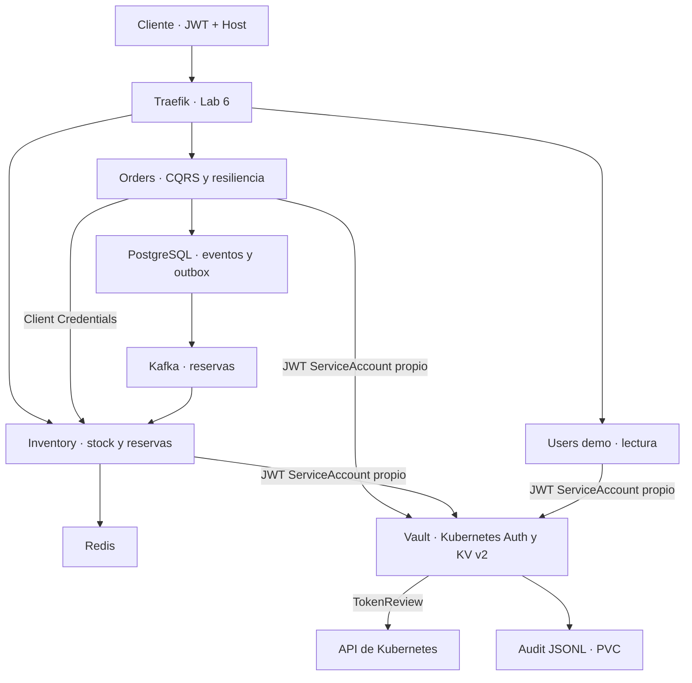

# Laboratorio 7 · Vault y gestión de secretos en microservicios Python

**Curso:** Microservicios Avanzado · **Complejidad:** alta · **Bloom:** aplicar.
**Duración guiada:** 66 minutos, con Lab 6 operativo e imágenes preparadas.
**Material:** solución acumulativa de los labs 1–6, código de integración, manifests, políticas y validaciones en el ZIP adjunto.

## Objetivos y resultado esperado

1. Desplegar Vault mediante Helm y utilizar KV v2.
2. Autenticar cada microservicio mediante su ServiceAccount de Kubernetes y limitar sus permisos.
3. Leer secretos con `hvac` e incorporarlos a las aplicaciones FastAPI existentes.
4. Renovar tokens y demostrar una rotación de secretos sin reiniciar los servicios.
5. Auditar accesos permitidos y rechazados, identificando el servicio responsable.



El JWT de Keycloak autoriza solicitudes a las APIs. El JWT proyectado de Kubernetes permite obtener un token de Vault. **Son identidades distintas y no se intercambian.** Se conservan UUID, `/api/v1`, importes Decimal, RS256/JWKS, roles/scopes, EventStore/CQRS, outbox, Kafka, Redis y las políticas del Gateway. Users continúa siendo un servicio de demostración; Keycloak administra las identidades.

## Qué se corrige del laboratorio original

| Problema | Corrección |
|---|---|
| Aplicaciones con token root de Vault | Login Kubernetes obligatorio; `VAULT_TOKEN` se rechaza en el proceso de aplicación. |
| Orders sustituido por pedidos simulados y hashes | Se mantiene el código acumulativo y la persistencia real. |
| Integración efectiva de un solo servicio | Identidad, política, lectura y rotación para los tres servicios. |
| Namespace `default`, nombres y credenciales incompatibles | Namespace `microservices`, mismos Deployments/Services y credenciales del Lab 6. |
| Caché global que podía devolver secretos de otra ruta | Un cliente por identidad y ruta; comprobaciones ACL directas contra Vault. |
| Renovación del token confundida con rotación de KV | Renovación según TTL y lectura periódica de KV independientes. |
| Configuración antigua retenida indefinidamente | Antigüedad máxima de 20 s; 403 o contenido inválido descartan la configuración inmediatamente. |
| Llamadas síncronas de hvac dentro del event loop | Bootstrap antes de arrancar ASGI; durante su ejecución, operaciones en `asyncio.to_thread`. |
| Credenciales o fragmentos de secretos en logs | Respuestas de estado sólo con versión, identidad, antigüedad y contadores. |
| Auditoría mezclada con logs operativos | Archivo JSONL, correlación request/response y reporte sin secretos. |
| Borrado del despliegue anterior antes de reemplazarlo | Actualización de los Deployments existentes y espera de readiness. |

## 0. Preparación previa

Usa el entorno Ubuntu/Bash del Lab 6: Python **3.12**, minikube **1.39.0**, Kubernetes **1.35.8**, kubectl **1.35**, Helm **3.20.1**, Traefik **3.7.14** y Keycloak **26.8.0**. Mantén PostgreSQL 16.3, Redis 7.2.5 y Kafka/Zookeeper Confluent 7.6.1. Reserva 6 CPU, 10 GiB para minikube y al menos 40 GB de disco; un host de 16 GiB es recomendable.

Esta revisión fija **Vault Community 2.1.2**, **chart 0.34.1** y **hvac 2.3.0**. El chart declara appVersion 2.0.4; el archivo de valores selecciona explícitamente la imagen 2.1.2. Se verificaron su renderizado y las operaciones de la integración contra el servidor 2.1.2. El chart se incluye con su SHA-256 contrastado con el índice oficial.

**Modo de enseñanza:** Vault dev, HTTP interno y credenciales ficticias. Su KV, políticas y configuración de auth están en memoria; **se pierden al reiniciar Vault**. Sólo la auditoría tiene PVC. El token `lab07-operator-only` sirve exclusivamente para configurar el laboratorio desde el pod de Vault. Este despliegue no representa una instalación de producción con TLS, Raft persistente, unseal y alta disponibilidad.

Desde la carpeta `microservices-lab` del ZIP:

```bash
python3.12 -m venv .venv312
source .venv312/bin/activate
python -m pip install -r order-service/requirements-dev.txt
python -m pip check
python scripts/preflight.py --auth
export PROFILE=msvc-gateway
export KUBE_CONTEXT=msvc-gateway
kubectl --context "$KUBE_CONTEXT" cluster-info
```

Python 3.13 no es el intérprete de esta práctica: se mantiene 3.12 para las dependencias acumulativas. No se necesita instalar la CLI de Vault en el host; los scripts ejecutan la CLI incluida en `vault-0`.

Si todavía no tienes el Lab 6 desplegado, sigue **LAB06.md** y ejecuta `bash scripts/lab06/deploy.sh` antes de este capítulo. No sustituyas los manifiestos de Lab 7 por los de Lab 6 después de migrar.

Conserva dos terminales abiertas para los port-forward:

```bash
# Terminal 1
kubectl --context msvc-gateway -n microservices port-forward service/keycloak 8080:8080
```

```bash
# Terminal 2
kubectl --context msvc-gateway -n traefik port-forward service/traefik 18080:80
```

Comprueba la base en una tercera terminal:

```bash
source .venv312/bin/activate
export PROFILE=msvc-gateway KUBE_CONTEXT=msvc-gateway
python scripts/lab06/validate_gateway.py
```

El resultado debe confirmar rutas, permisos y reserva Kafka/Redis. Si falla aquí, resuelve el Lab 6 antes de incorporar Vault.

## 1. Inspeccionar Helm y desplegar Vault · 8 minutos

```bash
(cd vendor && sha256sum -c vault-0.34.1.sha256)
helm lint vendor/vault-0.34.1.tgz -f k8s/lab07/vault-values.yaml
helm template vault vendor/vault-0.34.1.tgz \
  --namespace vault -f k8s/lab07/vault-values.yaml > /tmp/lab07-vault-rendered.yaml
kubectl --context "$KUBE_CONTEXT" create namespace vault --dry-run=client -o yaml \
  | kubectl --context "$KUBE_CONTEXT" apply -f -
helm upgrade --install vault vendor/vault-0.34.1.tgz \
  --namespace vault --kube-context "$KUBE_CONTEXT" \
  -f k8s/lab07/vault-values.yaml --wait --timeout=300s
kubectl --context "$KUBE_CONTEXT" -n vault rollout status statefulset/vault --timeout=300s
kubectl --context "$KUBE_CONTEXT" -n vault get pods,pvc,service
```

Verifica un `vault-0` Ready, PVC de auditoría Bound y servicio ClusterIP. No se publica Vault como NodePort ni a través de Traefik. El chart concede `system:auth-delegator` al ServiceAccount **vault**, que necesita consultar TokenReview.

## 2. Configurar KV v2, Kubernetes Auth y políticas · 12 minutos

```bash
bash scripts/lab07/bootstrap.sh
kubectl --context "$KUBE_CONTEXT" apply -f k8s/lab07/01-identities.yaml
```

El script comprueba que el motor `secret/` es KV v2, habilita Kubernetes Auth y configura:

```text
kubernetes_host = https://kubernetes.default.svc:443
disable_local_ca_jwt = false
```

Se utilizan el JWT y la CA locales del pod **Vault** para consultar la API de Kubernetes. No se usa la URL de minikube del host ni se concede TokenReview a los microservicios.

| Servicio y ServiceAccount | Namespace | Rol de Vault | Ruta KV permitida |
|---|---|---|---|
| `order-service` | `microservices` | `order-service` | `secret/data/order-service` |
| `inventory-service` | `microservices` | `inventory-service` | `secret/data/inventory-service` |
| `users-service` | `microservices` | `users-service` | `secret/data/users-service` |

Cada rol vincula nombre, namespace y audiencia **vault**. El token proyectado en `/var/run/secrets/vault/token` tiene `expirationSeconds: 600`; el kubelet lo rota. No se monta el token general de acceso a Kubernetes en las aplicaciones.

Ejemplo de política incluida en `vault/policies/order-service.hcl`:

```hcl
path "secret/data/order-service" { capabilities = ["read"] }
path "auth/token/lookup-self" { capabilities = ["read"] }
path "auth/token/renew-self" { capabilities = ["update"] }
path "auth/token/revoke-self" { capabilities = ["update"] }
```

Todo acceso no concedido se deniega. La aplicación no puede listar secretos, leer los de otro servicio ni escribir el suyo. El token inicial dura **60 s**, es renovable y tiene un máximo de **300 s**. No se añade la política default. Al llegar al máximo, el cliente debe autenticarse nuevamente y releer el JWT proyectado.

Bootstrap siembra datos sólo cuando no existen; repetirlo conserva las claves rotadas. Los valores son credenciales de demostración coherentes con la base anterior:

| Secreto | Uso |
|---|---|
| Orders: `database_url` | Crear el pool SQLAlchemy al arrancar. |
| Orders: `service_client_secret` | Client Credentials para consultar Inventory; proveedor de credencial actual consultado antes de reutilizar el access token. |
| Los tres: `admin_key` | Autorizar la actualización administrativa de configuración junto con JWT `ops:admin` / `ops.admin`. |
| Orders: la misma `admin_key` | Reconstrucción de proyecciones y reset del circuito interno. |

**La rotación guiada cambia `admin_key`.** Cambiar `database_url` en KV no recrea el pool PostgreSQL: esa credencial requiere reinicio controlado del servicio y coordinación con la base. Cambiar el secreto de Client Credentials exige actualizarlo también en Keycloak; la renovación de un token de Vault no realiza esa operación externa.

## 3. Incorporar hvac sin reemplazar la aplicación · 14 minutos

Revisa `shared/vault/client.py`, `application.py` y `launcher.py`:

1. El launcher autentica contra Vault con el JWT de ServiceAccount antes de importar `app.main`.
2. Lee el secreto y prepara la configuración inicial; Orders crea su pool y cliente OAuth con esos valores.
3. La aplicación incorpora un snapshot inmutable. El lector de configuración no espera el lock utilizado por las llamadas de red.
4. Una tarea lee KV cada **5 s** y renueva el token cuando ha transcurrido aproximadamente la mitad de su TTL. La relectura de KV no depende de que el token necesite renovación.
5. La configuración completa se reemplaza de forma atómica sólo después de validar las claves obligatorias.
6. Timeout de red de 2 s; errores de conectividad/5xx admiten el último snapshot válido hasta **20 s desde su última lectura correcta**. Después, `/health` y solicitudes de negocio devuelven 503.
7. Un acceso rechazado o una configuración inválida descarta el snapshot inmediatamente. No se utiliza un secreto antiguo para ocultar un 403.
8. Al terminar se detiene la tarea, se revoca el token propio y se cierra la sesión HTTP.

El launcher rechaza `VAULT_TOKEN`: no existe fallback al token del operador. Las operaciones hvac durante la ejecución ASGI se realizan en hilos; el bootstrap inicial ocurre antes de iniciar el servidor.

Despliega la integración:

```bash
bash scripts/lab07/deploy.sh
kubectl --context "$KUBE_CONTEXT" -n microservices get deployment,pods
```

Este comando reutiliza la instalación de Helm, comprueba bootstrap, construye las imágenes `:lab07`, aplica los ServiceAccounts y actualiza los **mismos tres Deployments**. Espera su readiness y después elimina del Secret de plataforma las tres claves de aplicación antiguas. Las credenciales de inicialización de PostgreSQL, migración y Keycloak siguen siendo configuración de infraestructura fuera de esta práctica.

No se borran Services ni datos. Los archivos históricos del Lab 6 permanecen en el ZIP para reproducir la base; los manifiestos activos de este capítulo están en `k8s/lab07`.

## 4. Comprobar identidad y mínimo privilegio · 8 minutos

```bash
bash scripts/lab07/check_acl.sh
kubectl --context "$KUBE_CONTEXT" auth can-i create tokenreviews.authentication.k8s.io \
  --as=system:serviceaccount:vault:vault
kubectl --context "$KUBE_CONTEXT" auth can-i create tokenreviews.authentication.k8s.io \
  --as=system:serviceaccount:microservices:order-service
```

Se esperan **yes** para Vault y **no** para Orders. `can-i` devuelve un código distinto de cero cuando la respuesta es no; aquí esa respuesta es el resultado esperado.

La sonda se ejecuta dentro de cada pod, usa su JWT proyectado y obtiene su propio token de Vault. Debe mostrar, para cada servicio:

```text
own read allowed; two foreign reads and own write denied
```

Las lecturas cruzadas se realizan directamente contra Vault; no pasan por la caché de la aplicación. Si una escritura o lectura cruzada se permite, el script falla con código distinto de cero.

## 5. Rotar claves y comprobar renovación · 14 minutos

Consulta el estado vía Gateway con un token de Keycloak para las audiencias y scopes de los tres servicios:

```bash
TOKEN=$(curl -fsS http://localhost:8080/realms/microservices-lab/protocol/openid-connect/token \
  -d grant_type=client_credentials -d client_id=lab-admin-client \
  -d client_secret=lab-admin-secret \
  --data-urlencode 'scope=orders.read orders.write inventory.read inventory.write ops.admin users.read' \
  | python -c 'import json,sys; print(json.load(sys.stdin)["access_token"])')

for recurso in orders products users; do
  curl -fsS "http://localhost:18080/api/v1/$recurso/config/status" \
    -H 'Host: microservices.local' -H "Authorization: Bearer $TOKEN"
  printf '\n'
done
```

El estado contiene `service`, `version`, `instance`, `age_seconds`, `logins` y `renewals`. No devuelve tokens, claves, contraseñas ni URLs de conexión.

Ejecuta la validación completa:

```bash
bash scripts/lab07/validate_all.sh
unset TOKEN
```

El script gira las **tres claves administrativas del laboratorio** a nuevos valores, conserva los demás campos KV y comprueba:

- Sin JWT: 401. Con token de sólo lectura: 403. Con JWT administrativo: estado accesible.
- La tarea adopta una versión superior en un máximo de 30 s, sin una llamada explícita a refresh que provoque la rotación.
- El valor anterior de `X-Admin-Key` recibe 403 y el nuevo permite `POST /api/v1/{orders|products|users}/config/refresh` con 200.
- Se conservan el identificador del proceso, el UID del pod y su contador de reinicios.
- Se observa al menos una renovación de token, separada de la actualización KV.
- El flujo acumulativo crea un producto con stock 20, crea un pedido por 2 unidades y espera stock 18 mediante Kafka/Redis.

La validación tarda aproximadamente 1–2 minutos y sale con error ante cualquier incumplimiento. Las claves quedan rotadas; repetir el script obtiene el valor vigente de Vault y vuelve a girarlo. No se imprimen las claves ni los access tokens. El rate limiter del Gateway continúa activo; el sondeo está espaciado para respetarlo.

## 6. Revisar auditoría · 6 minutos

```bash
kubectl --context "$KUBE_CONTEXT" -n vault exec vault-0 -- cat /vault/audit/audit.json \
  | python scripts/lab07/audit_report.py
```

Busca filas con el ServiceAccount, operación, ruta, decisión y cantidad:

```text
users-service | read | secret/data/users-service | allowed | ...
users-service | read | secret/data/order-service | denied-or-error | ...
```

Se correlacionan las entradas request y response por `request.id`. Una solicitud no emparejada se reporta como tal, sin suponer que se permitió. Las filas del operador se distinguen como `operator-or-unknown`; el reporte no calcula «tokens activos» a partir de solicitudes históricas.

Vault mantiene el HMAC predeterminado para valores sensibles. No se activa `log_raw`. La fuente es el archivo de auditoría, no `kubectl logs`; JSON inválido hace fallar el parser. La auditoría comienza cuando bootstrap habilita el dispositivo y no registra retroactivamente sus pasos anteriores.

**Distribución del tiempo:** 8 + 12 + 14 + 8 + 14 + 6 = 62 minutos; quedan 4 minutos para evidencias y discusión.

## Diagnóstico y recuperación

| Síntoma | Comprobación y solución |
|---|---|
| Bootstrap de la aplicación falla | Verifica rol, namespace, ServiceAccount, audience `vault`, token proyectado y KV con claves obligatorias. No agregues un token root a la aplicación. |
| Login Kubernetes devuelve 403 | Comprueba la relación rol/ServiceAccount y TokenReview del pod de Vault; revisa `https://kubernetes.default.svc:443` y la CA local. |
| Pod no lee el JWT | Confirma `fsGroup: 10001`, volumen `vault-jwt`, modo 0440 y montaje de sólo lectura. |
| 401 en la API | Comprueba issuer/audiencia y expiración del JWT de Keycloak. No uses el token de Vault como Bearer de la API. |
| 403 en refresh | Requiere `ops:admin`, scope `ops.admin` y la clave administrativa actualmente vigente. |
| 429 | Respeta la reposición del rate limiter. No atribuyas este código a la política de Vault. |
| 503 tras interrupción de Vault | La configuración tiene antigüedad máxima de 20 s. Restaura Vault; la tarea vuelve a autenticar y leer KV. |
| Orders no consulta Inventory | Confirma `service_client_secret=order-svc-secret-lab` en el estado inicial y su correspondencia con Keycloak; verifica PostgreSQL/Redis/Kafka antes de modificar el código. |
| PVC de auditoría Pending | Comprueba provisionador y StorageClass del perfil minikube. |

Si Vault dev se reinicia, vuelve a configurar su estado:

```bash
bash scripts/lab07/bootstrap.sh
```

Los servicios ya arrancados reintentan la autenticación. Los que estén en CrashLoopBackOff reintentan mediante el siguiente arranque. Bootstrap vuelve a sembrar las claves iniciales porque el KV se perdió; la auditoría anterior puede permanecer en el PVC y corresponde a otra ejecución de Vault. No se promete persistencia del secreto en modo dev.

Para recuperar sólo las aplicaciones cuando sea necesario:

```bash
for servicio in order-service inventory-service users-service; do
  kubectl --context "$KUBE_CONTEXT" -n microservices rollout restart "deployment/$servicio"
  kubectl --context "$KUBE_CONTEXT" -n microservices rollout status "deployment/$servicio" --timeout=300s
done
```

Este reinicio es recuperación, **no forma parte de la demostración de rotación sin reinicio**. No borres namespaces, PVC, Kafka ni PostgreSQL para solucionar un fallo de autenticación.

## Entregables y criterios de aceptación

Entrega el estado de los tres Deployments Ready, salida de la sonda ACL, validación de rotación con misma instancia/UID, contador de renovación y reporte de auditoría. No incluyas JWT, tokens de Vault ni valores de secretos.

La práctica aprueba cuando cada servicio sólo lee su ruta; los accesos cruzados y escrituras se rechazan; las claves nuevas se utilizan sin reinicio; los tokens se renuevan; el flujo de negocio acumulativo funciona y los accesos pueden atribuirse en auditoría.

Preguntas para discusión: ¿por qué renovar un token no actualiza KV? ¿Qué cambia al rotar una contraseña de PostgreSQL? ¿Qué papel tiene TokenReview? ¿Qué se pierde al reiniciar un Vault dev? ¿Por qué un 403 no debe ocultarse mediante una caché antigua?

## Verificación de esta revisión

Se ejecutaron **211 pruebas**: 119 de Orders, 57 de Inventory, 7 de Users y 28 de Vault/integración. Todas pasaron.

Las pruebas utilizaron Vault **2.1.2 real**, Keycloak **26.8.0 real**, PostgreSQL **16.3 real** y Redis **7.2.5 real**. Incluyen arranque real de los tres launchers, Client Credentials, creación de pedidos con precheck autenticado, reconstrucción de proyecciones con la clave rotada, ACL de KV y cambios de autorización sin reiniciar procesos.

El endpoint **TokenReview se sustituyó por un servidor de prueba que valida JWT firmados**: no es evidencia de RBAC, proyección/rotación del kubelet ni conectividad dentro de Kubernetes. Las pruebas locales de aplicaciones desactivaron Kafka; la validación en minikube comprueba la reserva real. Se renderizó y verificó Helm y se comprobaron los manifests. **No se ejecutó el despliegue completo de Docker/minikube en este entorno.**

Para repetir las pruebas nuevas con el binario Vault instalado:

```bash
export VAULT_TEST_BINARY=/ruta/absoluta/al/binario/vault
python -m pytest tests-vault -q
```

El servidor de prueba usa el puerto 18200 y se cierra al terminar. La prueba de stack completo requiere `KEYCLOAK_TEST_ISSUER`, `POSTGRES_TEST_ADMIN_URL` y `REDIS_TEST_URL`; utiliza una base temporal `lab07_vault_http_test`, la elimina al terminar y debe ejecutarse sólo sobre infraestructura de prueba. Sin estos endpoints, esa prueba se marca como omitida. Para los servicios, ejecuta sus suites desde cada carpeta con las variables de prueba documentadas en los labs anteriores.

## Referencias oficiales

- [Kubernetes Auth: validación y token local de Vault](https://developer.hashicorp.com/vault/docs/auth/kubernetes).
- [API de Kubernetes Auth y roles](https://developer.hashicorp.com/vault/api-docs/auth/kubernetes).
- [KV v2](https://developer.hashicorp.com/vault/docs/secrets/kv/kv-v2).
- [Dispositivos de auditoría y HMAC](https://developer.hashicorp.com/vault/docs/audit).
- [Esquema de auditoría y correlación](https://developer.hashicorp.com/vault/docs/audit/schema).
- [Repositorio del chart Helm](https://github.com/hashicorp/vault-helm) e [índice oficial](https://helm.releases.hashicorp.com/index.yaml).
- [hvac](https://hvac.readthedocs.io/en/stable/).
