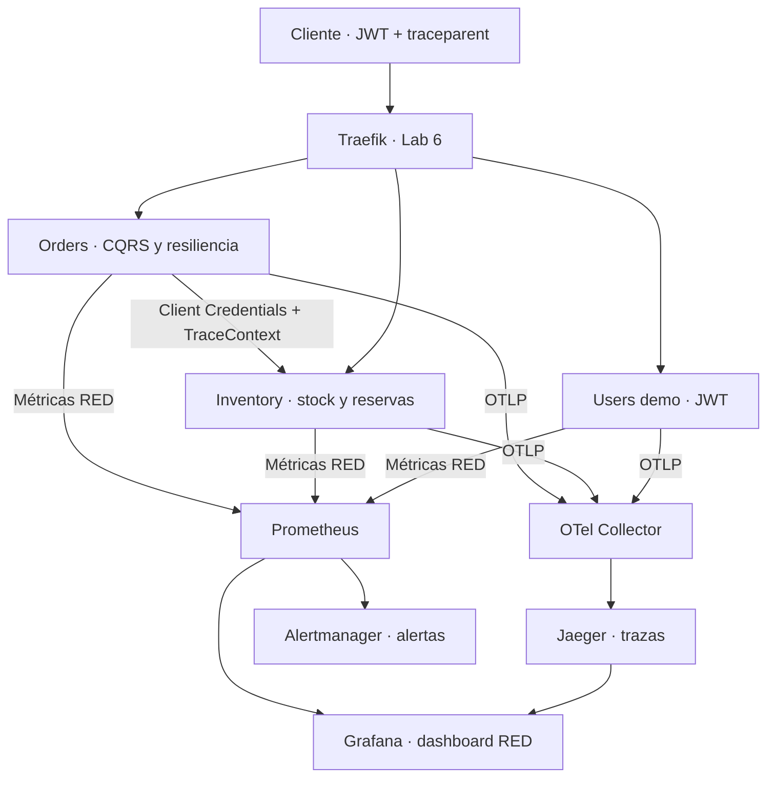

# Laboratorio 8 · Observabilidad de microservicios Python con OpenTelemetry

**Curso:** Microservicios Avanzado · **Complejidad:** alta · **Bloom:** aplicar.
**Duración guiada:** 66 minutos, con Lab 7 operativo, dependencias instaladas e imágenes preparadas.
**Continuidad:** solución acumulativa de los labs 1–7; guía, código, chart Helm y validaciones incluidos en el ZIP.

## Objetivos y resultado esperado

1. Desplegar Collector, Jaeger, Prometheus, Alertmanager y Grafana en namespaces dedicados.
2. Instrumentar FastAPI y generar trazas distribuidas con propagación W3C TraceContext.
3. Exponer métricas RED mediante prometheus-fastapi-instrumentator y visualizarlas en Grafana.
4. Emitir logs JSON con `trace_id` y `span_id`.
5. Configurar alertas de latencia p99 > 500 ms y errores 5xx > 1%, y comprobar su recepción en Alertmanager.



Vault sigue autenticando cada servicio con su ServiceAccount. Se conservan JWT de Keycloak, UUID, Decimal, EventStore/CQRS, outbox, Kafka, Redis, retries, bulkhead y circuit breakers. La observabilidad se añade a las aplicaciones existentes. Los logs JSON se consultan mediante `kubectl logs`; esta práctica no incorpora un backend adicional para almacenarlos.

## Correcciones del original

| Problema | Corrección |
|---|---|
| Encabezado rotulado como laboratorio 4 | Identificación como laboratorio 8. |
| Orders de ejemplo con persistencia simulada y paths incompatibles | Instrumentación del código acumulativo y su consulta real a Inventory. |
| Nuevo Deployment en `default` sin Vault/JWT/configuración previa | Actualización de los mismos Deployments en `microservices`, conservando identidad y secretos. |
| httpx instalado pero sin instrumentar | Instrumentación explícita del cliente HTTP real de Orders; propagación al hilo de resiliencia. |
| Callback de métricas vacío que elimina las métricas predeterminadas | Callback que registra contadores e histogramas reales, con registry por aplicación. |
| Consultas con `status_code` y `service` inexistentes | Etiquetas explícitas `service`, `method`, `handler`, `status` y consultas coherentes. |
| Scraping en namespace incorrecto y dirección formada sólo con el puerto | Targets DNS completos y servicios internos de métricas para los tres recursos. |
| Prueba que aprueba aunque falte la traza | Consulta del trace ID exacto y comprobación de servicios, spans y relación padre/hijo. |
| Webhook de Alertmanager apuntando a su propia API v1 | Envío Prometheus → Alertmanager, API v2 y receiver local sin notificaciones externas. |
| Charts sin versiones y valores incompatibles | Chart didáctico incluido, con cinco componentes e imágenes fijadas. |
| Validaciones que sólo comprueban Running o archivos | Readiness, trazas concretas, logs correlacionados, series RED, dashboard y alerta recibida. |

## 0. Preparación previa del instructor

Entorno Ubuntu/Bash del Lab 7: **Python 3.12**, minikube **1.39.0**, Kubernetes **1.35.8**, kubectl **1.35** y Helm **3.20.1**. Mantén el perfil/contexto `msvc-gateway`. Se recomienda asignar **8 CPU y 12 GiB a minikube**, con host de 24 GiB y 50 GB libres para el conjunto acumulativo. Un perfil de menor capacidad requiere comprobar previamente memoria y tiempos de arranque.

| Componente nuevo | Versión fijada |
|---|---|
| OpenTelemetry API / SDK / exporter OTLP gRPC | 1.45.1 |
| Instrumentación FastAPI / HTTPX | 0.66b1, pareja del SDK seleccionado |
| prometheus-fastapi-instrumentator | 7.0.0 |
| Collector contrib | 0.162.0 |
| Jaeger | 2.22.0 |
| Prometheus | 3.15.0 |
| Alertmanager | 0.34.1 |
| Grafana | 13.2.3 |
| Chart del laboratorio | `lab08-observability` 1.0.0 |

La instrumentación utiliza las APIs disponibles en FastAPI 0.111.0 y HTTPX 0.27.0. Se comprobó la instalación conjunta sin conflictos. Se sustituye Jaeger 1 por Jaeger 2 y su configuración basada en Collector. Las versiones del stack se obtuvieron de releases oficiales y se fijaron en el chart; no se resuelven durante la instalación.

Desde `microservices-lab`:

```bash
python3.12 -m venv .venv312
source .venv312/bin/activate
python -m pip install -r order-service/requirements-dev.txt
python -m pip check
python scripts/preflight.py --auth
export PROFILE=msvc-gateway KUBE_CONTEXT=msvc-gateway
kubectl --context "$KUBE_CONTEXT" cluster-info
helm lint observability/chart
```

Si partes de un clúster nuevo, reproduce **LAB06.md** y después **LAB07.md**. El ZIP contiene toda la solución acumulativa. Prepara las imágenes antes de clase; instalar paquetes y descargar el stack por primera vez puede exceder los 66 minutos.

Conserva los port-forward de Keycloak y Traefik del Lab 6:

```bash
# Terminal 1
kubectl --context msvc-gateway -n microservices port-forward service/keycloak 8080:8080
```

```bash
# Terminal 2
kubectl --context msvc-gateway -n traefik port-forward service/traefik 18080:80
```

Comprueba que los tres servicios están operativos y mantienen sus ACL:

```bash
bash scripts/lab07/check_acl.sh
python scripts/lab06/validate_gateway.py
```

Si Vault dev se reinició, ejecuta primero `bash scripts/lab07/bootstrap.sh` y espera que se recuperen las aplicaciones. KV/auth/policies de Vault dev están en memoria; la auditoría conserva su PVC.

## 1. Desplegar el stack con Helm · 10 minutos

El chart compacto está en `observability/chart`. Sus archivos de configuración se empaquetan junto con los Deployments y Services. Se utilizan `observability` para Collector/Jaeger y `monitoring` para Prometheus/Alertmanager/Grafana. Los recursos de negocio permanecen en `microservices`.

```bash
for namespace in observability monitoring; do
  kubectl --context "$KUBE_CONTEXT" create namespace "$namespace" --dry-run=client -o yaml \
    | kubectl --context "$KUBE_CONTEXT" apply -f -
done
helm template lab08-observability observability/chart -n observability > /tmp/lab08-stack.yaml
helm upgrade --install lab08-observability observability/chart \
  --namespace observability --kube-context "$KUBE_CONTEXT" --wait --timeout=300s
kubectl --context "$KUBE_CONTEXT" -n observability get deployments,pods,services
kubectl --context "$KUBE_CONTEXT" -n monitoring get deployments,pods,services,pvc
```

Espera Collector y Jaeger Ready, y Prometheus, Alertmanager y Grafana Ready. Los probes usan HTTP; la verificación no depende de `wget` dentro de imágenes que podrían carecer de shell/herramientas.

| Servicio | Namespace | Puerto y función |
|---|---|---|
| `otel-collector` | observability | 4317 OTLP gRPC, 4318 OTLP HTTP, 13133 health |
| `jaeger` | observability | 4317/4318 ingestión OTLP, 16686 UI/API, 13133 health |
| `prometheus` | monitoring | 9090 consultas y UI |
| `alertmanager` | monitoring | 9093 UI/API v2 |
| `grafana` | monitoring | 3000 dashboard |

El Collector recibe **trazas**, aplica `memory_limiter` antes de `batch` y exporta OTLP a Jaeger. Las métricas RED se scrapean directamente desde las APIs. Esta elección evita contabilizar dos veces las mismas solicitudes mediante dos pipelines de métricas.

Jaeger usa memoria acotada a 10 000 trazas: sus datos se pierden al reiniciar. Prometheus dispone de PVC de 2 GiB y retención de dos días. Grafana usa almacenamiento temporal y reproduce sus datasources/dashboard desde ConfigMap; Alertmanager usa almacenamiento temporal. Es un entorno de enseñanza, sin HA ni almacenamiento de trazas de producción.

## 2. Revisar e integrar tracing y logs · 12 minutos

La implementación se encuentra en `shared/observability`:

| Archivo | Responsabilidad |
|---|---|
| `application.py` | Resource, provider, exporter OTLP, FastAPI/HTTPX, métricas y cierre. |
| `context.py` | Contexto por solicitud y spans de negocio. |
| `logging.py` | Middleware ASGI y formatter JSON de eventos de solicitud. |

El launcher del Lab 7 primero lee Vault y crea la aplicación con sus secretos. Cuando `OBSERVABILITY_ENABLED=true`, instala la observabilidad antes de arrancar Uvicorn. Sigue usando un worker y una réplica por servicio.

El Resource identifica `service.name`, `service.version`, `service.instance.id` y `deployment.environment.name`. Cada aplicación recibe un provider y registry propios; los factories de pruebas no comparten contadores accidentalmente. El sampling del laboratorio es parent-based con raíz always-on. El generador utiliza un `traceparent` sampled para poder encontrar su traza.

Se instrumenta FastAPI y **el cliente HTTPX que consulta Inventory**. `asyncio.to_thread` conserva el contexto de la solicitud; el span cliente creado en el hilo propaga W3C `traceparent` a Inventory. Instalar httpx o instrumentar sólo FastAPI no logra esa propagación por sí solo.

Se añaden dos spans manuales a operaciones existentes:

- `inventory.check`: abarca la comprobación de stock, retries y fallback observados.
- `orders.persist`: abarca la escritura real de eventos; el contador de pedidos se incrementa después de completarla.

El resultado esperado es un span servidor de Orders, un span de comprobación, un span HTTP cliente, el span servidor de Inventory y un span de persistencia bajo el **mismo trace ID**. La relación padre/hijo demuestra causalidad, no sólo coincidencia de identificadores.

Los logs de solicitud contienen exclusivamente:

```json
{
  "timestamp": "2026-10-08T20:00:00+00:00",
  "level": "INFO",
  "event": "http_request_completed",
  "service": "order-service",
  "method": "POST",
  "route": "/api/v1/orders",
  "status": 201,
  "trace_id": "4bf92f3577b34da6a3ce929d0e0e4736",
  "span_id": "00f067aa0ba902b7"
}
```

Este ejemplo ilustra el formato, no una evidencia de ejecución. Las rutas son plantillas; cuerpos, headers, query strings, claves administrativas y tokens no se incorporan al log de solicitud. No se reemplazan los handlers globales de logging. Uvicorn y las bibliotecas pueden emitir sus propios logs operativos además de estos eventos JSON.

El Collector recibe spans en batch; al terminar el proceso se cierra el provider y se intenta vaciar la cola. La exportación es asíncrona y acotada. La observabilidad no garantiza entrega sin pérdidas ante saturación o indisponibilidad prolongada del backend.

## 3. Exponer métricas RED y mantener Vault · 8 minutos

Se utiliza prometheus-fastapi-instrumentator con un callback que registra:

| Métrica | Etiquetas |
|---|---|
| `http_requests_total` | `service`, `method`, `handler`, `status` |
| `http_request_duration_seconds_bucket` | `service`, `method`, `handler`, `le` |
| `business_orders_created_total` | `service` |

El histograma contiene buckets de 5 ms a 10 s e incluye **0.5 s**, alineado con el umbral de latencia. Se excluyen `/health` y `/metrics`. Las rutas parametrizadas se normalizan como `/api/v1/orders/{order_id}`; las rutas desconocidas se agrupan, evitando una serie nueva por UUID o URL arbitraria.

Prometheus añade `job` e `instance` durante scraping. El chart crea `order-service-metrics`, `inventory-service-metrics` y `users-service-metrics` con DNS completo y puerto correcto. Esos servicios publican también pods no Ready para observar una aplicación que sigue ejecutándose pero perdió una dependencia. `/metrics` puede responder cuando Vault está temporalmente indisponible; las solicitudes de negocio siguen sujetas al control de configuración del Lab 7.

Los endpoints de métricas son internos y no se publican por las rutas de Traefik. En esta práctica hay una réplica por API. Escalar exige descubrimiento de targets por pod y considerar cada instancia; el scraping estático de un Service no representa correctamente varias réplicas.

Despliega las imágenes instrumentadas:

```bash
bash scripts/lab08/deploy.sh
kubectl --context "$KUBE_CONTEXT" -n microservices get pods
```

El script recupera/configura Vault dev, mantiene sus secretos vigentes, instala el stack y actualiza los mismos Deployments a `:lab08`. Conserva ServiceAccounts, JWT proyectado, políticas, launcher de Vault y variables de negocio. La instrumentación no instala un token root en las aplicaciones.

## 4. Verificar trazas y logs del flujo real · 12 minutos

Abre un port-forward en cada terminal adicional:

```bash
kubectl --context msvc-gateway -n observability port-forward service/jaeger 16686:16686
```

```bash
kubectl --context msvc-gateway -n monitoring port-forward service/prometheus 9090:9090
```

```bash
kubectl --context msvc-gateway -n monitoring port-forward service/alertmanager 9093:9093
```

```bash
kubectl --context msvc-gateway -n monitoring port-forward service/grafana 3000:3000
```

Desde la raíz del proyecto y con el entorno Python activo:

```bash
python scripts/lab08/test_trace.py
python scripts/lab08/validate_logs.py
```

La primera prueba obtiene un JWT administrativo, crea un producto con stock 20 y un pedido de 2 unidades por 10.00, exige respuesta 201 y precheck verificado. Envía un trace ID aleatorio en `traceparent` y consulta **esa traza concreta** en Jaeger durante un máximo de 45 s. Exige Orders e Inventory, los dos spans manuales y la relación HTTP cliente/servidor.

Se guarda únicamente el identificador de evidencia en `lab08-trace-id.txt`. La segunda prueba busca el mismo ID en los logs JSON de ambos servicios, exige `span_id` válido y rechaza campos inesperados. Faltas de propagación o evidencia hacen fallar los scripts. No se asume que FastAPI devuelve `traceparent` como header de respuesta.

Abre Jaeger en [http://localhost:16686](http://localhost:16686) y consulta el ID guardado. Ubica `inventory.check`, la llamada HTTP hacia Inventory y `orders.persist`. El tracing de esta práctica demuestra el tramo **HTTP Orders → Inventory**; no incluye propagación de contexto a través de mensajes Kafka ni spans automáticos de cada consulta SQL.

## 5. Consultar RED y visualizar Grafana · 8 minutos

```bash
python scripts/lab08/generate_traffic.py --seconds 30
python scripts/lab08/validate_backends.py
```

El tráfico saludable pasa por Traefik con JWT y consulta los tres recursos con pausas para respetar el rate limiter. La validación espera tres targets UP y series finitas para los tres servicios, sin aceptar una respuesta vacía como éxito.

En [Prometheus](http://localhost:9090), consulta:

```promql
lab:http_request_rate:5m
```

```promql
lab:http_error_ratio:5m
```

```promql
lab:http_latency_p99:5m
```

Las recording rules usan una ventana de 5 minutos. El ratio considera **5xx / solicitudes instrumentadas**; 4xx no se clasifican como fallos del servidor. Si todavía no existe una serie 5xx, se construye un cero a partir del denominador. Sin tráfico suficiente, la latencia puede ser NaN; genera solicitudes y espera al menos dos scrapes. Un panel vacío no demuestra cumplimiento del SLO.

En [Grafana](http://localhost:3000), usa `admin` / `lab08-grafana-demo`, credenciales ficticias guardadas en el Secret `lab08-grafana-admin`. Abre **Microservices → Lab08 · Microservices RED**. Debes ver tres paneles: solicitudes/s, proporción de errores y p99 en segundos. Los datasources tienen UID `prometheus` y `jaeger`, referenciados explícitamente por el dashboard.

## 6. Comprobar alertas y distinguir SLO de prueba de transporte · 10 minutos

El archivo `observability/chart/files/rules.yaml` es la fuente de reglas:

| Alerta | Condición | Duración |
|---|---|---|
| `HighLatencyP99` | p99 en ventana de 5 min > 0.5 s | 2 min |
| `HighErrorRate` | ratio 5xx > 0.01 con tráfico positivo | 5 min |
| `MicroserviceMetricsUnavailable` | target de microservicio con `up == 0` | 1 min |

Estas son alertas de umbral sobre SLIs asociados a los objetivos de latencia y errores. No calculan cumplimiento mensual ni burn rate de un presupuesto de errores. Conserva los tiempos reales al interpretar pending/firing.

El flujo es **Prometheus evalúa → envía alertas → Alertmanager agrupa y muestra**. El receiver `lab-ui` no envía correos, mensajes ni webhooks externos.

Comprueba el transporte en pocos minutos:

```bash
python scripts/lab08/test_alert.py
```

El script instala temporalmente una regla separada `Lab08PipelineTest`, espera su proyección en el pod, recarga Prometheus y exige encontrarla en `/api/v2/alerts` de Alertmanager. Finalmente restaura `groups: []` y comprueba que la regla desaparece de Prometheus. La alerta recibida puede permanecer un tiempo como resuelta/expirada. Esta prueba no modifica los umbrales ni los `for` de las alertas SLO.

Para comprobar sus expresiones y tiempos con datos reproducibles, usa el `promtool` de la imagen fijada:

```bash
docker run --rm --entrypoint /bin/promtool \
  -v "$PWD/observability:/work:ro" -w /work/tests \
  prom/prometheus:v3.15.0 test rules rules-test.yaml
```

Las cuatro situaciones verifican tráfico saludable sin series 5xx, errores sostenidos y espera de cinco minutos, latencia alta y espera de dos minutos, y ausencia de tráfico sin una falsa alerta de error.

**Extensión opcional dentro de clase:** provocar los umbrales sobre el servicio demo. Abre otro port-forward:

```bash
kubectl --context msvc-gateway -n microservices port-forward service/users-service 8003:8003
```

```bash
python scripts/lab08/generate_traffic.py --fault --seconds 330
```

Se usa un endpoint de demostración protegido por JWT, `GET /api/v1/users/observability/probe`: espera 750 ms y devuelve 500 en uno de cada cinco ciclos. Se accede directamente para observar el backend sin que el rate limiter/circuit breaker del Gateway impida la generación controlada. Los SLIs de servicio incluyen estas solicitudes.

Durante la ejecución observa pending → firing en Prometheus y la recepción en Alertmanager. La demora depende del scrape, evaluación y ventana. Terminar el generador detiene el fallo; los datos de los últimos cinco minutos pueden mantener las alertas activas hasta que salgan de la ventana. Esta extensión ocupa parte del tiempo de observación, no requiere sustituir la lógica de negocio.

## Validación integral y evidencias

Con los seis port-forward necesarios activos — Keycloak, Traefik, Jaeger, Prometheus, Alertmanager y Grafana — ejecuta:

```bash
bash scripts/lab08/validate_all.sh
```

Debe comprobar readiness, ACL de Vault, traza exacta, logs correlacionados, tráfico/RED, dashboard/datasources provisionados, alerta recibida y el flujo acumulativo de reserva Kafka/Redis. Un fallo produce un código de salida distinto de cero.

Entrega: trace ID y vista de la traza, logs JSON de Orders/Inventory con ese ID, tres targets UP, paneles RED y evidencia de alerta en Alertmanager. Los tokens y secretos quedan fuera de las evidencias.

**Distribución guiada:** 10 + 12 + 8 + 12 + 8 + 10 = 60 minutos; quedan 6 minutos para evidencias y discusión. La preparación de imágenes y del Lab 7 ocurre antes de la sesión.

## Diagnóstico y pausa

| Síntoma | Comprobación |
|---|---|
| Vault perdió KV tras reiniciar | Ejecuta `scripts/lab07/bootstrap.sh`; espera recuperación de los servicios. |
| Traces no llegan a Jaeger | Comprueba `OBSERVABILITY_ENABLED`, endpoint OTLP 4317, pipeline traces del Collector y exporter OTLP hacia Jaeger. |
| Sólo aparece Orders | Revisa instrumentación del cliente HTTPX y el contexto del hilo; no basta con instrumentar FastAPI. |
| ID no aparece en respuesta | La prueba utiliza Jaeger y los logs; no depende de un header de respuesta opcional. |
| `/metrics` existe pero faltan RED | Verifica que el callback registra métricas y que se consulta la aplicación instrumentada. |
| Target DOWN | Comprueba puerto, DNS `*-metrics`, contenedor ejecutándose y acceso a `/metrics`. |
| Panel sin series | Genera tráfico, espera dos scrapes, comprueba etiquetas `status/service` y usa la recording rule correcta. |
| 401/403 al generar tráfico | Comprueba JWT, audiencia y roles/scopes; el token de Vault no autoriza APIs. |
| 429 o circuito del Gateway abierto | Reduce tráfico o usa el probe directo para la demostración controlada. |
| Alerta pending | Espera el `for` real; revisar la existencia de la regla no prueba que haya disparado. |
| Alertmanager vacío | Verifica `alerting.alertmanagers` en Prometheus y su URL interna 9093. |
| Dashboard sin datos | Comprueba datasource UID, conectividad Grafana → Prometheus y series de las reglas. |
| Recursos Pending/OOMKilled | Revisa CPU/memoria del perfil, requests/limits y PVC de Prometheus. |

Para pausar conservando imágenes y datos del perfil:

```bash
minikube -p msvc-gateway stop
```

Al retomar, inicia el perfil, recupera Vault dev, espera readiness y vuelve a abrir los port-forward. La pausa/reanudación puede perder trazas de Jaeger y estado temporal de Grafana/Alertmanager. La provisión reproduce el dashboard. El PVC de Prometheus está marcado `helm.sh/resource-policy: keep`; su eliminación explícita queda a cargo del instructor cuando termine el curso.

Preguntas de cierre: ¿por qué no basta con ver pods Running? ¿Qué añade el span cliente a una traza? ¿Por qué una serie por UUID es un problema? ¿Qué diferencia hay entre una alerta recibida y un SLO incumplido? ¿Cómo se interpreta un panel sin tráfico?

## Verificación de esta entrega y límites

Se aprobaron **218 pruebas Python**: 119 de Orders, 57 de Inventory, 7 de Users y 35 de Vault/instrumentación/integración. Además, **cuatro escenarios de promtool** comprobaron reglas y duraciones. La instalación pasó `pip check`; Helm pasó lint/render y se validaron **27 objetos de Kubernetes**, junto con sintaxis Python/Bash.

La integración utilizó Vault, Keycloak, PostgreSQL, Redis, Prometheus y Alertmanager **reales**. Verificó el arranque de los tres launchers, autenticación y rotación del Lab 7, pedido persistido, consulta autenticada a Inventory, logs correlacionados y spans exportados por la red en formato OTLP. El receptor OTLP de esa prueba fue un servidor de prueba, no el Collector. También se probó el envío de una alerta de Prometheus a Alertmanager.

Se validaron las configuraciones con los binarios reales Collector 0.162.0 y Jaeger 2.22.0. **Una prueba del stack completo quedó omitida** porque el entorno impide funciones de proceso/IPC necesarias para ejecutar Collector/Jaeger y plugins de Grafana. No se presenta como probado el flujo Collector → Jaeger ni la visualización efectiva del dashboard de Grafana en este entorno.

TokenReview continúa siendo un sustituto de prueba que valida JWT firmados; las pruebas locales desactivan Kafka. **No se ejecutó Docker/minikube aquí.** La validación integral incluida debe comprobar en el entorno del alumno proyección de ServiceAccounts/RBAC, reserva Kafka/Redis, recepción en Jaeger y dashboard operativo.

Pruebas de instrumentación independientes del clúster:

```bash
python -m pytest tests-observability -q
```

Las suites de integración usan infraestructura de prueba y variables `VAULT_TEST_BINARY`, `KEYCLOAK_TEST_ISSUER`, `POSTGRES_TEST_ADMIN_URL`, `REDIS_TEST_URL` y `OBS_TEST_TOOLS`. Esta última identifica el directorio de binarios descrito en las fixtures; no es necesaria para realizar el laboratorio en Kubernetes. La base temporal `lab07_vault_http_test` se crea y elimina durante pruebas de stack. Sin herramientas/endpoints, los casos correspondientes se omiten.

## Referencias oficiales

- [Instrumentación manual de OpenTelemetry Python](https://opentelemetry.io/docs/languages/python/instrumentation/).
- [Instrumentación FastAPI](https://opentelemetry-python-contrib.readthedocs.io/en/latest/instrumentation/fastapi/fastapi.html) y [HTTPX](https://opentelemetry-python-contrib.readthedocs.io/en/latest/instrumentation/httpx/httpx.html).
- [prometheus-fastapi-instrumentator](https://github.com/trallnag/prometheus-fastapi-instrumentator).
- [Releases Collector](https://github.com/open-telemetry/opentelemetry-collector-releases/releases) y [Jaeger](https://github.com/jaegertracing/jaeger/releases).
- [Configuración Jaeger](https://www.jaegertracing.io/docs/2.21/deployment/configuration/).
- [Alerting rules](https://prometheus.io/docs/prometheus/latest/configuration/alerting_rules/) y [pruebas de reglas](https://prometheus.io/docs/prometheus/latest/configuration/unit_testing_rules/).
- [Configuración Alertmanager](https://prometheus.io/docs/alerting/latest/configuration/).
- [Provisioning de Grafana](https://grafana.com/docs/grafana/latest/administration/provisioning/).
- [W3C Trace Context](https://www.w3.org/TR/trace-context/).
