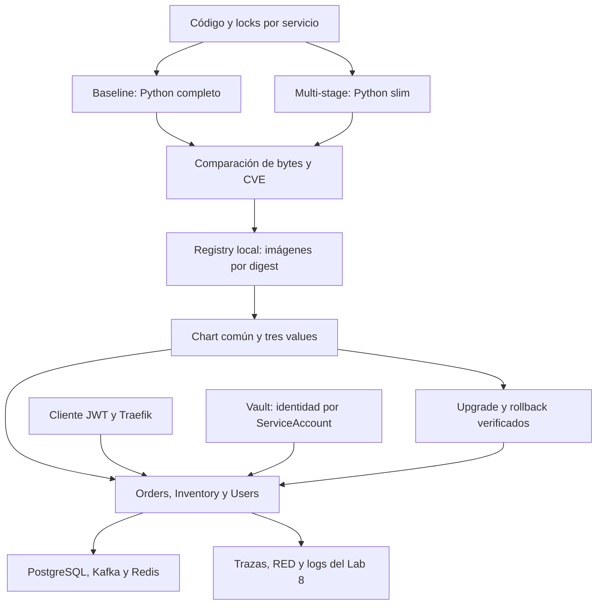

# Laboratorio 9 · Imágenes optimizadas y despliegues con Helm

| Campo | Valor |
|---|---|
| Curso | Microservicios Avanzado |
| Duración | 66 minutos guiados, con herramientas, clúster y descargas preparados; reserva 30–60 minutos adicionales para la primera preparación |
| Complejidad | Media–alta por la integración acumulativa |
| Nivel Bloom | Crear |
| Base | Laboratorios 1–8 corregidos; Lab 8 funcionando en `msvc-gateway` |
| Entorno de referencia | Ubuntu/WSL2, Bash, Python 3.12 y un nodo minikube |

## Resultado esperado

Empaquetarás los **servicios reales del curso**, compararás imágenes equivalentes, revisarás CVE y administrarás sus despliegues con un chart reutilizable. Se mantienen Orders, Inventory y Users, con autenticación, CQRS/event store, Kafka, resiliencia, Vault y observabilidad. Traefik continúa siendo el gateway.



El proceso tiene dos versiones didácticas: **9.0.0**, con las dependencias heredadas, y **9.1.0**, con una remediación concreta. El código de negocio es el mismo: la segunda versión actualiza dependencias y metadatos de release. No cambiaremos las respuestas de los endpoints para simular una funcionalidad inexistente.

## Objetivos de aprendizaje

- [ ] Construir imágenes con multi-stage, usuario no root, contexto controlado y caché; **medir una reducción ≥40% por servicio** respecto de una baseline equivalente.
- [ ] Escanear imágenes con Trivy, identificar CVE, aplicar una remediación y contrastar resultados.
- [ ] Crear y examinar un chart parametrizado reutilizable para los tres microservicios.
- [ ] Publicar imágenes en el registry local de minikube y verificar que el runtime del nodo puede descargarlas.
- [ ] Desplegar con values por servicio y demostrar upgrade/rollback con historial, digest, configuración y pods Ready.

## Qué se corrigió del original

| Problema | Corrección |
|---|---|
| Cabecera “laboratorio 4” | Numeración y continuidad del Lab 9 |
| Reescribe las aplicaciones como mocks y crea `gateway-service` | Conserva el código acumulado y `users-service`; Traefik sigue siendo el gateway |
| Namespace y nombres de recursos distintos | `microservices`, nombres y selectores originales; no se rompen rutas, scraping ni roles Vault |
| Build desde la carpeta del servicio | Contexto raíz para incluir `shared/`, aplicaciones y migraciones de Orders |
| UID 1000 y arranque directo de Uvicorn | UID/GID 10001 y launcher Vault; JWT proyectado con audiencia `vault` |
| `COPY . .`, paquetes y archivos innecesarios | Copias explícitas, ignores aplicados al contexto y wheels disponibles únicamente durante la instalación |
| Tamaños y CVE de ejemplo tratados como resultados | JSON real, cálculo en bytes, umbral que falla y recuento por paquete/CVE |
| Mezcla `docker-env` con un port-forward del host | Docker construye en el host; Skopeo publica por HTTP desde el host; kubelet usa el endpoint del nodo |
| Helm intenta crear recursos ya existentes | Preflight, captura de estado y adopción limitada a Deployment, Service y ServiceAccount de cada app |
| Rollback fijo a revisión 1 | Captura la revisión actualmente desplegada y comprueba la restauración completa de values |

## Materiales

El ZIP contiene `microservices-lab/`, la solución acumulativa, `LAB09.md`, los Dockerfiles, locks, chart, values, scripts y pruebas. Trabaja desde la raíz del proyecto. Conserva los datos del clúster del Lab 8; no crees otro proyecto mínimo ni elimines el perfil.

| Ruta | Uso |
|---|---|
| `{servicio}/Dockerfile.baseline` | Python completo, misma aplicación y lock que la optimizada en cada comparación |
| `{servicio}/Dockerfile` | Builder de wheels y runtime slim |
| `{servicio}/requirements-baseline*.txt` | Dependencias heredadas: exclusivamente para la comparación 9.0.0 |
| `{servicio}/requirements.txt`, `requirements-lock.txt` | Dependencias corregidas y resolución exacta de la versión 9.1.0 |
| `.dockerignore`, `{servicio}/Dockerfile*.dockerignore` | Excluir caches, entornos, tests, claves y archivos ajenos al runtime |
| `helm/msvc-chart/` | Chart reutilizable y esquema de values |
| `helm/values/{servicio}.yaml` | Configuración acumulativa de cada app |
| `scripts/lab09/` | Construcción, análisis, publicación, adopción y verificación |
| `reports/lab09/dependency-review/` | Análisis Python antes/después realizado durante esta revisión |

Los locks se resolvieron para Python 3.12/Linux usando wheels. Las dependencias de pruebas no se incluyen en las imágenes. El laboratorio mantiene Python **3.12**: no mezcles estos locks con Python 3.13, donde el `pydantic-core` de la baseline antigua carece del wheel requerido.

## Preparación previa

Utiliza las versiones ya instaladas en el Lab 8: minikube **1.39.0**, Kubernetes **1.35.8** y Helm **3.20.1**. Este laboratorio añade **Trivy 0.75.0**, Docker con BuildKit y Skopeo. La ruta principal usa Ubuntu/WSL2 con Docker Engine accesible en la misma distribución. En Windows usa Bash dentro de WSL2; no copies `eval` a PowerShell.

```bash
cd ~/microservices-lab  # o la carpeta real extraída del ZIP
export PROFILE=msvc-gateway
export KUBE_CONTEXT=msvc-gateway
export PYTHON_BIN=python3
export PATH="$HOME/.local/bin:$PATH"

python3 --version
python3 -c "import yaml; print('PyYAML disponible para los verificadores')"
minikube -p "$PROFILE" status
kubectl --context "$KUBE_CONTEXT" get nodes
kubectl --context "$KUBE_CONTEXT" -n microservices get deploy,svc,sa
helm --kube-context "$KUBE_CONTEXT" list -A
```

**Debe existir el Lab 8 operativo**, con los tres servicios, PostgreSQL, Kafka, Redis, Keycloak, Traefik, Vault y el stack de observabilidad. Mantén suficiente memoria y espacio para dos familias de imágenes y sus archivos; la baseline completa ocupa bastante más que el runtime slim.

Si anteriormente activaste el daemon Docker interno de minikube, desactívalo antes de construir en el host:

```bash
eval "$(minikube -p "$PROFILE" docker-env -u)"
docker info >/dev/null
docker buildx version

# En Ubuntu/WSL2; instala únicamente si faltan estas herramientas.
sudo apt-get update
sudo apt-get install -y skopeo curl
skopeo --version
bash scripts/lab09/install-trivy.sh
trivy --version
```

El instalador fija Trivy 0.75.0 y verifica el SHA-256 del archivo oficial. No necesita Rust ni compilar dependencias Python. Antes de continuar, ejecuta las verificaciones funcionales del Lab 8 con sus port-forward; si no pasan, corrige el entorno antes de atribuir la falla al empaquetado.

## Paso 1 · Examinar las imágenes equivalentes

**Tiempo guiado: 8 minutos.** No sobrescribas `app/main.py` ni `requirements.txt` con los ejemplos del original.

Para cada servicio se construyen dos imágenes con **la misma versión de Python, Debian Bookworm, aplicación y lock**. La diferencia principal de tamaño provendrá de Python completo frente a slim y de los artefactos excluidos. Multi-stage aporta separación y caché; no prometemos que por sí solo produzca una reducción del 40%.

Ejemplo del Dockerfile optimizado de Orders incluido en los materiales:

```dockerfile
# syntax=docker/dockerfile:1
ARG BASE_IMAGE=python:3.12.14-slim-bookworm
FROM $BASE_IMAGE AS builder
WORKDIR /build
ARG REQUIREMENTS_LOCK=requirements-lock.txt
COPY order-service/${REQUIREMENTS_LOCK} ./requirements-lock.txt
RUN --mount=type=cache,target=/root/.cache/pip python -m pip wheel --only-binary=:all: --wheel-dir=/wheels -r requirements-lock.txt

FROM $BASE_IMAGE AS runtime
COPY --from=builder /build/requirements-lock.txt /tmp/requirements-lock.txt
RUN --mount=type=bind,from=builder,source=/wheels,target=/wheels python -m pip install --no-cache-dir --no-index --find-links=/wheels -r /tmp/requirements-lock.txt && python -m pip check && rm -f /tmp/requirements-lock.txt
ENV PYTHONDONTWRITEBYTECODE=1 PYTHONUNBUFFERED=1 PYTHONFAULTHANDLER=1
ARG APP_VERSION=9.1.0
ENV APP_VERSION=$APP_VERSION
LABEL org.opencontainers.image.title="order-service" org.opencontainers.image.version="$APP_VERSION"
RUN groupadd --gid 10001 appgroup && useradd --uid 10001 --gid 10001 --no-create-home appuser
WORKDIR /app
COPY shared/ ./shared/
COPY order-service/app/ ./app/
COPY order-service/alembic/ ./alembic/
COPY order-service/alembic.ini ./
USER 10001:10001
EXPOSE 8001
CMD ["python", "-m", "shared.vault.launcher", "--port", "8001"]
```

El bind mount de BuildKit evita añadir el directorio de wheels como una capa permanente. El builder tampoco necesita compiladores: `--only-binary=:all:` falla explícitamente si el entorno no tiene un wheel compatible. La configuración y los secretos de Vault se obtienen al arrancar en Kubernetes; no se incorporan a las imágenes. Tampoco se copian scripts del operador a Orders.

Los Dockerfiles de Inventory y Users siguen el mismo patrón con sus aplicaciones y puertos. El cache de dependencias se conserva si cambia únicamente el código. Kubernetes usa `startupProbe` y `readinessProbe`; no instalamos `curl` dentro del runtime para repetir esas comprobaciones.

## Paso 2 · Construir y medir

**Tiempo guiado: 10 minutos, con bases y wheels disponibles.**

```bash
VERSION=9.0.0 bash scripts/lab09/build.sh
python3 -m json.tool reports/lab09/9.0.0/sizes-summary.json
```

El script descarga las bases, obtiene sus digests y construye seis imágenes desde **`.`**. Selecciona `requirements-baseline-lock.txt` para ambas imágenes 9.0.0. Registra tamaños de `docker image inspect`, ID/configuración, hash del lock, bases por digest y archivos Docker para el análisis y publicación.

La comprobación es:

```text
reducción (%) = 100 × (bytes_baseline − bytes_optimizada) / bytes_baseline
```

**Criterio:** `passes_40_percent: true` en los tres servicios. Si no se cumple, el script termina con error y deja la evidencia para analizar capas. No apruebes una fila por ver “MB” o por copiar una cifra esperada. El tamaño corresponde a la imagen local sin comprimir, no a bytes transferidos al registry.

Además, cada imagen optimizada debe ejecutar Python como UID 10001 e importar el launcher. Este smoke test comprueba empaquetado; el arranque completo requiere Vault, identidad Kubernetes y los backends. Por eso no se propone arrancar el contenedor aislado y declarar que todo el sistema funciona.

Los tags locales incluyen versión y no se sobrescriben. Si deseas reconstruir tras un cambio, asigna una nueva versión. Para repetir el análisis o la publicación, reutiliza los archivos ya construidos.

## Paso 3 · Trivy y remediación real

**Tiempo guiado: 10 minutos, con la base de vulnerabilidades disponible.**

```bash
VERSION=9.0.0 bash scripts/lab09/scan.sh
python3 -m json.tool reports/lab09/9.0.0/cves-summary.json
```

El escaneo usa los archivos Docker guardados, por lo que no depende del daemon que Trivy encuentre. Actualiza la base una vez y usa `--skip-db-update` en las seis imágenes. Conserva el JSON completo y calcula HIGH/CRITICAL por destino, paquete, versión instalada e identificador; distingue los hallazgos con `FixedVersion` de los que aún no tienen corrección.

`--exit-code 0` permite recolectar hallazgos: **no equivale a aprobar seguridad**. Un error de lectura o de descarga sigue deteniendo el script. Un resultado ausente/incompleto tampoco se interpreta como cero vulnerabilidades.

### Remediación incluida

Durante esta revisión se analizaron realmente los locks Python con Trivy 0.75.0. En cada servicio, las dependencias heredadas produjeron **7 hallazgos en Starlette, incluidos 3 HIGH**. La actualización incluida produjo **0 hallazgos en esos locks**, con la base de datos registrada en `scan-receipt.json`.

| Paquete | Heredado | Corrección incluida |
|---|---|---|
| FastAPI | 0.111.0 | 0.143.0 |
| Starlette | 0.37.2, transitivo | 1.7.0, fijado explícitamente |
| Pydantic | 2.7.1 | 2.14.0, requerido por la actualización de FastAPI |
| Prometheus FastAPI Instrumentator | 7.0.0 | 8.1.0, compatible con Starlette 1.x |

Actualizar únicamente Starlette no funciona: FastAPI antiguo restringe su versión, y el instrumentador antiguo también es incompatible con Starlette 1.x. La solución actualiza el conjunto, resuelve de nuevo los locks y ejecuta regresión. Se preservan el resto de los objetivos y contratos.

Puedes repetir la comprobación Python:

```bash
bash scripts/lab09/scan-dependencies.sh
```

**Alcance de esa evidencia:** dependencias Python declaradas, no imágenes ni paquetes de Debian. Los resultados pueden cambiar con una nueva base de CVE. La imagen slim tampoco garantiza menos CVE: debe medirse. No ejecutamos `apt upgrade` a ciegas ni agregamos excepciones generales para ocultar hallazgos.

Construye y escanea también las imágenes corregidas, usando el mismo lock nuevo en baseline/optimizada:

```bash
VERSION=9.1.0 bash scripts/lab09/build.sh
VERSION=9.1.0 bash scripts/lab09/scan.sh
python3 -m json.tool reports/lab09/9.1.0/cves-summary.json
```

Contrasta los CVE concretos entre versiones. Si quedan hallazgos del sistema operativo, revisa la base y su versión corregida, genera una nueva imagen/version y vuelve a probar. Documenta paquete, CVE, cambio y evidencia; no copies CVE ficticios ni declares “cero CVE” usando solamente el análisis de locks.

Como gate adicional, sobre una imagen corregida ya analizada:

```bash
trivy image --skip-db-update --scanners vuln --ignore-unfixed \
  --severity HIGH,CRITICAL --exit-code 1 \
  --input reports/lab09/9.1.0/users-service-optimized.tar
```

Este gate detecta HIGH/CRITICAL **con corrección disponible**. Los no corregidos permanecen visibles en el informe completo. Si falla, el alumno debe tratar/documentar esos hallazgos; empaquetar y arrancar no basta para aprobarlos.

## Paso 4 · Registry: publicar y comprobar descarga desde el nodo

**Tiempo guiado: 8 minutos.**

```bash
VERSION=9.0.0 bash scripts/lab09/registry.sh
VERSION=9.1.0 bash scripts/lab09/registry.sh
cat reports/lab09/9.1.0/users-service-image.yaml
```

| Actor | Endpoint utilizado | Motivo |
|---|---|---|
| Skopeo, ejecutado en Ubuntu/WSL2 | `127.0.0.1:15000` | Port-forward hacia `kube-system/service/registry`, puerto 80 |
| Runtime del nodo minikube | `localhost:5000` | HostPort del addon `registry-proxy` |
| Pods/Helm | `localhost:5000/{servicio}@sha256:…` | La descarga la efectúa el runtime del nodo, no el localhost del contenedor |

El script espera tanto el Deployment del registry como su DaemonSet proxy, publica con Skopeo por HTTP local, obtiene el digest y ejecuta **`crictl pull` desde el nodo** contra exactamente la referencia que usará Helm. Comprueba la descarga antes del despliegue. El port-forward se cierra automáticamente al finalizar.

Aquí usamos un registry HTTP local de laboratorio. No es una configuración de registry de producción. No hace falta configurar el Docker del host para publicar por HTTP porque publica Skopeo, no el daemon Docker.

Si `crictl pull` falla por TLS, resolución o conexión, detente y revisa el addon/runtime. **No sustituyas la publicación por `image load` y marques cumplido el objetivo del registry.** Tampoco elimines el perfil para cambiar su runtime: perderías la continuidad. El endpoint localhost/HTTP es el patrón documentado del addon; la prueba explícita detecta diferencias de configuración.

Los tags publicados no se sobrescriben. El addon es efímero: si pierde sus blobs, vuelve a ejecutar `registry.sh` con los archivos `.tar` de cada versión, y comprueba que el digest se conserva antes de continuar.

## Paso 5 · Estudiar y validar el chart

**Tiempo guiado: 10 minutos.**

Un chart despliega **un microservicio**; tres releases reutilizan exactamente el mismo chart. Los values conservan toda la configuración no secreta del Lab 8. El esquema exige autenticación y observabilidad activas, digest válido, nombre/puerto coherentes y excluye credenciales de Vault. Mantiene una réplica por servicio: este laboratorio no introduce un objetivo de escalado.

```bash
cat helm/msvc-chart/Chart.yaml
cat helm/msvc-chart/values.yaml
cat helm/values/order-service.yaml
cat helm/msvc-chart/templates/deployment.yaml

# Ejemplo con el digest REAL generado al publicar.
helm template order-service helm/msvc-chart --namespace microservices \
  -f helm/values/order-service.yaml \
  -f reports/lab09/9.0.0/order-service-image.yaml \
  > reports/lab09/9.0.0/order-service-rendered.yaml

kubectl --context "$KUBE_CONTEXT" apply --dry-run=server \
  -f reports/lab09/9.0.0/order-service-rendered.yaml

helm package helm/msvc-chart --destination reports/lab09
```

El resultado por release tiene cuatro recursos: ServiceAccount, ConfigMap, Service y Deployment. El ConfigMap contiene `APP_VERSION` y `SERVICE_NAME`; su checksum provoca rollout cuando cambia. Los demás valores se renderizan como `env` explícitos, compatibles con la adopción del Deployment previo. Los secretos se leen desde Vault al arrancar.

Se conserva el selector inmutable `app: {servicio}`. Los labels de Helm se añaden como metadatos sin ampliar el selector. Así también siguen funcionando los Services de métricas creados por el chart de observabilidad del Lab 8.

Las probes comprueban readiness/startup. No añadimos una liveness dependiente de Vault que provoque reinicios continuos durante una caída externa. El JWT proyectado y `fsGroup: 10001` permiten al usuario no root leer su identidad.

## Paso 6 · Migrar las aplicaciones existentes a Helm

**Tiempo guiado: 8 minutos.**

```bash
VERSION=9.0.0 bash scripts/lab09/deploy.sh
helm --kube-context "$KUBE_CONTEXT" list -n microservices
```

La migración sigue este orden:

1. Verificar Vault y recuperar su configuración dev, conservando secretos ya existentes.
2. Lint/renderizar los tres charts y validar contra el API server **antes** de cambiar propiedad.
3. Guardar JSON del Deployment, Service y ServiceAccount existentes; rechazar recursos propiedad de otro release/namespace.
4. Añadir los metadatos de propiedad Helm únicamente a esos nueve recursos.
5. Instalar tres releases llamados `order-service`, `inventory-service` y `users-service`, esperar rollout y verificar la ejecución.

El primer install **no usa `--atomic`**, porque su eliminación automática al fallar podría borrar recursos adoptados del Lab 8. Un install fallido queda disponible para diagnóstico y corrección mediante `helm upgrade --install`.

El script no adopta PostgreSQL, Redis, Kafka, Vault, Keycloak, Traefik, PVC ni los Services `${servicio}-metrics` del release `lab08-observability`. No uses `helm uninstall` para “arreglar” la migración: borraría aplicaciones que ya existían.

**Criterios:** Helm `deployed`; Deployment observado; pods Ready; referencia del digest publicado; UID 10001 y `APP_VERSION` leídos con Python dentro de los pods. También compara los UID de los recursos y el ClusterIP capturados antes de la adopción. Un pod `Running` sin readiness no aprueba.

Si necesitas recuperar temporalmente Lab 8 tras un install fallido, consulta eventos/logs y vuelve a aplicar sus manifiestos e identidades, sin eliminar recursos. Esto recupera la especificación, pero los metadatos de propiedad Helm permanecen: arregla después el release. No alternes permanentemente `kubectl apply` del Lab 8 y Helm del Lab 9 sobre las mismas apps.

## Paso 7 · Upgrade y rollback con evidencia

**Tiempo guiado: 4 minutos, con ambas versiones publicadas.**

```bash
VERSION=9.1.0 bash scripts/lab09/upgrade-rollback.sh
```

La prueba se realiza en Users para observar el ciclo de release sin introducir cambios de esquema en el event store. Captura la revisión desplegada y todos sus values; actualiza a la imagen 9.1.0 corregida y un límite de memoria de 384Mi, usando `--atomic --wait`. Verifica digest, pods, UID y versión en ejecución. Después hace rollback a **la revisión capturada**, espera readiness y comprueba igualdad completa de values con el estado inicial.

```bash
helm --kube-context "$KUBE_CONTEXT" history users-service -n microservices
cat reports/lab09/9.1.0/history-upgraded.json
cat reports/lab09/9.1.0/history-rolled-back.json
```

Un rollback crea una **nueva revisión** que recupera la configuración anterior. No retrocede el contador de revisiones. La columna `APP VERSION` procede de `Chart.yaml`; no basta para identificar la aplicación: esta práctica verifica `APP_VERSION` dentro del pod y el digest en los values/Deployment.

El rollback devuelve temporalmente la versión heredada para demostrar el mecanismo. **Termina el laboratorio desplegando la versión corregida en los tres servicios**:

```bash
VERSION=9.1.0 bash scripts/lab09/deploy.sh
python3 scripts/lab09/verify_release.py --version 9.1.0
```

La configuración final vuelve a los límites base de los values, con las dependencias corregidas. Rollback de una app no revierte eventos, reservas, datos, secrets de Vault ni migraciones. Este ejercicio no ejecuta migraciones nuevas: una actualización real de esquema exige compatibilidad y su plan de recuperación.

## Validación funcional acumulativa

Mantén los port-forward del Lab 8. Desde terminales independientes, si no están abiertos:

```bash
kubectl --context msvc-gateway -n traefik port-forward svc/traefik 18080:80
kubectl --context msvc-gateway -n microservices port-forward svc/keycloak 8080:8080
kubectl --context msvc-gateway -n observability port-forward svc/jaeger 16686:16686
kubectl --context msvc-gateway -n monitoring port-forward svc/prometheus 9090:9090
kubectl --context msvc-gateway -n monitoring port-forward svc/alertmanager 9093:9093
kubectl --context msvc-gateway -n monitoring port-forward svc/grafana 3000:3000
```

Cada línea ocupa su propia terminal. Comprueba los puertos en tu Lab 8 antes de ejecutarlas; los accesos siguen siendo locales.

```bash
export PYTHON_BIN=python   # Python 3.12 del entorno de validación del curso
bash scripts/lab08/validate_all.sh
```

Esa validación usa las apps desplegadas por Helm del Lab 9, sin volver a aplicar manifiestos del Lab 8. Comprueba ACL de Vault, operación de Orders con validación de stock, traza exacta Orders→Inventory, logs correlacionados, métricas RED, dashboard y transporte de alerta. Finalmente valida gateway y reserva por Kafka del flujo acumulativo. Sus solicitudes crean datos de prueba; usa el entorno de laboratorio.

**No apruebes el Lab 9 únicamente con `/health`:** deben mantenerse JWT, contratos, event store, mensajería, secretos dinámicos y observabilidad.

Para ejecutar las pruebas de empaquetado y observabilidad del material, en un entorno de validación con las dependencias de pruebas del curso:

```bash
python -m pytest tests-packaging tests-observability -q
```

## Evidencias que entrega el alumno

- `sizes-summary.json` de las versiones construidas, con los tres umbrales de reducción aprobados y las bases/locks utilizados.
- JSON completos Trivy baseline/optimizada, resumen y explicación de los CVE tratados o pendientes; distinguir Python de sistema operativo.
- Catalog, digests por servicio y descarga exitosa desde el runtime minikube.
- Templates renderizados y chart empaquetado; tres releases desplegados y los recursos originales preservados.
- Historial de upgrade/rollback, igualdad de values restaurados y verificación final 9.1.0.
- Validación funcional acumulativa aprobada después del despliegue final.

## Alcance de la revisión entregada

Se validaron realmente los locks antes/después con Trivy, la resolución de wheels para Python 3.12, el renderizado del chart contra el esquema Kubernetes 1.35.8 y las pruebas disponibles. La hoja de resultados incluida en `reports/lab09/revision-verification.md` detalla la regresión ejecutada.

**No hay Docker ni minikube disponibles en el entorno de revisión.** Por ello quedan para tu clúster la construcción y reducción real de tamaño, los CVE de las imágenes completas/OS, la publicación/descarga, la adopción Helm y el upgrade/rollback. Los scripts hacen esas verificaciones y fallan si no se cumplen; esta entrega no inventa resultados de esas operaciones.

## Fuentes técnicas

- [Docker: multi-stage builds](https://docs.docker.com/build/building/multi-stage/)
- [Docker: contexto e ignores](https://docs.docker.com/build/concepts/context/)
- [minikube: registry](https://minikube.sigs.k8s.io/docs/handbook/registry/)
- [minikube: métodos de carga/publicación y runtimes](https://minikube.sigs.k8s.io/docs/handbook/pushing/)
- [Trivy 0.75.0](https://github.com/aquasecurity/trivy/releases/tag/v0.75.0)
- [Trivy: opciones del escaneo de imágenes](https://trivy.dev/docs/latest/references/configuration/cli/trivy_image/)
- [Starlette: advisory CVE-2026-54283](https://github.com/Kludex/starlette/security/advisories/GHSA-82w8-qh3p-5jfq)
- [FastAPI: dependencias y versiones](https://github.com/fastapi/fastapi/blob/master/pyproject.toml)
- [Helm 3: upgrade](https://helm.sh/docs/v3/helm/helm_upgrade/), [rollback](https://helm.sh/docs/v3/helm/helm_rollback/)
