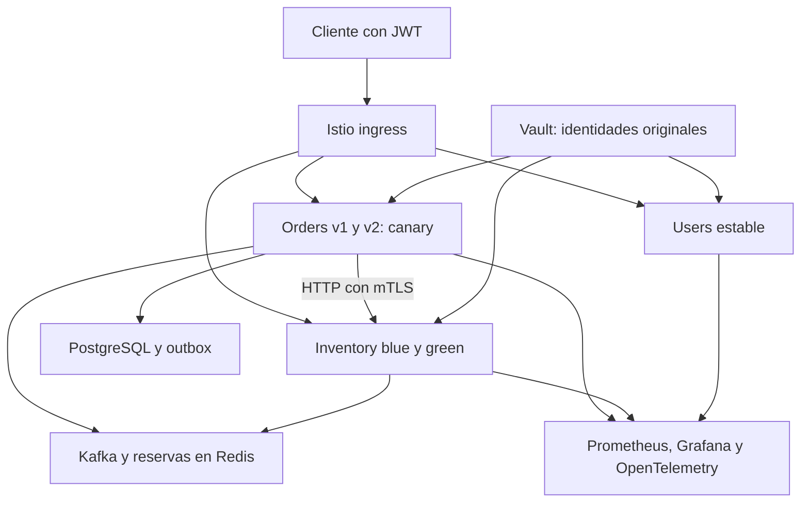

# Laboratorio 10 · Microservicios Python con Istio

| Campo | Valor |
|---|---|
| Curso | Microservicios Avanzado |
| Duración | 66 minutos guiados con clúster, herramientas e imágenes preparados; reserva tiempo adicional para descargas y construcción |
| Complejidad | Alta |
| Nivel Bloom | Crear |
| Base | Lab 9 corregido, terminado con las dependencias 9.1.0 |
| Entorno | Ubuntu, Bash, Python 3.12, perfil/contexto `msvc-gateway` |
| Versiones | Istio/istioctl 1.31.1; Kubernetes 1.35.8; Helm 3.20.1; stack de observabilidad del Lab 8 |

## Resultado esperado

Incorporarás **Orders, Inventory y Users reales** al mesh. Mantendrás JWT, los secretos de Vault, el event store/CQRS, Kafka, Redis, resiliencia de aplicación y OpenTelemetry. Aplicarás mTLS estricto en los workloads seleccionados, distribuirás tráfico canary y probarás blue/green por encabezado. El ejercicio termina comprobando el negocio y la observabilidad acumulados.



Cada workload seleccionado recibe Envoy automáticamente al crearse el pod. La inyección es **por etiqueta de pod**, dentro de `microservices`; no se etiqueta indiscriminadamente todo el namespace ni se reinician sus backends.

Durante este laboratorio el ingreso público de las apps pasa de Traefik a Istio. Traefik y su configuración se conservan para regresar al Lab 9. Sus limitadores y circuit breaker de borde no se trasladan automáticamente a Istio; JWT y el circuit breaker implementado dentro de Orders siguen activos. La migración de esas políticas de borde sería una práctica adicional.

## Objetivos de aprendizaje

- [ ] Instalar una versión compatible de Istio e inyectar automáticamente sidecars en los workloads seleccionados de `microservices`.
- [ ] Configurar `PeerAuthentication` STRICT y `DestinationRule` con `ISTIO_MUTUAL`, comprobando cifrado y autenticación entre workloads del mesh.
- [ ] Implementar canary de `order-service` con distribución **90/10 → 50/50 → 0/100**, y verificar las respuestas de ambas variantes.
- [ ] Implementar blue/green de `inventory-service` mediante `x-version: green`, conservando blue como destino predeterminado.
- [ ] Integrar señales de tráfico, errores, latencia y saturación de los proxies en el Prometheus/Grafana existente, por versión y sin duplicar recuentos.

## Correcciones principales

| Original | Corrección |
|---|---|
| Istio 1.22.2 y Kubernetes 1.30 | Istio 1.31.1 compatible con Kubernetes 1.35 del curso; no cambiar ni recrear el clúster |
| `orders-service` y `/api/v1/inventory` | `order-service`, `/api/v1/products`, `/api/v1/reservations` y Users incluidos |
| Reiniciar todos los Deployments del namespace | Inyección automática sólo en apps seleccionadas; backends sin modificación |
| Credenciales PostgreSQL en YAML y nueva DB ficticia | Identidades/roles Vault originales; PostgreSQL, Redis y Kafka compartidos |
| Deployments nuevos ajenos a Helm | Variantes dentro de los mismos releases, con selectores separados y SA compartida por servicio |
| Imagen v2 y JSON de versión inexistentes | Imágenes construidas/publicadas; encabezados de identidad emitidos por la app que respondió |
| Dos DestinationRules para el mismo host | Una regla por servicio con TLS y subsets integrados |
| 20 peticiones y reparto “18/2” | 400 solicitudes autenticadas, tolerancia estadística y errores que no se contabilizan como éxito |
| ServiceMonitor/PodMonitor sin Operator instalado | Cinco scrapes estáticos integrados en el chart existente, sin instalar otro Prometheus |
| Métricas app bloqueadas por STRICT | Merge de métricas en 15020; excepción operativa explicada y sin publicar métricas en el gateway |
| Recuento doble source/destination y latencia sin conversión | `reporter="destination"` y milisegundos convertidos a segundos |
| Limpieza con `pkill`/purge y borrado de rutas | Rollback a revisiones capturadas; no borrar datos, namespaces ni CRD |

## Materiales y preparación

Usa el proyecto acumulativo incluido en el ZIP. Si ya tienes Lab 9 funcionando, actualiza sus archivos con los de esta entrega **conservando tus reports y archivos de imágenes**; no borres el proyecto ni los datos del clúster. El ZIP trae código y verificadores, no imágenes Docker preconstruidas.

| Ruta | Contenido |
|---|---|
| `helm/msvc-chart/` | Chart ampliado; modo mesh apagado por defecto, compatible con los values del Lab 9 |
| `helm/values/lab10-*.yaml` | Etiquetas y variantes para las apps seleccionadas |
| `istio/install.yaml` | Perfil demo ajustado, sin egress gateway innecesario y con ingress ClusterIP |
| `istio/security.yaml`, `destination-rules.yaml` | STRICT seleccionado y una regla TLS/subsets por servicio |
| `istio/routes-*.yaml` | Gateway/mesh: 100/0 inicial, 90/10, 50/50 y 0/100 |
| `shared/mesh/application.py` | Encabezados de identidad del servidor |
| `scripts/lab10/` | Instalación, despliegue, tráfico, verificación y recuperación |
| `observability/chart/` | Mismo stack del Lab 8, ampliado con métricas y dashboard mesh |
| `tests-mesh/` | Casos positivos y negativos de identidad, distribución y chart |

Recomendación de recursos para esta práctica acumulativa: **6 CPU, 12 GiB RAM y 50 GiB libres** en el entorno de minikube; ajusta a tu infraestructura. Cinco apps con sus proxies, gateway y control plane se suman al stack anterior. Si faltan recursos, los pods pueden quedar Pending: eso no prueba un error del routing ni de mTLS.

```bash
cd ~/microservices-lab  # usa la ruta real de tu proyecto
export PROFILE=msvc-gateway
export KUBE_CONTEXT=msvc-gateway
export PYTHON_BIN=python3
export PATH="$HOME/.local/bin:$PATH"

minikube -p "$PROFILE" status
kubectl --context "$KUBE_CONTEXT" get nodes
kubectl --context "$KUBE_CONTEXT" -n microservices get deploy,sts,svc
helm --kube-context "$KUBE_CONTEXT" list -A
python3 --version
python3 -c "import yaml, httpx"
bash scripts/lab10/install-istio.sh
istioctl version --remote=false
```

El instalador fija 1.31.1 y verifica SHA-256. Usa el entorno Python 3.12 de validación del curso, con sus dependencias. Istio 1.22 está fuera de soporte y no corresponde a Kubernetes 1.35. No ejecutes el `minikube start ... --kubernetes-version=v1.30.0` del original sobre un perfil nuevo.

Antes de continuar, deben estar operativos los tres releases de apps, Vault, Keycloak, PostgreSQL, Kafka, Redis y observabilidad del Lab 9. Si ya instalaste otro Istio o etiquetaste el namespace para inyección global/revisionada, resuelve primero esa configuración: el preflight no la sobrescribe silenciosamente.

## Paso 1 · Preparar imágenes y versiones reales

**Preparación previa a los 66 minutos guiados.** El código de negocio y los contratos se mantienen. Las variantes representan releases identificables, no una nueva ruta `/v2/orders` ni bases separadas inventadas.

Como esta entrega añade los encabezados de identidad al launcher, **reconstruye las imágenes**; las del Lab 9 no contienen esa modificación:

```bash
VERSION=10.0.0 bash scripts/lab09/build.sh
VERSION=10.0.0 bash scripts/lab09/scan.sh
VERSION=10.0.0 bash scripts/lab09/registry.sh

VERSION=10.1.0 bash scripts/lab09/build.sh
VERSION=10.1.0 bash scripts/lab09/scan.sh
VERSION=10.1.0 bash scripts/lab09/registry.sh
```

Se reutiliza el flujo ya corregido: Docker del host, contexto raíz, locks nuevos, Trivy, Skopeo y descarga por digest desde el nodo. Ambas versiones usan las dependencias remediadas del Lab 9. Conserva los informes reales; no vuelvas a la baseline vulnerable 9.0.0.

| Workload | Identidad de variante | Imagen/release | Vault ServiceAccount/rol |
|---|---|---|---|
| `order-service` | v1 | 10.0.0 | order-service |
| `order-service-v2` | v2 | 10.1.0 | order-service |
| `inventory-service` | blue | 10.0.0 | inventory-service |
| `inventory-service-green` | green | 10.1.0 | inventory-service |
| `users-service` | stable | 10.0.0 | users-service |

La imagen 10.1.0 de Users se construye con el flujo común, pero no participa en el canary del ejercicio. Los Deployments v1/v2 o blue/green comparten estado persistente, configuraciones e identidad de su servicio. La distribución de tráfico no crea una copia aislada de datos ni una migración de esquema.

## Paso 2 · Instalar Istio y capturar el estado de recuperación

**Tiempo guiado: 10 minutos.**

```bash
cat istio/install.yaml
bash scripts/lab10/install-mesh.sh
kubectl --context "$KUBE_CONTEXT" -n istio-system get deploy,svc
```

El script ejecuta precheck, instala el perfil demo ajustado, espera istiod/ingress y captura las revisiones actuales de los tres releases y del release de observabilidad. No modifica etiquetas del namespace ni reinicia backends.

El ingress es **ClusterIP**: usaremos port-forward local. No requiere LoadBalancer externo, NodePort, IP pública ni `minikube tunnel`. El egress gateway se deshabilita porque no forma parte de los objetivos. El tracing de aplicación continúa con el SDK/Collector del Lab 8; no se configura otra exportación de trazas del proxy que duplique esa instrumentación.

## Paso 3 · Desplegar las cinco variantes e inyectar Envoy

**Tiempo guiado: 12 minutos.**

```bash
bash scripts/lab10/deploy.sh
python3 scripts/lab10/check-sidecars.py
```

El despliegue renderiza/prevalida los tres releases, establece rutas **100/0 iniciales**, actualiza primero Inventory y después Orders/Users y espera readiness. Cada variante adicional pertenece al **mismo release Helm** que su servicio.

El Deployment original conserva su selector inmutable `app: {servicio}`. La variante utiliza `app: {servicio}-{variante}` y el Service común selecciona `lab10-service: {servicio}`. Así ambos reciben tráfico sin solapar los selectores de los controladores.

La etiqueta de pod `sidecar.istio.io/inject: "true"` activa la inyección automática. La ausencia de una etiqueta global de inyección evita incorporar PostgreSQL, Redis, Kafka, Keycloak o Jobs de migración al mesh. No ejecutes `rollout restart deployment -n microservices` sin seleccionar workloads.

Se preservan:

- UID/GID y `fsGroup` 10001 para la aplicación.
- Launcher Vault, rol y ruta KV originales.
- Token proyectado con audiencia **vault**, usado por la app.
- Token proyectado **istio-ca**, añadido por Istio y usado por Envoy.
- JWT, recursos, startup/readiness, configuración de Kafka/Redis y OpenTelemetry.

`holdApplicationUntilProxyStarts` permite que el proxy esté listo antes del bootstrap de la app. Istio reescribe las probes HTTP para que kubelet pueda ejecutarlas sin certificado de cliente. Verificar “2/2” ayuda con sidecars convencionales, pero el verificador inspecciona proxy, readiness e identidades en lugar de depender únicamente de esa cadena.

Después de tener todos los proxies listos, el script aplica STRICT y actualiza **el release de observabilidad existente**. No instala otro Prometheus ni cambia sus credenciales.

## Paso 4 · Cambiar el ingreso y validar JWT/negocio

**Tiempo guiado: 8 minutos.**

Detén **sólo la terminal** que ejecuta el port-forward de Traefik en 18080. No mates todos los procesos `port-forward`. Abre el ingreso Istio en ese mismo puerto y conserva los otros port-forward del Lab 8:

```bash
# Una terminal por comando.
kubectl --context msvc-gateway -n istio-system port-forward svc/istio-ingressgateway 18080:80
kubectl --context msvc-gateway -n microservices port-forward svc/keycloak 8080:8080
kubectl --context msvc-gateway -n observability port-forward svc/jaeger 16686:16686
kubectl --context msvc-gateway -n monitoring port-forward svc/prometheus 9090:9090
kubectl --context msvc-gateway -n monitoring port-forward svc/alertmanager 9093:9093
kubectl --context msvc-gateway -n monitoring port-forward svc/grafana 3000:3000
```

Los clientes mantienen `Host: microservices.local`, las rutas del curso y tokens de Keycloak. El Gateway no publica `/metrics`, dashboard, administración de Istio ni un `/health` compartido ambiguo.

```bash
# Sin JWT: debe ser 401, no una lista de ejemplo sin autenticar.
curl -i -H 'Host: microservices.local' \
  http://localhost:18080/api/v1/orders

# Validación acumulativa con credenciales de laboratorio.
python3 scripts/lab06/validate_gateway.py
```

Este validador comprueba tres rutas, JWT inválido/ausente, audiencia y permisos, host/rutas incorrectas y el flujo real de producto→pedido→reserva. Debe persistir un pedido con stock precheck verificado y materializar la reserva por Kafka/Redis. Esta prueba no valida rate limiting de Traefik, que está fuera del nuevo ingreso.

## Paso 5 · mTLS STRICT: pruebas positivas y negativas

**Tiempo guiado: 10 minutos.**

```bash
cat istio/security.yaml
cat istio/destination-rules.yaml

istioctl --context "$KUBE_CONTEXT" analyze -n microservices --failure-threshold Error
istioctl --context "$KUBE_CONTEXT" proxy-status

ORDER_POD=$(kubectl --context "$KUBE_CONTEXT" -n microservices \
  get pod -l app=order-service -o jsonpath='{.items[0].metadata.name}')
istioctl --context "$KUBE_CONTEXT" proxy-config secret "$ORDER_POD" -n microservices

python3 scripts/lab10/verify-mtls.py
```

La política STRICT selecciona `lab10-mesh: "true"`. Cada servicio tiene una sola DestinationRule que combina TLS y subsets. No crees otra regla de canary para el mismo host que compita con la regla TLS.

El verificador crea dos pods temporales utilizando una imagen fijada del laboratorio y una SA sin permisos Vault:

1. En ambos comprueba acceso al endpoint de descubrimiento de Keycloak y resolución DNS del destino.
2. El pod **sin proxy** intenta `/health` de Users: debe observar rechazo del transporte, no una respuesta HTTP ni un timeout de arranque contado como éxito.
3. El pod **con proxy** realiza la misma solicitud: debe devolver 200.
4. Los pods se limpian por nombre. Se espera la terminación del contenedor de prueba, no `Pod Succeeded`, porque un sidecar convencional puede mantener el pod vivo.

Las métricas comprobarán después `connection_security_policy="mutual_tls"` para tráfico HTTP exitoso a ambas versiones. Los certificados deben aparecer activos en la tabla de `proxy-config secret`. Aplicar YAML o ver un error `000` sin controles no demuestra mTLS.

### Alcance del cifrado

STRICT protege los **workloads de aplicación seleccionados** y el tráfico entre proxies. No convierte en TLS todas las conexiones existentes: PostgreSQL, Kafka, Redis, Vault y Keycloak siguen con la configuración del curso y fuera de esta migración. El salto local Envoy→app tampoco equivale a TLS en el proceso Python.

El endpoint operativo de merge de métricas **15020** se scrapea en HTTP dentro del clúster. Es una excepción de telemetría del agente y no un puerto de negocio protegido por STRICT. No se publica en el gateway. Esta práctica no afirma “todo el tráfico interno cifrado”; proteger también telemetría/backends y restringirlos con políticas sería una extensión.

## Paso 6 · Canary y blue/green por respuestas reales

**Tiempo guiado: 16 minutos.**

```bash
bash scripts/lab10/canary.sh
```

El script aplica 90/10, genera tráfico de calentamiento durante 45 segundos para obtener varios scrapes, y recorre 90/10 → 50/50 → 0/100. Para cada etapa envía **400 GET autenticados** a `/api/v1/orders`, exige 200 y JSON válido y lee:

```text
X-Lab-Variant: v1 o v2
X-Lab-Version: 10.0.0 o 10.1.0
```

Los encabezados los genera el middleware de la aplicación con su configuración de despliegue. No se derivan del header enviado por el cliente ni se añaden ficticiamente en VirtualService. El cuerpo y la autorización conservan sus contratos.

El reparto se comprueba con una tolerancia basada en cuatro desviaciones estándar, con margen mínimo de cuatro puntos porcentuales. Una muestra pequeña no garantiza 18/2 y los pesos no son una cuota determinista. En 0/100 se exige que **todas** las respuestas observadas sean v2. Faltas de identidad, errores HTTP o distribución incorrecta detienen la progresión.

Los cambios incluyen una espera breve de propagación y captura de `proxy-status`; la comprobación decisiva son las respuestas. El ejercicio no usa mirroring, y desactiva retries automáticos en sus rutas para no introducir reintentos implícitos de escrituras.

### Blue/green

La regla de Inventory aplica primero el header green y después el destino blue predeterminado. Conserva las rutas `/api/v1/products` y `/api/v1/reservations`.

| Header | Variante esperada |
|---|---|
| Ausente | blue |
| `x-version: blue` | blue |
| `x-version: green` | green |
| `x-version: unknown` | blue |

El script comprueba cada caso diez veces con JWT y los encabezados reales de respuesta. Blue y green comparten Redis/Kafka; los mismos productos deben ser visibles en ambos. No se inventa otra base de Inventory ni se copian contraseñas al YAML.

Orders→Inventory usa blue por defecto. El `x-version` del cliente **no se propaga automáticamente** desde una petición a Orders; la prueba blue/green dirige una petición explícita a Inventory. Las VirtualServices del mesh también permiten ese routing a clientes internos que envían el header al host de Inventory.

Para repetir individualmente:

```bash
python3 scripts/lab10/traffic.py canary --v2-percent 100 --requests 400
python3 scripts/lab10/traffic.py bluegreen
```

Para rollback de tráfico, manteniendo ambas imágenes desplegadas:

```bash
kubectl --context "$KUBE_CONTEXT" apply -f istio/routes-100-0.yaml
sleep 5
python3 scripts/lab10/traffic.py canary --v2-percent 0 --requests 400
```

Esto restaura routing a v1; no revierte pedidos, reservas ni eventos persistidos.

## Paso 7 · Golden signals en el stack existente

**Tiempo guiado: 10 minutos.**

El chart de observabilidad cambia sus tres Services de métricas a `targetPort: 15020` y añade Services exclusivos para Orders v2 e Inventory green. Prometheus conserva `job="microservices"` para las reglas RED y scrapea cinco endpoints en `/stats/prometheus`. El agente combina las métricas de app y proxy. No se necesitan CRD ServiceMonitor/PodMonitor ni Prometheus Operator.

El dashboard **`lab10-mesh`** se provisiona mediante ConfigMap y el mismo datasource `prometheus`. El dashboard RED del Lab 8 continúa disponible.

| Señal/panel | Implementación |
|---|---|
| Tráfico Orders | `rate(istio_requests_total[2m])`, agrupado por versión |
| Errores Orders | 5xx/total, con numerador cero cuando no hay 5xx |
| P99 Orders | Histograma de milisegundos dividido por 1000; unidad segundos |
| Saturación del proxy | Memoria asignada de Envoy relativa al límite configurado de 256 MiB |
| Tráfico Inventory | Blue/green por `destination_version` |

Las consultas HTTP usan **`reporter="destination"`** para evitar sumar dos veces source y destination. Se filtra por `destination_canonical_service`, fijado en los labels de los workloads. La memoria asignada del proxy es una aproximación a presión de memoria, no una medida de cola, CPU o memoria total de la aplicación.

Después del calentamiento y las etapas, sin esperar a que caduque la ventana de dos minutos:

```bash
python3 scripts/lab10/validate-observability.py
```

**Criterios:** cinco targets UP, muestras reales de ambas variantes de Orders e Inventory con `mutual_tls`, resultados finitos/no vacíos en los cinco paneles y dashboard provisionado en Grafana. Un `curl` a la API de Prometheus con resultado vacío no aprueba.

Con tráfico cero, las razones/percentiles pueden quedar sin información útil. Si retomas la validación después de varios minutos, vuelve a 90/10 y ejecuta `traffic.py warmup --seconds 45` antes de las etapas y el validador.

## Validación final del ejercicio

Con todos los port-forward activos y el ingreso 18080 apuntando a Istio:

```bash
bash scripts/lab10/validate_all.sh
```

La secuencia comprueba proxies/identidades, pruebas mTLS, canary, blue/green, métricas por versión, ACL de Vault, JWT y negocio/Kafka, traza exacta Orders→Inventory, logs correlacionados y transporte de alerta.

El verificador de logs del Lab 10 consulta **todos los pods de cada servicio/variante**. Tras 0/100 el pedido puede ejecutarse en v2: buscar únicamente logs de `deployment/order-service` no encontraría su traza. Se mantiene el allowlist de campos para no incluir tokens, headers arbitrarios o cuerpos.

No ejecutes `scripts/lab08/validate_all.sh` como sustituto: su comprobación original esperaba tres targets y sus logs se limitaban al Deployment base. El flujo del Lab 10 adapta esas comprobaciones a cinco versiones, sin volver a desplegar los manifiestos antiguos.

## Entregables del alumno

- Cinco workloads Ready con proxy, imágenes por digest e identidades originales.
- Certificados activos, análisis de Istio y pruebas positiva/negativa mTLS con controles.
- Informes de las etapas 90/10, 50/50 y 0/100 con muestra de 400 solicitudes por etapa.
- Cuatro casos blue/green, con versión observada en respuestas autorizadas.
- Cinco scrapes UP, paneles por versión y tráfico `mutual_tls` real.
- Flujo producto→pedido→reserva y traza/logs correlacionados aprobados.
- Explicación del alcance de cifrado, estado compartido y reversión de tráfico frente a reversión de datos.

## Recuperación y limpieza sin perder el curso

Para volver al Lab 9:

```bash
bash scripts/lab10/cleanup.sh
```

El script elimina únicamente políticas/rutas de esta práctica y hace rollback a **las revisiones capturadas** de las apps y observabilidad. Las variantes desaparecen al recuperar los manifests anteriores de sus releases. Espera readiness y compara los valores originales. No borra imágenes, PVC, backends, datos, Vault, Keycloak ni namespaces.

Detén sólo el port-forward del ingress Istio y vuelve a abrir el de Traefik:

```bash
kubectl --context msvc-gateway -n traefik port-forward svc/traefik 18080:80
```

Istio permanece instalado sin incorporar las apps restauradas al mesh. No se propone `istioctl uninstall --purge` ni eliminar CRD: puede afectar configuraciones distintas al ejercicio. Conserva las capturas/revisiones hasta completar la recuperación; no sustituyas el número guardado por una revisión 1 fija.

## Verificación realizada y límites

El informe `reports/lab10/revision-verification.md` contiene los resultados de regresión, chart, políticas e inyección. Se ejecutaron herramientas reales Helm, istioctl y promtool, además de pruebas Python de negocio/identidad/observabilidad.

**No hay Docker ni minikube en el entorno de revisión.** No se instalaron proxies en un clúster ni se observó aquí un reparto real 90/10, una negociación mTLS entre pods o métricas de Envoy desplegado. La inyección y el análisis realizados son sobre manifests locales; los scripts verifican el comportamiento real en tu clúster y fallan si no se cumple. Las pruebas de distribución verifican el validador, no simulan una aprobación de Istio.

## Fuentes técnicas

- [Istio: soporte y compatibilidad de Kubernetes](https://istio.io/latest/docs/releases/supported-releases/)
- [Release Istio 1.31.1](https://github.com/istio/istio/releases/tag/1.31.1)
- [Inyección automática: etiquetas por pod](https://istio.io/latest/docs/setup/additional-setup/sidecar-injection/)
- [Autenticación y mTLS](https://istio.io/latest/docs/tasks/security/authentication/mtls-migration/)
- [Traffic shifting](https://istio.io/latest/docs/tasks/traffic-management/traffic-shifting/)
- [Prometheus y merge de métricas en 15020](https://istio.io/latest/docs/ops/integrations/prometheus/)
- [Métricas estándar y labels](https://istio.io/latest/docs/reference/config/metrics/)
- [Probes de salud con sidecar](https://istio.io/latest/docs/ops/configuration/mesh/app-health-check/)
