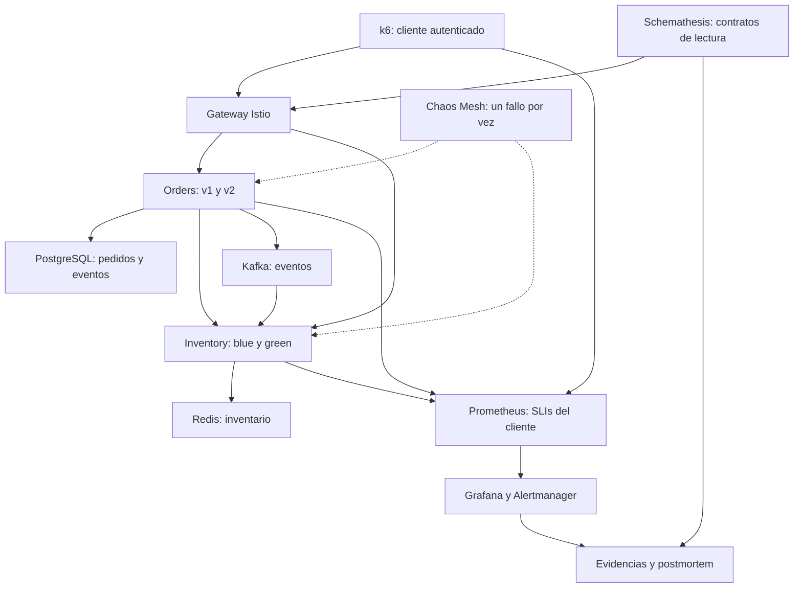

# Laboratorio 12 · Carga, caos controlado y SLOs

Curso: **Microservicios Avanzado**. Complejidad alta; Bloom: crear. Tiempo orientativo: **90–120 minutos**, con herramientas descargadas y Lab 11 operativo. Los 66 minutos del original resultaban insuficientes para cuatro experimentos con baseline y recuperación.

## 1. Resultado esperado

Diseñarás escenarios smoke, load, stress y spike con k6; observarás métricas en Prometheus/Grafana; ejecutarás PodChaos, NetworkChaos y StressChaos; validarás contratos durante el fallo y documentarás un postmortem con evidencia. Se conservan las aplicaciones acumulativas, JWT, Vault, Kafka, CQRS, circuit breaker, mTLS y GitOps del curso.



Inventory depende de **Redis**, no de PostgreSQL. El escenario de partición prueba esa dependencia real. Users permanece desplegado, pero no forma parte de la carga ni de los SLOs de este ejercicio.

## 2. Preparación y continuidad

Trabaja desde la raíz `microservices-lab` del ZIP. No ejecutes este ejercicio en producción ni en un clúster compartido: instala un agente privilegiado de fallos sobre el minikube local del curso.

| Componente | Configuración de esta revisión |
|---|---|
| Contexto / aplicaciones | `msvc-gateway` / namespace `microservices` |
| Kubernetes / Helm / Python | 1.35.8 / 3.20.1 / 3.12 |
| Istio | 1.31.1, gateway `microservices.local` |
| k6 / Chaos Mesh | 2.0.0 / chart 2.8.4 |
| Prometheus / Grafana / Alertmanager | 3.15.0 / 13.2.3 / 0.34.1, del Lab 8 |
| Schemathesis | 4.30.0, del entorno de desarrollo del Lab 11 |

**Namespaces:** Prometheus, Grafana y Alertmanager están en `monitoring`. Collector/Jaeger y el release Helm `lab08-observability` están en `observability`. Conserva esa distribución y sus PVCs.

Antes de iniciar, detén el observador `gitops.py monitor` del Lab 11 y pausa promociones de CI. Mantén la autorreconciliación de Argo: el fallo intencional no es motivo para revertir un commit sano. No cambies réplicas de Orders con Helm o `kubectl scale` mientras Argo administra su configuración.

Comprueba:

```bash
kubectl config current-context
kubectl -n microservices get deploy,pods
kubectl -n argocd get application lab11-orders
kubectl -n monitoring get deploy,svc
helm list -n observability
k6 version
python --version
python -m pip check
```

Orders v1 necesita al menos dos réplicas Ready. La aplicación Argo `lab11-orders` debe estar **Synced / Healthy**. El gateway debe mantener Orders **100% v1 / 0% v2**, como al cierre del Lab 11. Inventory blue y green deben estar Ready; no cambies sus reglas de tráfico durante las pruebas.

Usa el entorno Python 3.12 del Lab 11. Si necesitas recrearlo:

```bash
python3.12 -m venv .venv
source .venv/bin/activate
python -m pip install -r order-service/requirements-dev.txt
```

En Windows activa `.venv\Scripts\Activate.ps1`. Los scripts Bash requieren WSL o Git Bash con acceso al mismo kubeconfig; ejecuta los comandos del laboratorio en ese entorno. No reutilices el entorno Python 3.13 del laboratorio original.

Instala el binario **k6 2.0.0** para tu sistema desde su release oficial; comprueba el checksum publicado y agrégalo al PATH. Helm y kubectl también deben estar en PATH. No necesitas cambiar las imágenes de las aplicaciones.

### Activar observabilidad y Chaos Mesh

```bash
bash scripts/lab12/prepare.sh
```

El script guarda la revisión anterior del release de observabilidad, activa el receptor remote write y agrega reglas/dashboard mediante el chart existente. Instala Chaos Mesh sin dashboard, con un controlador y el socket correspondiente al runtime real del nodo. No recrea minikube. Si el runtime no se reconoce o el socket no existe, detente y revisa ese requisito.

Mantén estos port-forward en **terminales separadas**:

```bash
kubectl -n istio-system port-forward svc/istio-ingressgateway 18080:80
```

```bash
kubectl -n microservices port-forward svc/keycloak 8080:8080
```

```bash
kubectl -n monitoring port-forward svc/prometheus 9090:9090
```

```bash
kubectl -n monitoring port-forward svc/grafana 3000:3000
```

```bash
kubectl -n monitoring port-forward svc/alertmanager 9093:9093
```

Estas conexiones al gateway y al proveedor de identidad son distintas de conectarse directamente a un pod de Orders. La carga atraviesa las políticas y el mesh. Si un port-forward termina, restablécelo antes de continuar; su caída también aparece como indisponibilidad desde el cliente.

```bash
curl -f http://localhost:9090/-/ready
curl -f http://localhost:9093/-/ready
```

## 3. Definir SLIs, SLOs y presupuesto

Las solicitudes elegibles son las **operaciones de negocio** emitidas por el script. No incluyen OAuth ni creación de fixtures. Cada solicitud aporta un valor de éxito **o** error; un Rate que recibe solamente errores produce una medida incorrecta.

| Indicador | Definición y objetivo |
|---|---|
| Disponibilidad | Respuestas esperadas / solicitudes emitidas, objetivo ≥ 99.5% |
| Latencia | Solicitudes con duración < 500 ms y sin fallo de transporte / emitidas, objetivo ≥ 99% |
| Ventana formal | 30 días, si existe retención suficiente y carga representativa |
| Ventana de este lab | Cada ejecución y sus fases; PromQL de 2 minutos para observación |

El Prometheus del curso retiene **2 días**. No permite demostrar cumplimiento mensual. Una ejecución corta tampoco prueba capacidad de producción.

Para una ventana con `N` solicitudes y `B` resultados incorrectos:

- Disponibilidad: `1 - B/N`.
- Presupuesto permitido: `0.005 × N`.
- Fracción del presupuesto consumido: `B / (0.005 × N)`.
- Sin solicitudes, el resultado es **sin datos**, no 100% de disponibilidad.

Ejemplo de cálculo, no resultado del laboratorio: 2 errores entre 100 solicitudes equivalen a 98% de disponibilidad y **400% del presupuesto de esa ventana**. No son 400% del presupuesto mensual.

### Consultas y unidades

En Grafana abre **Lab 12 · Carga y caos** y selecciona el `run_id` de tu ejecución. En Prometheus puedes consultar:

```promql
lab12:availability:ratio2m{run_id="TU_RUN_ID"}
```

```promql
lab12:availability:burn2m{run_id="TU_RUN_ID"}
```

```promql
lab12:latency:good_ratio2m{run_id="TU_RUN_ID"}
```

```promql
k6_lab12_latency_p95{run_id="TU_RUN_ID"}
```

Para **k6 2.0.0**, la última métrica tiene ese nombre y está en **segundos**; el JSON local de k6 conserva milisegundos. El dashboard usa unidad `s`. Son percentiles por operación/serie: **no promedies ni sumes p95** entre operaciones, ejecuciones o generadores. Para el p95 del conjunto completo, el analizador usa las muestras individuales.

La alerta `Lab12AvailabilityFastBurn` usa un burn rate > 14.4 durante 30 segundos con tráfico presente. Es una alerta didáctica de ventana corta; no sustituye una política de alertas de múltiples ventanas de producción. Se integra con el Alertmanager existente y su receptor de laboratorio, sin configurar correo o Slack.

Comprueba que la regla esté cargada antes de probar caos:

```bash
curl -fsS http://localhost:9090/api/v1/rules > reports/lab12/prometheus-rules.json
```

## 4. Diseñar y ejecutar la carga

Archivo: `tests/load/lab12.js`. Usa rutas `/api/v1`, Host del gateway y client credentials de Keycloak; renueva el token antes de su vencimiento. Crea un producto válido con stock suficiente y utiliza UUIDs y precios decimales como texto.

| Perfil | Diseño incluido | Propósito |
|---|---|---|
| smoke | 1 VU, 30 s | Conectividad y errores básicos |
| load | Rampa a 10 VUs, mantenimiento y descenso; 120 s | Comportamiento con carga moderada |
| stress | 10 → 20 → 30 → 0 VUs; 120 s | Buscar degradación sin prometer saturación |
| spike | 5 → 30 → 0 VUs; 95 s | Cambio rápido de demanda |
| chaos | 5 VUs constantes durante 330 s | Baseline, fallo y recuperación |

Los VUs no equivalen a un RPS fijo. La espera, latencia, recursos y mezcla determinan el throughput. No combines `--duration/--vus` con los stages del ejercicio.

Primero ejecuta smoke:

```bash
export RUN_ID="smoke-$(date -u +%Y%m%dT%H%M%S)"
PROFILE=smoke bash scripts/lab12/load.sh
python scripts/lab12/analyze.py "reports/lab12/$RUN_ID"
python scripts/lab12/contracts.py "reports/lab12/$RUN_ID/contracts"
```

Smoke y load exigen errores < 0.5%, fracción lenta < 1%, p95 < 500 ms y tráfico en ambos servicios. Son gates de este ejercicio; no prueban el SLO mensual.

Después, ejecuta por separado:

```bash
RUN_ID="load-$(date -u +%Y%m%dT%H%M%S)" PROFILE=load bash scripts/lab12/load.sh
```

```bash
RUN_ID="stress-$(date -u +%Y%m%dT%H%M%S)" PROFILE=stress bash scripts/lab12/load.sh
```

```bash
RUN_ID="spike-$(date -u +%Y%m%dT%H%M%S)" PROFILE=spike bash scripts/lab12/load.sh
```

Cada ejecución imprime su ID en k6 y guarda `summary.json` y `samples.json` bajo `reports/lab12/<run_id>`. Ejecuta el analizador sobre cada carpeta. En stress/spike los thresholds son amplios para exploración: un exit 0 **no demuestra** cumplimiento del SLO; consulta los SLIs y el informe.

La carga predeterminada es de lectura. Para incluir un 20% aproximado de creación de pedidos:

```bash
RUN_ID="mixed-$(date -u +%Y%m%dT%H%M%S)" PROFILE=load WORKLOAD=mixed bash scripts/lab12/load.sh
```

Esta mezcla genera pedidos, eventos Kafka y reservas reales. Los datos quedan como evidencia; no borres PostgreSQL ni Redis para limpiar el ejercicio. Detén la carga si faltan recursos antes de introducir un fallo.

## 5. Experimentos controlados

Antes de cada experimento escribe una hipótesis comprobable, el indicador que observarás y el criterio de recuperación. Ejecuta **uno por vez**:

| Experimento | Alcance | Hipótesis por comprobar |
|---|---|---|
| `pod-kill` | Un pod Orders v1 | Otra réplica sigue atendiendo y se crea un reemplazo Ready |
| `network-delay` | Un pod Orders v1 → Inventory, 200 ms ± jitter 50 ms, 60 s | El precheck muestra latencia o degradación controlada |
| `redis-partition` | Inventory blue/green ↔ Redis, 60 s | Inventario pierde acceso a su almacenamiento; Orders puede diferir el precheck |
| `cpu-stress` | Un contenedor `order-service`, un worker al 80%, 60 s | La contención aumenta latencia sin destruir la otra réplica |

La carga de CPU es la configuración del worker, no una garantía de consumir el 80% de todo el nodo. El contenedor `istio-proxy` queda fuera de StressChaos. Pod-kill es una acción puntual: no lleva un scheduler ni una duración ficticia de tres minutos.

Cache, circuit breaker, reintentos del mesh y probes pueden reducir, desplazar o amplificar el efecto observado. Un precheck diferido con HTTP 201 no equivale a una reserva completada: correlaciona el estado posterior del pedido y los eventos. No desactives estos mecanismos para forzar el resultado esperado.

```bash
python scripts/lab12/experiment.py pod-kill
```

```bash
python scripts/lab12/experiment.py network-delay
```

```bash
python scripts/lab12/experiment.py redis-partition
```

```bash
python scripts/lab12/experiment.py cpu-stress
```

El runner crea un lock, comprueba Argo y las réplicas, valida contratos sin caos, inicia carga mixta, exige baseline con tráfico y sin errores, solicita la inyección y espera `AllInjected=True`. Después realiza contratos durante el fallo, elimina únicamente su CR esperando finalizers y comprueba recuperación con contratos y smoke. Guarda timestamps UTC y estados de pods.

La ventana `fault-window` va desde la **solicitud de inyección hasta la eliminación confirmada**. Es una ventana de observación, no una prueba del instante exacto de modificación/restauración del kernel. Los 60 s del CR pueden expirar antes de terminar las comprobaciones. Cruza `timeline.json`, `chaos-status.json`, eventos y traces para atribuir el impacto.

Si no se confirma la inyección, el experimento falla. Si falla la limpieza, conserva el lock y detiene la secuencia. No ignores el fallo con `|| true`, no elimines finalizers por fuerza ni borres todos los recursos del namespace. Ante una interrupción, revisa el CR y deja actuar al controlador antes de repetir.

### Contratos durante el caos

El script usa **Schemathesis 4.30.0** y operaciones GET conocidas. Obtiene el OpenAPI vivo dentro de los contenedores antes del fallo; durante el fallo reutiliza esas capturas. Las solicitudes de prueba atraviesan el gateway con JWT; no se publica `/openapi.json` en el ingreso.

Comprueba estado documentado, content type y schema cuando existen. Las respuestas no JSON de indisponibilidad y los fallos de transporte se registran separadamente: **no cuentan como contrato validado ni prueban su origen en el gateway**. Una respuesta JSON con estado/cuerpo no conformes sí es una violación. Una respuesta cuyo OpenAPI no define cuerpo sólo permite validar lo que el contrato documenta.

`--during-chaos` permite registrar indisponibilidad sin confundirla con una violación de schema, pero no exonera el SLO. El baseline y la recuperación exigen todas las comprobaciones disponibles. Las seis lecturas acotadas no constituyen fuzzing exhaustivo ni prueban todos los endpoints del curso.

## 6. Evidencias y postmortem

En la carpeta que imprime el runner conserva:

- `samples.json`, `summary.json` y `k6.log`: carga y thresholds reales.
- `timeline.json`, `chaos-status.json`, `pods-before.json` y `pods-after.json`: alcance y secuencia.
- `baseline-contracts`, `during-contracts` y `recovery-contracts`: snapshots OpenAPI y resultados.
- `slo-report.json`, `postmortem.md` y carpeta `recovery`: cálculo por servicio/fase y recuperación.

Obtén además, durante el fallo, desde otra terminal:

```bash
kubectl -n chaos-testing get podchaos,networkchaos,stresschaos
kubectl -n microservices get events --sort-by=.metadata.creationTimestamp
curl -fsS http://localhost:9090/api/v1/alerts
curl -fsS http://localhost:9093/api/v2/alerts
```

Guarda esas salidas y capturas Grafana en **la misma carpeta**. Alertmanager puede agrupar o retrasar notificaciones; una prueba breve puede no disparar la alerta. Registra lo observado. Espera a que transcurra la ventana de evaluación antes de afirmar que una alerta se resolvió.

Completa `postmortem.md`: impacto observado, timeline, causa sustentada, factores contribuyentes, recuperación, qué funcionó y acciones con responsable/fecha/evidencia de cierre. El generador deja campos por comprobar; no fabrica latencias, porcentajes, duración de incidentes ni impacto mensual.

## 7. Restauración y criterios de aceptación

Sólo después de cerrar los cuatro experimentos y revisar la recuperación:

```bash
bash scripts/lab12/restore.sh
```

Restaura la revisión previa del release de observabilidad; conserva PVCs y la instalación/CRDs de Chaos Mesh. Cierra los port-forward con Ctrl+C en sus propias terminales. Reanuda el observador y las promociones del Lab 11 después de comprobar Argo Synced/Healthy.

La entrega se acepta si:

- Los cuatro perfiles tienen resultados y se explican sus diferencias.
- Cada fallo tiene hipótesis, alcance, evidencia de inyección y recuperación.
- SLIs/error budget incluyen éxitos y fallos, unidades correctas y ausencia de datos explícita.
- Los contratos distinguen conformidad, violaciones e indisponibilidad; hay baseline y recuperación.
- El postmortem contiene conclusiones sustentadas y acciones verificables.

## 8. Verificación de esta revisión

Se ejecutaron k6 2.0.0 y Prometheus 3.15.0 reales contra un **fixture HTTP local**: OAuth, headers, rutas, payload mixto, muestras, thresholds y remote write. Se verificó el nombre/unidad de latencia exportada. También pasaron Helm lint, las cuatro CRs contra los esquemas oficiales Chaos Mesh 2.8.4 y las reglas/tests PromQL, incluido el caso sin datos.

No se ejecutaron inyecciones reales en minikube, recuperación del clúster, pipeline ni navegación de Grafana en este entorno. El fixture no sustituye la validación de negocio del curso. Consulta `reports/lab12/revision-verification.md`; no se atribuyen al Lab 12 los tests históricos de Labs anteriores.

## Referencias oficiales

- [k6 2.0.0 y checksums](https://github.com/grafana/k6/releases/tag/v2.0.0)
- [k6: salida Prometheus remote write](https://grafana.com/docs/k6/latest/results-output/real-time/prometheus-remote-write/)
- [Chaos Mesh: instalación Helm](https://chaos-mesh.org/docs/production-installation-using-helm/)
- [Chaos Mesh: NetworkChaos](https://chaos-mesh.org/docs/simulate-network-chaos-on-kubernetes/)
- [Chaos Mesh: StressChaos](https://chaos-mesh.org/docs/simulate-heavy-stress-on-kubernetes/)
- [Prometheus: pruebas de reglas](https://prometheus.io/docs/prometheus/latest/configuration/unit_testing_rules/)
- [Google SRE: postmortems](https://sre.google/sre-book/postmortem-culture/)
